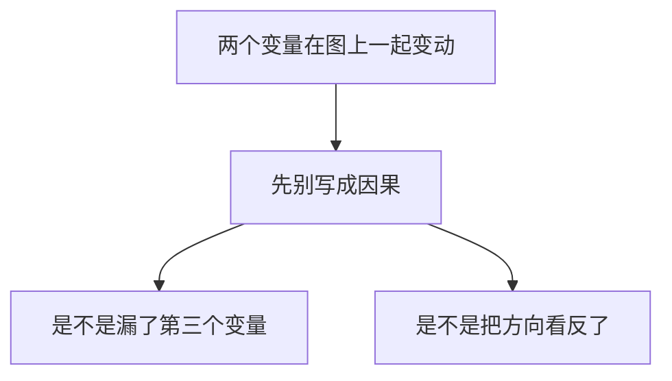

# 意见分歧、相关与因果

| | |
|---|---|
| 表面 | Book |
| 用时 | 约 12 分钟 |
| 原书 | 曼昆《经济学原理》微观分册第 8 版 · 第 2 章 · 分歧，以及附录里的原因和结果 |
| 本章深度 | 会用 |
| 导航 | [学习台](../README.md) · [上一页](05_positive_normative.md) · [掌握路径](../MASTERY_PATH.md) |

## 学完你能做什么

- 用储蓄对税收的反应、水井税的 10% 与 20%，分开两类分歧。
- 用打火机和家用旅行车各说出一种因果错误。
- 合上书仍能把本章几对容易写混的东西分开。

## 概念讲解

经济学家常因建议互相矛盾而受到批评。课本用玩笑记下这种印象：围坐在一起也达不成共识；一百道题好像会有很多套答案。分歧有两个基本原因。一是对哪一种实证理论正确、或某个参数有多大，看法不同。二是价值观不同，于是对政策应该追求什么有不同的规范观点。科学仍在认识之中，中间有分歧并不奇怪。

| 分歧从哪来 | 还在争什么 | 课本情景 |
|---|---|---|
| 科学判断 | 哪一种实证说法对，或某个参数有多大 | 家庭储蓄对「改按消费征税」的反应大不大 |
| 价值观 | 政策应当追求什么 | Peter 纳税是收入的 10%，Paula 是 20%，谁交得太多 |

科学判断的例子是：政府应按家庭收入征税，还是按消费征税。主张改为消费税的人认为，不对储蓄起来的那部分收入征税，家庭会多储蓄。储蓄高，就有更多资源用于资本积累，生产率和生活水平提高得更快。主张维持所得税的人认为，家庭储蓄对税法的这种改变反应不大。两派的规范主张不同，是因为他们对「储蓄对税收激励的反应有多大」这一实证问题看法不同。

价值观上的不同，用一口井就能看出来。Peter 和 Paula 从镇上的水井中取同样多的水。为了支付修井费用，镇里向居民征税。Peter 的收入为 15 万美元，纳税 1.5 万美元，是收入的 10%。Paula 的收入为 3 万美元，纳税 6000 美元，是收入的 20%。这样公平吗？谁交得太多？Paula 收入低，是因为她残疾，还是因为她决定从事演艺？Peter 收入高，是因为继承了遗产，还是因为他愿意长时间做枯燥的工作？这些都会改变人们怎么看。镇里请两位专家研究这笔税，得到不一致的建议，并不奇怪。经济科学再完善，也回答不了两人里谁的税交得太多。这接上上一页：规范结论不能只从科学里长出来。

分歧不可避免，但不宜夸大。共识比人们有时以为的更多。课本有一张约二十条政策主张的表，专业经济学家里绝大多数赞同，公众里往往没有同样的认同。正文接着讲两条：租金上限降低了住房的数量和质量；关税和进口配额通常降低总体经济福利。赞同的比例都大约九成。表里还有一条：最低工资增加年轻人和不熟练工人的失业。尽管如此，房租上限和进口限制仍然常见。原因可能在政治过程，也可能是公众还没有被说服。

书中还有一栏，记录一批经济学家是同意、不同意，还是不确定。这里的例子是限制转售演出和比赛门票：许多经济学家认为，这使潜在观众平均而言变差。这一页不展开倒票。

### 附录：一起变动还不等于因果

图形常被用来说明一件事怎样引起另一件事。需求曲线这类图把其他因素固定住再让价格动，原因是画图的人放进去的。用现实数据作图，就不那么稳。

第一类问题是忽略的变量。做不到其他条件不变时，可能把图里一个变量看成另一个变量变动的原因，其实变动来自图上没画的第三个变量。课本设想一项研究在房间里的东西和癌症之间找关系，发现家里的打火机越多，家庭成员得癌症的可能越大，于是建议对打火机征税，并印上有害健康的警示。这张图没有把吸烟数量固定住。打火机多的人往往烟也多。引发癌症的是吸烟，不是打火机。看到一幅图被用来支持因果，要问有没有一个没画出来的变量，能够解释你看到的一起变动。

第二类问题是反向因果关系：以为是甲引起乙，事实上是乙引起甲。课本设想一幅图，大城市里每千人的警察越多，每千人的暴力犯罪越多，于是有人认为警察带来了犯罪，应当取消执法。图本身分不清方向。更说得通的一种读法是：越危险的城市，雇用的警察越多。看哪一个先变动，也不够保险。人常常按对未来的预期行动。预期犯罪将高涨的城市，现在就会多雇警察。

家用旅行车把这一点说得更直白。夫妇往往在预期孩子出生时先买车。买车在前，不能得出旅行车的销售引起了人口增长。

还没有一套完整的规则，保证从图形里读出因果是妥当的。记住两句，就可以避开许多站不住的推论：打火机没有引起癌症，家用旅行车没有带来小孩。

| 图上看到的 | 站不住的推论 | 更该问的 |
|---|---|---|
| 打火机越多，癌症越多 | 打火机引起癌症，应当对它征税 | 漏掉的吸烟 |
| 警察越多，暴力犯罪越多 | 警察带来犯罪 | 危险的城市才多雇警察；也可能是预期在前 |
| 先买旅行车，后有孩子 | 旅行车带来了人口增长 | 预期孩子出生的家庭先买车 |

作图附录的其余部分不在这一页铺开。坐标和曲线的形状，已经在汽车与电脑的边界上用过。斜率也在那里算过一次：从 600 辆、2200 台到 700 辆、2000 台，每辆汽车两台电脑。Emma 买小说的需求曲线，以及沿曲线的变动和曲线的移动，留到第 4 章。

### 本章收成几对

| 容易混的一对 | 怎样分开 |
|---|---|
| 能用的假设，和该换的假设 | 大理石可以忽略空气。沙滩球不行 |
| 模型，和完整现实 | 塑料人体留下主要器官，不画每一条毛细血管 |
| 边界上、以内、以外 | 上：有效。内：例如 300 辆与 1000 台，两种都可以更多。外：做不到 |
| 沿边界走，和边界外移 | 走：700 辆与 2000 台，每辆汽车两台电脑。外移：电脑技术变好，可以走到 650 辆与 2300 台 |
| 微观，和宏观 | 房租、汽车业是微观。失业率随时间变动是宏观。减税仍要问家庭的购买 |
| 实证，和规范 | Portia：最低工资引起失业。Noah：政府应该提高最低工资 |
| 科学判断，和价值观 | 储蓄对税收的反应大不大。Peter 的 10% 和 Paula 的 20%，谁交得太多 |
| 相关，和因果 | 打火机与癌症漏了吸烟。旅行车在婴儿之前，不是车带来了人 |

前两章介绍了经济学的思想和做法。下一章开始更具体地看经济行为，首先是相互依存和贸易。这门学科看起来门槛不高，难处在于同一个人要能在具体事实和抽象模型之间来回走。靠的是练习。

> [!NOTE]
> **标注 · 课本例子**  
> 收入税与消费税；Peter 15 万美元纳税 10%，Paula 3 万美元纳税 20%；租金上限与关税大约九成经济学家赞同其常见结论；打火机、警察、家用旅行车。

> [!WARNING]
> **注意**  
> 10% 和 20% 已经算出来了，科学仍然回答不了谁交得太多。那是价值观。储蓄反应「大不大」还没定论，那是实证参数。不要把这两类分歧写成同一句「经济学家总是吵架」。

> [!TIP]
> **关键术语**  
> **相关**：两个变量一起变动。一起变动本身不是因果。  
> **忽略的变量**：图上没画、却能解释一起变动的第三个因素。  
> **反向因果**：把方向看反了。

> [!IMPORTANT]
> **深度解析**  
> 租金上限、关税和最低工资在这张共识表里是「多数经济学家怎样看」。机制和图形不在这一页算完。倒票只用来说明表旁还有一栏记录同意或不确定，不展开门票市场。

## 小测验

### B06-1 · 选择

主张改征消费税的人和主张维持所得税的人，分歧首先卡在哪个实证问题上？

- A. Peter 和 Paula 谁的税更不公平
- B. 家庭储蓄对这种税收激励的反应有多大
- C. 打火机是否致癌
- D. 循环流量图要不要画政府

要点

B。一边认为不对储蓄征税会让家庭多储蓄，另一边认为反应不大。这是参数大小的分歧。A 是价值观的例子。

### B06-2 · 判断

Peter 纳税占收入 10%，Paula 占 20%。把这两个比例算出来之后，谁交得太多就由经济科学决定了。

要点

不对。比例已经摆在桌上。谁交得太多还要看公平的标准，例如收入差别从哪来。科学回答不完这句。

### B06-3 · 简答

打火机与癌症、家用旅行车与婴儿，各是哪一种错误？各用一句说出更该问的事。

要点

打火机是忽略的变量：漏了吸烟。旅行车是反向或预期：家庭因为预期有孩子才先买车，不是车带来了人。

## 本页带走

分歧来自实证判断不同，或价值观不同。共识往往比玩笑里说的更多。图上一起变动之后，要问有没有没画上的变量，以及方向是不是反了。打火机没有引起癌症，家用旅行车没有带来小孩。

回到 [学习台](../README.md)，按 [掌握路径](../MASTERY_PATH.md) 做 [C2-R09](../PRACTICE.md#c2-r09) 和 [C2-R10](../PRACTICE.md#c2-r10)，再进入讲清、用上和自核。术语在 [术语表](../GLOSSARY.md)。
