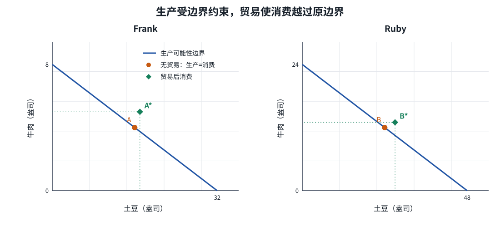

# 现代经济寓言：生产可能性

| | |
|---|---|
| 表面 | Book |
| 用时 | 约 12 分钟 |
| 原书 | 曼昆《经济学原理》微观分册第 8 版 · 第 3 章 · 3.1–3.1.1 |
| 本章深度 | 会画、会算 |
| 导航 | [学习台](../README.md) · [掌握路径](../MASTERY_PATH.md) · 下一页 [专业化与贸易](02_specialization_and_trade.md) |

## 学完你能做什么

- 从单位生产时间推出每天 8 小时的产量。
- 画出 Frank 与 Ruby 的直线生产可能性边界，并指出无贸易点。
- 解释为什么无贸易时生产边界也是消费边界。

## 概念讲解

一天里的果汁、咖啡、衣服、汽车和书，可能分别来自许多地方。相互依存不是因为陌生人都在无偿帮忙，而是因为他们提供物品与服务时也得到回报。第 3 章追问：人为什么愿意依靠别人？贸易究竟多给了什么？

先把世界缩到两个人、两种食物。Frank 是农民，Ruby 是牧牛人；两人都爱吃牛肉和土豆。若一人只会养牛、另一人只会种土豆，交换能增加食物品种。若两人都会做两种事，只是一方土地或技能更合适，专业化仍有好处。最难的情况是 Ruby 做两件事都更快。本章正是要解决这个难点。

### 从分钟数到生产边界

两人每天各有 8 小时，即 480 分钟。时间可以用于养牛、种土豆，或两者组合。

| 生产者 | 每盎司牛肉所需时间 | 每盎司土豆所需时间 | 8 小时只产牛肉 | 8 小时只产土豆 |
|---|---:|---:|---:|---:|
| Frank | 60 分钟 | 15 分钟 | 8 盎司 | 32 盎司 |
| Ruby | 20 分钟 | 10 分钟 | 24 盎司 | 48 盎司 |

计算只做一步：480 除以每盎司所需分钟数。Frank 若把时间平分，4 小时养牛、4 小时种土豆，就得到 4 盎司牛肉和 16 盎司土豆。Ruby 同样平分时间，得到 12 盎司牛肉和 24 盎司土豆。

令横轴为土豆 `P`，纵轴为牛肉 `B`，单位都是盎司。两条边界可以写成：

- Frank：`B = 8 - P/4`。每多产 4 盎司土豆，就少产 1 盎司牛肉。
- Ruby：`B = 24 - P/2`。每多产 2 盎司土豆，就少产 1 盎司牛肉。

边界上的所有点，都对应把 480 分钟分配完。这里的转化率固定，所以边界是直线。第 2 章的汽车—电脑边界则允许机会成本随组合改变；两章采用的简化不同，并不互相否定。

*图：实线为生产可能性边界。A、B 是无贸易时的生产与消费；`A*`、`B*` 是下一页要推导的贸易后消费。先看实线，下一页再解释虚线外的点。*

### 无贸易时，吃什么只能由自己生产

课本假设 Frank 选择 A 点：16 盎司土豆和 4 盎司牛肉；Ruby 选择 B 点：24 盎司土豆和 12 盎司牛肉。这些选择还涉及食物偏好，单看边界无法预测。但选择一旦给定，无贸易时「生产并消费」就是同一句话。

两人的无贸易总产量是牛肉 `4 + 12 = 16` 盎司，土豆 `16 + 24 = 40` 盎司。保留这两个总数，后面用它衡量专业化带来的增量。

> [!NOTE]
> **标注 · 课本例子**  
> Frank 60/15 分钟，Ruby 20/10 分钟；每天 8 小时。无贸易点：Frank 4 牛肉、16 土豆，Ruby 12 牛肉、24 土豆。数量单位均为盎司。

> [!WARNING]
> **注意**  
> 直线不是因为没有权衡，而是因为权衡的比率固定。Frank 从牛肉转出一小时，会少 1 盎司牛肉、多 4 盎司土豆；转到哪一点都一样。

> [!TIP]
> **关键术语**  
> **生产可能性边界**：时间和技术既定时，能够达到的生产组合。  
> **自给自足**：不交易，只消费自己生产的组合。  
> **固定转化率**：同一小时在两种活动间转移时，产量增减的比率不变。

> [!IMPORTANT]
> **深度解析**  
> 生产边界只说明「能生产什么」，不说明「最爱什么」。A、B 两点是课本给定的选择，不是从效率公式推出来的。偏好没有进入方程，不等于偏好不存在。

## 小测验

### B01-1 · 选择

Frank 把全部 8 小时用于种土豆，产量是多少？

- A. 8 盎司
- B. 24 盎司
- C. 32 盎司
- D. 48 盎司

要点

C。每盎司土豆用 15 分钟，`480 ÷ 15 = 32` 盎司。

### B01-2 · 简答

为什么 Frank 与 Ruby 的生产可能性边界是直线？无贸易时它为什么也限制消费？

要点

两人的时间在牛肉和土豆之间按固定比率转换，机会成本不随组合改变，所以边界为直线。无贸易时消费只能来自自己的生产，因此生产可能性也是消费可能性。

## 费曼输出（学完自己讲）

**一句：** 把 8 小时按固定比率分配给两种食物，就得到一条直线生产边界。  
**术语：** 自给自足=不交易，只消费自己的产出。你补：生产可能性边界= ______  
**例子：** Frank 480 分钟全种土豆。你补关键一步：为什么产量是 32 而不是 8？______  
**提醒：** A、B 是给定的偏好选择，不是边界自动决定的点。

## 本页带走

Frank 的两端是 8 盎司牛肉或 32 盎司土豆，Ruby 是 24 或 48。无贸易时，两人只能消费自己的产出：Frank 为 4 与 16，Ruby 为 12 与 24；合计牛肉 16、土豆 40。

下一页看交换怎样让消费越过自己的边界：[专业化与贸易](02_specialization_and_trade.md)。

掌握路径上，本页对应 [C3-R01](../PRACTICE.md#c3-r01)、[C3-R02](../PRACTICE.md#c3-r02)。
