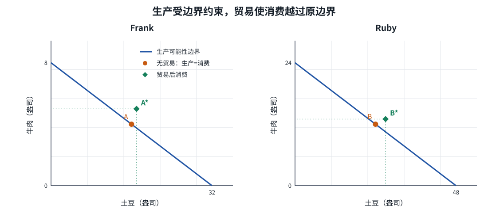

# 专业化与贸易：消费越过生产边界

| | |
|---|---|
| 表面 | Book |
| 用时 | 约 12 分钟 |
| 原书 | 曼昆《经济学原理》微观分册第 8 版 · 第 3 章 · 3.1.2 |
| 本章深度 | 会逐格核对 |
| 导航 | [学习台](../README.md) · [上一页](01_production_possibilities.md) · [下一页](03_absolute_and_comparative.md) |

## 学完你能做什么

- 从工作时间算出专业化后的生产组合。
- 按「生产 → 交换 → 消费」复原整张贸易表。
- 用数字证明两人的贸易后消费都在各自原生产边界之外。

## 概念讲解

Ruby 提议：Frank 不再养牛，把 8 小时全用于土豆；自己用 6 小时养牛、2 小时种土豆。然后 Frank 给 Ruby 15 盎司土豆，Ruby 给 Frank 5 盎司牛肉。

Frank 的第一反应是：如果交易对我好，怎么可能也对你好？这正是要检查的地方。不要把贸易先想成一堆固定食物在两人间挪动；专业化先改变了生产组合。

### 第一步：先算生产，不要先算消费

Frank 全种土豆：`480 ÷ 15 = 32` 盎司土豆，牛肉为 0。

Ruby 用 6 小时即 360 分钟养牛：`360 ÷ 20 = 18` 盎司牛肉；用 2 小时即 120 分钟种土豆：`120 ÷ 10 = 12` 盎司土豆。

| 生产者 | 无贸易：生产并消费 | 专业化后生产 |
|---|---|---|
| Frank | 4 盎司牛肉、16 盎司土豆 | 0 盎司牛肉、32 盎司土豆 |
| Ruby | 12 盎司牛肉、24 盎司土豆 | 18 盎司牛肉、12 盎司土豆 |

### 第二步：交换的是 5 与 15

Ruby 给 Frank 5 盎司牛肉，Frank 给 Ruby 15 盎司土豆。对同一件物品，一方「得到」就是另一方「给出」。消费 = 自己的生产 − 给出 + 得到。

| Frank | 牛肉 | 土豆 |
|---|---:|---:|
| 生产 | 0 | 32 |
| 贸易 | 得到 5 | 给出 15 |
| 消费 | 5 | 17 |
| 比无贸易增加 | +1 | +1 |

| Ruby | 牛肉 | 土豆 |
|---|---:|---:|
| 生产 | 18 | 12 |
| 贸易 | 给出 5 | 得到 15 |
| 消费 | 13 | 27 |
| 比无贸易增加 | +1 | +3 |

两人都没有增加工作时间，却都比原来的 A、B 点多消费两种食物。这不是账面上的「你多我就少」，而是生产重组之后可分的总量变了。

### 第三步：核对消费是否真的越过原边界

Frank 若全靠自己并已经生产 17 盎司土豆，按 `B = 8 - P/4`，最多只能同时生产 `8 - 17/4 = 3.75` 盎司牛肉。贸易后他消费 5 盎司牛肉，超过 3.75，因此 `A*` 在自己的生产边界之外。

Ruby 若全靠自己并已经生产 27 盎司土豆，最多只能同时生产 `24 - 27/2 = 10.5` 盎司牛肉。贸易后她消费 13 盎司牛肉，也超过 10.5，因此 `B*` 同样在外。

*图：`A*` 与 `B*` 都在各自实线之外。生产仍受各自边界约束；被贸易拓宽的是消费可能性。*

> [!NOTE]
> **标注 · 课本例子**  
> Frank 全种 32 盎司土豆；Ruby 生产 18 盎司牛肉和 12 盎司土豆。5 盎司牛肉换 15 盎司土豆后，Frank 消费 5 与 17，Ruby 消费 13 与 27。

> [!WARNING]
> **注意**  
> 不要把 Frank 的「生产 0 牛肉」直接当成「消费 0 牛肉」。他随后用土豆换到 5 盎司牛肉。先写生产，再写贸易，最后才写消费。

> [!TIP]
> **关键术语**  
> **专业化**：把更多时间集中用于某些活动。  
> **贸易后消费**：自己的生产减去给出、加上得到。  
> **消费可能性**：在既定生产与交换条件下能够消费的组合；它不必等于自己的生产边界。

> [!IMPORTANT]
> **深度解析**  
> 说消费点在生产边界之外，并没有违反稀缺性。每个人的生产仍在自己的边界上；贸易把两人的产出重新组合，使各自不必只靠自己的技术满足消费。

## 小测验

### B02-1 · 选择

贸易完成后，Frank 的消费组合是什么？

- A. 0 盎司牛肉、32 盎司土豆
- B. 5 盎司牛肉、17 盎司土豆
- C. 13 盎司牛肉、27 盎司土豆
- D. 4 盎司牛肉、16 盎司土豆

要点

B。Frank 生产 0 牛肉、32 土豆，再得到 5 牛肉、给出 15 土豆，所以消费 5 牛肉、17 土豆。

### B02-2 · 简答

Ruby 的贸易后消费为 13 盎司牛肉、27 盎司土豆。怎样用她的原边界证明这个点靠自己做不到？

要点

Ruby 的边界为 `B = 24 - P/2`。当 `P = 27` 时，自己最多同时有 `24 - 13.5 = 10.5` 盎司牛肉，小于贸易后消费的 13 盎司，所以 `B*` 在原生产边界之外。

## 费曼输出（学完自己讲）

**一句：** 专业化先改变生产，交换再改变消费，两人的消费都能越过自己的生产边界。  
**术语：** 贸易后消费=生产−给出+得到。你补：专业化= ______  
**例子：** Frank 生产 0 牛肉、32 土豆，再用 15 土豆换 5 牛肉。你补关键一步：最终两种各消费多少？______  
**提醒：** 不要把生产点与消费点混成同一行。

## 本页带走

Frank 消费从 4 牛肉、16 土豆变为 5 与 17；Ruby 从 12 与 24 变为 13 与 27。两人两种都更多，而且两个消费点都越过各自原生产边界。下一页解释分工方向为什么不是由「谁更快」单独决定。

下一页：[绝对优势与比较优势](03_absolute_and_comparative.md)。

掌握路径上，本页对应 [C3-R03](../PRACTICE.md#c3-r03)、[C3-R04](../PRACTICE.md#c3-r04)。
