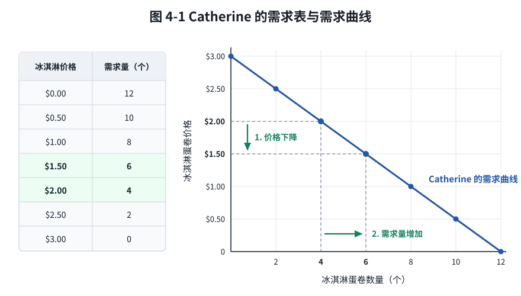
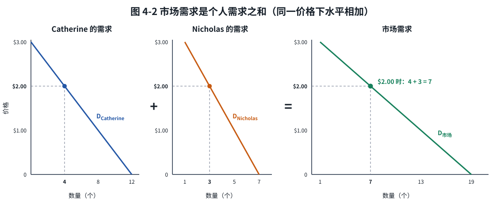

# 需求曲线与市场加总：同一价格下加数量

| | |
|---|---|
| 表面 | Book |
| 用时 | 约 12 分钟 |
| 原书 | 曼昆《经济学原理》微观分册第 8 版 · 第 4 章 · 4.2.1–4.2.2（图 4-1、图 4-2） |
| 本章深度 | 会读表、会加总 |
| 导航 | [学习台](../README.md) · [上一页](01_markets_competition.md) · [下一页](03_demand_shifts.md) |

## 学完你能做什么

- 区分需求、需求量、需求表和需求曲线。
- 对照曼昆图 4-1，用 Catherine 的需求表与需求曲线说明需求定理。
- 对照曼昆图 4-2，在每个既定价格下水平加总 Catherine 与 Nicholas 的需求量。

## 概念讲解

### 需求量、需求定理与 Catherine 的需求曲线（图 4-1）

**需求量（quantity demanded）** 是买者**愿意并且能够**购买的一种物品的数量。只想吃却付不起钱，不构成有效需求量。在决定需求量的众多因素里，物品自身的价格起核心作用：每勺冰淇淋若涨到 20 美元，你会少买冰淇淋，也许改买冷冻酸奶；若降到 0.20 美元，你就会多买一些。

这种普遍关系称为 **需求定理（law of demand）**：在其他条件不变时，一种物品的价格上升，对该物品的需求量减少；价格下降，对该物品的需求量增加。

在影响消费者购买意愿的其他因素（收入、爱好、相关物品价格等）都保持不变的前提下，把价格与需求量的对应关系列成表格，就是 **需求表（demand schedule）**；按经济学惯例把**价格标在纵轴、数量标在横轴**画成图形，就是 **需求曲线（demand curve）**。其他条件不变时，更低的价格意味着更多的需求量，因此需求曲线向右下方倾斜。

*图：曼昆图 4-1。左侧需求表列出每个价格下 Catherine 每月购买的冰淇淋蛋卷数；右侧需求曲线向右下方倾斜——例如价格从 $\$2.00$ 降到 $\$1.50$ 时，需求量沿需求曲线从 $4$ 个增加到 $6$ 个。*

### 市场需求与个人需求：同一价格下水平相加（图 4-2）

图 4-1 只表示 Catherine 一个人的需求。为了分析市场如何运行，需要把市场上所有买者对某种物品的需求合在一起，得到 **市场需求（market demand）**。

假设市场上只有两位买者——Catherine 和 Nicholas。原书图 4-2 给出的加总关系非常直接：在**每一种既定价格水平**下，

$$\text{市场需求量} = \text{Catherine 的需求量} + \text{Nicholas 的需求量}$$

| 每个冰淇淋蛋卷价格（美元） | Catherine 需求量（个） | $+$ | Nicholas 需求量（个） | $=$ | 市场需求量（个） |
|---:|---:|:---:|---:|:---:|---:|
| $0.00$ | $12$ | $+$ | $7$ | $=$ | $19$ |
| $0.50$ | $10$ | $+$ | $6$ | $=$ | $16$ |
| $1.00$ | $8$ | $+$ | $5$ | $=$ | $13$ |
| $1.50$ | $6$ | $+$ | $4$ | $=$ | $10$ |
| $2.00$ | $4$ | $+$ | $3$ | $=$ | $7$ |
| $2.50$ | $2$ | $+$ | $2$ | $=$ | $4$ |
| $3.00$ | $0$ | $+$ | $1$ | $=$ | $1$ |

例如在价格为 $\$2.00$ 时，Catherine 需求 $4$ 个，Nicholas 需求 $3$ 个，这一价格下的市场需求量就是 $4 + 3 = 7$ 个；在 $\$1.50$ 时，市场需求量为 $6 + 4 = 10$ 个。

*图：曼昆图 4-2。固定纵轴上的任一价格，把个人需求曲线横轴上标出的个人需求量相加，就得到市场需求曲线（如 $\$2.00$ 时 $4 + 3 = 7$ 个）。*

这种作图方法称为 **水平相加**：固定纵轴价格，把横轴上的个人数量往右相加——既不是把两个人在同一数量下愿意付的价格相加，也不是把不同价格下的数量混加。由于后续要分析整个市场的运行，最常使用的将是这条**市场需求曲线**。

还要先分清两个词：**「需求」** 指整张需求表或整条需求曲线的位置；**「需求量」** 指曲线上某一个具体价格对应的数量。这个区分在下一页将直接决定你是「沿曲线走」还是「平移整条曲线」。

> [!NOTE]
> **标注 · 课本例子**  
> Catherine 免费时需求 $12$ 个，$\$3.00$ 时为 $0$；Nicholas 在 $\$3.00$ 时仍需求 $1$ 个。市场需求量在 $\$1.50$、$\$2.00$、$\$2.50$ 时分别为 $10$、$7$、$4$ 个。

> [!WARNING]
> **注意**  
> 价格从 $\$2.00$ 降到 $\$1.50$，Catherine 的需求量从 $4$ 增至 $6$（市场需求量从 $7$ 增至 $10$），不能说「需求曲线右移」。其他条件没变，这只是沿着同一条需求曲线移动。

> [!TIP]
> **关键术语**  
> **需求量**：买者愿意并且能够购买的一种物品的数量。  
> **需求定理**：其他条件不变时，一种物品价格上升则需求量减少，价格下降则需求量增加。  
> **市场需求**：所有个人对某种特定物品或服务的需求总和（同一价格下水平相加数量）。

> [!IMPORTANT]
> **深度解析**  
> 需求曲线不是某个月的销售流水账，而是一张「其他条件保持不变」时的条件对应表。如果现实中某个月价格变了，同时买者收入或天气也变了，就不能把前后两个观测点直接连成同一条需求曲线。

## 小测验

### B02-1 · 选择

价格为 $\$2.00$ 时，Catherine、Nicholas 和市场的需求量分别是多少？

- A. $4$、$3$、$7$
- B. $6$、$4$、$10$
- C. $2$、$2$、$4$
- D. $4$、$3$、$12$

要点

A。在同一价格 $\$2.00$ 下水平相加个人数量：$4 + 3 = 7$ 个，不是把价格相加，也不是把不同价格行的数量混加。

### B02-2 · 简答

为什么需求曲线向右下方倾斜？这句话依赖什么前提？

要点

在其他条件不变时，价格越低，买者愿意并且能够购买的数量越多；价格越高，需求量越少。前提是收入、爱好、相关物品价格、预期等其他影响买者的因素都保持不变。

## 费曼输出（学完自己讲）

**一句：** 需求表和需求曲线表示其他条件不变时价格与需求量的反向关系，市场需求由个人需求在同一价格下水平相加得到。  
**术语：** 需求量=买者愿意并且能够购买的数量。你补：市场需求= ______  
**例子：** $\$2.00$ 时 Catherine 为 $4$、Nicholas 为 $3$。你补关键一步：为什么市场需求量是 $7$，图上叫什么加总？______  
**提醒：** 水平相加是固定纵轴价格、相加横轴数量，不要把价格相加。

## 本页带走

需求曲线向右下方倾斜，因为其他条件不变时价格越低、需求量越多（图 4-1）。由个人需求得到市场需求的方法是逐价格水平相加（图 4-2）：$\$2.00$ 时为 $4 + 3 = 7$，$\$1.50$ 时为 $6 + 4 = 10$，$\$2.50$ 时为 $2 + 2 = 4$。

下一页改变坐标轴以外的因素：[需求移动与沿曲线移动](03_demand_shifts.md)。

掌握路径上，本页对应 [C4-R03](../PRACTICE.md#c4-r03)、[C4-R04](../PRACTICE.md#c4-r04)。
