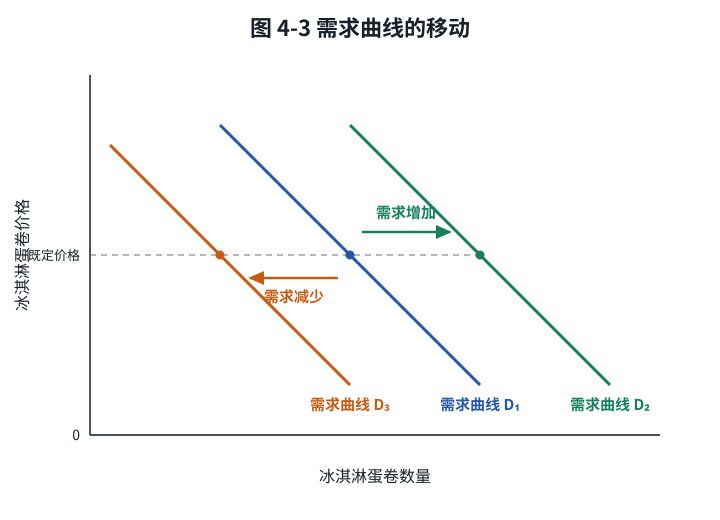

# 需求移动与沿曲线移动：先找变动来自哪里

| | |
|---|---|
| 表面 | Book |
| 用时 | 约 15 分钟 |
| 原书 | 曼昆《经济学原理》微观分册第 8 版 · 第 4 章 · 4.2.3（表 4-1、图 4-3、图 4-4） |
| 本章深度 | 会判断 |
| 导航 | [学习台](../README.md) · [上一页](02_demand_curve.md) · [下一页](04_supply_curve.md) |

## 学完你能做什么

- 用需求函数把「沿需求曲线移动」和「整条需求曲线移动」彻底分开。
- 用符号方向与生活机制区分正常物品与低档物品、替代品与互补品。
- 对照曼昆表 4-1、图 4-3 和图 4-4（香烟案例），独立判断任一买方事件的图形变化。

## 概念讲解

### 需求函数：谁在坐标轴上，谁是背景参数

一条需求曲线只画在 $(Q, P)$ 平面上，暗含「其他条件不变」（*ceteris paribus*）。把影响买者决策的全部核心变量写出来，市场需求关系可以记为 **需求函数**：

$$Q^d = D(P,\; Y,\; P_{\text{related}},\; T,\; E,\; N)$$

其中 $P$ 是本物品自身价格，$Y$ 是买者收入，$P_{\text{related}}$ 是相关物品价格，$T$ 是爱好（偏好），$E$ 是对未来的预期，$N$ 是买者数量。

这个式子直接给出全章最关键的作图判据：

- **沿着需求曲线移动（需求量变动）**：只有纵轴变量 $P$ 改变（$\Delta P \neq 0$），函数 $D(\cdot)$ 里的背景参数 $(Y, P_{\text{related}}, T, E, N)$ 全部不变，点在同一条曲线上滑动。
- **需求曲线本身移动（需求变动）**：括号里除 $P$ 以外的任一轴外变量改变，使得在**每一种既定价格 $P_0$** 下对应的 $Q^d$ 都发生变化——每一种价格下买得更多（$\Delta Q^d|_{P_0} > 0$）称为 **需求增加**，曲线从 $D_1$ 右移到 $D_2$；每一种价格下买得更少（$\Delta Q^d|_{P_0} < 0$）称为 **需求减少**，曲线从 $D_1$ 左移到 $D_3$。

*图：曼昆图 4-3。固定任意价格 $P_0$，使需求量增加的任何变动都会让需求曲线向右移动到 $D_2$；使需求量减少的任何变动都会让需求曲线向左移动到 $D_3$。*

### 五类轴外移动因素与两对核心分类

1. **收入（$Y$）：正常物品与低档物品**  
   其他条件相同时，看需求随收入变动的符号：
   - **正常物品（normal good）**：$\dfrac{\Delta Q^d}{\Delta Y} > 0$。收入增加时需求增加（右移），收入减少时需求减少（左移），如课本中的冰淇淋。
   - **低档物品（inferior good）**：$\dfrac{\Delta Q^d}{\Delta Y} < 0$。收入增加时需求减少（左移），收入减少时反而需求增加（右移），如课本中的公共汽车出行（收入降低时更少买车或打车，转而多乘公交）。「低档」仅指收入效应符号为负，不是说物品劣质。

2. **相关物品价格（$P_{\text{related}}$）：替代品与互补品**  
   设本物品为 $A$，相关物品为 $B$，其他条件相同时看交叉价格方向：
   - **替代品（substitutes）**：$\dfrac{\Delta Q^d_A}{\Delta P_B} > 0$。满足相似需要，成对替换使用。$B$ 涨价使人们少买 $B$、转向多买 $A$，$A$ 的需求曲线右移；反之 $B$ 降价使 $A$ 的需求左移。课本例子：冷冻酸奶与冰淇淋、热狗与汉堡包、电影票与流媒体视频服务。
   - **互补品（complements）**：$\dfrac{\Delta Q^d_A}{\Delta P_B} < 0$。成套搭配使用。$B$ 涨价使人们少买 $B$，连带在每种价格下也少买 $A$，$A$ 的需求曲线左移；反之 $B$ 降价使 $A$ 的需求右移。课本例子：热软糖（hot fudge）与冰淇淋、汽油与汽车、电脑与软件。

3. **爱好（$T$）**  
   经济学家通常不解释偏好如何形成，但研究偏好变化后的结果。若新研究显示常吃冰淇淋的人更健康长寿，任意价格下需求量都会上升，需求曲线右移。

4. **预期（$E$）**  
   对未来的预期会改变**今天**的需求：预期下个月收入增加，今天更愿多花钱买冰淇淋（当前需求右移）；预期明天冰淇淋打折降价，今天先忍住少买（当前需求左移）。

5. **买者数量（$N$）**  
   市场需求是个人需求在每一价格下的水平加总。若除 Catherine 和 Nicholas 外，Peter 也加入冰淇淋买者行列，每一种价格下的市场需求量都更大，市场需求曲线右移。

### 曼昆表 4-1：影响买者的变量汇总

| 变量 | 该变量的一场变动会…… | 课本情景对照 |
|---|---|---|
| **物品自身的价格（$P$）** | **表现为沿着需求曲线的移动** | 冰淇淋价格或香烟含税零售价变化 |
| **收入（$Y$）** | 使需求曲线移动 | 失业降薪使冰淇淋（正常品）左移、公交（低档品）右移 |
| **相关物品的价格（$P_{\text{related}}$）** | 使需求曲线移动 | 冷冻酸奶降价使冰淇淋左移；热软糖降价使冰淇淋右移 |
| **爱好（$T$）** | 使需求曲线移动 | 健康宣传改变对冰淇淋或香烟的偏好 |
| **预期（$E$）** | 使需求曲线移动 | 预期明天降价使今天需求左移 |
| **买者数量（$N$）** | 使需求曲线移动 | Peter 进入市场使市场需求右移 |

### 案例研究：减少香烟需求量的两种方法

公共政策制定者若想减少吸烟，既可以设法左移香烟的需求曲线，也可以提高香烟价格、沿同一条需求曲线向上推。曼昆图 4-4 把两者的区别画得一目了然：

| 政策路径 | 作用变量 | 课本数字 | 图形与术语表达 |
|---|---|---|---|
| **方法一：公益广告、烟盒健康警示、禁播电视香烟广告** | 改变偏好 $T$（轴外变量），香烟价格仍为每包 $\$4.00$ | 每天吸烟量从 $20$ 支减至 $10$ 支（点 $A \to B$） | **需求减少**：整条需求曲线从 $D_1$ 左移到 $D_2$ |
| **方法二：对烟草制造商征税并转嫁为更高零售价** | 提高香烟自身价格 $P$（纵轴变量），偏好未变 | 每包价格从 $\$4.00$ 升至 $\$8.00$，每天吸烟量从 $20$ 支减至 $12$ 支（点 $A \to C$） | **需求量减少**：沿着同一条需求曲线 $D_1$ 向上移动 |

*图：曼昆图 4-4。图（a）价格固定在 $\$4.00$，警示政策让需求曲线从 $D_1$ 左移到 $D_2$（$20 \to 10$ 支）；图（b）需求曲线 $D_1$ 不动，税收把价格从 $\$4.00$ 推到 $\$8.00$，吸烟量沿 $D_1$ 从 $20$ 支降到 $12$ 支。*

> [!NOTE]
> **标注 · 课本例子**  
> 正常物品冰淇淋、低档物品公共汽车；替代品冰淇淋与冷冻酸奶、互补品冰淇淋与热软糖；Peter 加入市场；香烟警示使 $\$4.00$ 下每天 $20 \to 10$ 支，香烟税使价格 $\$4.00 \to \$8.00$、数量 $20 \to 12$ 支。

> [!WARNING]
> **注意**  
> 看到「吸烟人数或销量少了」不能直接写「香烟需求下降」。若是因为健康警示，叫**需求减少**（曲线左移）；若仅因为加税涨价，必须叫**需求量减少**（沿曲线移动）。

> [!TIP]
> **关键术语**  
> **正常物品 vs. 低档物品**：$\Delta Q^d / \Delta Y > 0$ 为正常物品，$\Delta Q^d / \Delta Y < 0$ 为低档物品。  
> **替代品 vs. 互补品**：$\Delta Q^d_A / \Delta P_B > 0$ 为替代品，$\Delta Q^d_A / \Delta P_B < 0$ 为互补品。  
> **需求变动 vs. 需求量变动**：前者是轴外变量引起整条 $D$ 左右平移；后者是本物品价格 $\Delta P$ 引起沿原 $D$ 移动。

> [!IMPORTANT]
> **深度解析**  
> 图 4-4（b）中每包香烟从 $\$4.00$ 涨到 $\$8.00$，为什么吸烟量恰好从 $20$ 支降到 $12$ 支而不是 $5$ 支？这取决于买者对价格变动有多敏感——即第 5 章将专门度量的 **需求价格弹性**（课本指出青少年吸烟者对价格往往比成年人更敏感）。本章先把变动性质和方向判准。

## 小测验

### B03-1 · 选择

冷冻酸奶价格下降（$\Delta P_{\text{酸奶}} < 0$），对冰淇淋市场最直接的影响是什么？

- A. 冰淇淋需求曲线右移
- B. 冰淇淋需求曲线左移
- C. 沿冰淇淋需求曲线向上移动
- D. 冰淇淋供给曲线右移

要点

B。两者是替代品（$\Delta Q^d_{\text{冰淇淋}} / \Delta P_{\text{酸奶}} > 0$）。冷冻酸奶变便宜使买者转向冷冻酸奶，在每一种既定冰淇淋价格下需求量都减少，冰淇淋需求曲线左移。

### B03-2 · 简答

对照曼昆表 4-1 与图 4-4，说明香烟健康警示与提高香烟税为什么都能减少吸烟，却对应完全不同的图形动作。

要点

健康警示改变的是轴外偏好变量 $T$，使同一价格（如每包 $\$4.00$）下的吸烟量从 $20$ 支降到 $10$ 支，整条需求曲线从 $D_1$ 左移到 $D_2$（需求减少）。提高香烟税改变的是纵轴上的香烟自身价格 $P$（$\$4.00 \to \$8.00$），偏好等轴外参数未变，因此表现为沿同一条需求曲线 $D_1$ 从点 $A$ 移到点 $C$（$20 \to 12$ 支，需求量减少）。

## 费曼输出（学完自己讲）

**一句：** 在 $Q^d = D(P, Y, P_{\text{related}}, T, E, N)$ 中，只有自身价格 $P$ 变动是沿曲线走，其余五个变量变动都会平移整条需求曲线。  
**术语：** 替代品=$\Delta Q^d_A / \Delta P_B > 0$（一种涨价使另一种需求右移）。你补：互补品= ______  
**例子：** 香烟警示（$\$4$ 下 $20 \to 10$）与加税（$\$4 \to \$8$ 下 $20 \to 12$）。你补关键一步：哪一种叫「需求减少」，哪一种叫「需求量减少」？______  
**提醒：** 正常品与低档品看 $\Delta Q^d / \Delta Y$ 的正负号，不是评价商品档次高低。

## 本页带走

记住表 4-1 的总判据：本物品价格 $P$ 在纵轴上，它的变动只沿需求曲线移动；收入 $Y$（正常品正、低档品负）、相关物品价格 $P_{\text{related}}$（替代品正、互补品负）、爱好 $T$、预期 $E$ 和买者数量 $N$ 不在轴上，它们的变动使需求曲线整体左右移动。

下一页转到卖者一方：[供给曲线与市场加总](04_supply_curve.md)。

掌握路径上，本页对应 [C4-R05](../PRACTICE.md#c4-r05)、[C4-R06](../PRACTICE.md#c4-r06)。
