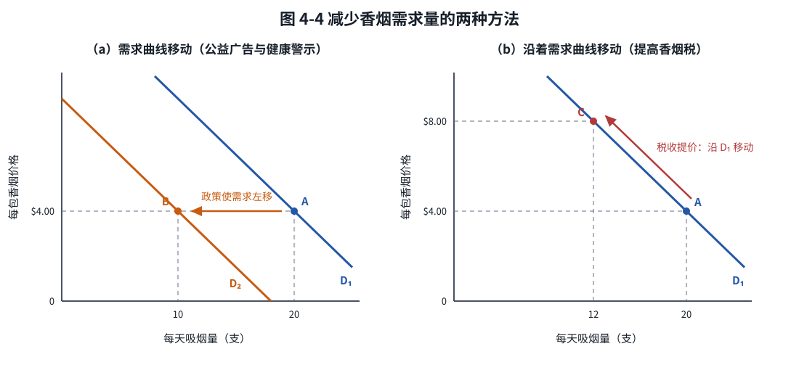

# 需求移动与沿曲线移动：先找变动来自哪里

| | |
|---|---|
| 表面 | Book |
| 用时 | 约 14 分钟 |
| 原书 | 曼昆《经济学原理》微观分册第 8 版 · 第 4 章 · 4.2.3（图 4-3、表 4-1、图 4-4） |
| 本章深度 | 会判断 |
| 导航 | [学习台](../README.md) · [上一页](02_demand_curve.md) · [下一页](04_supply_curve.md) |

## 学完你能做什么

- 对照曼昆图 4-3，用五类因素判断需求曲线向右移还是向左移。
- 准确区分正常物品与低档物品、替代品与互补品。
- 对照曼昆表 4-1 与图 4-4（香烟案例），把「需求曲线移动」和「沿着需求曲线变动」彻底分开。

## 概念讲解

### 需求曲线的移动：需求增加与需求减少（图 4-3）

市场需求曲线是在「其他条件不变」下画出的，因此它不必随时间永远停在原位。一旦某个非价格因素改变了**任何一种既定价格水平下**买者想购买的数量，整条需求曲线就会移动。例如，假设美国医学会突然发现经常吃冰淇淋的人更长寿、更健康，那么在每一种既定价格下买者都想买更多冰淇淋。

- 使每一种价格水平下的需求量都增加的任何变动，都会使需求曲线**向右移动**（从 $D_1$ 移到 $D_2$），称为 **需求增加（increase in demand）**。
- 使每一种价格水平下的需求量都减少的任何变动，都会使需求曲线**向左移动**（从 $D_1$ 移到 $D_3$），称为 **需求减少（decrease in demand）**。

*图：曼昆图 4-3。在任一既定价格水平下，买者愿意购买的数量增加使需求曲线向右移至 $D_2$（需求增加）；愿意购买的数量减少使需求曲线向左移至 $D_3$（需求减少）。*

### 使需求曲线移动的五类重要变量

1. **收入：正常物品与低档物品**  
   如果某个夏天你失业了、收入减少，你对冰淇淋的需求很可能会减少：
   - **正常物品（normal good）**：在其他条件相同时，收入增加引起需求量增加（或收入减少引起需求量减少）的物品，如冰淇淋（收入降 $\to$ 需求曲线左移）。
   - **低档物品（inferior good）**：在其他条件相同时，收入增加引起需求量减少（或收入减少引起需求量增加）的物品，如**坐公共汽车**——收入减少时更不大可能买车或乘出租车，反而更可能去坐公交（收入降 $\to$ 公交需求曲线右移）。注意：「低档」只描述需求与收入呈反向关系，不是评价商品质量差。

2. **相关物品的价格：替代品与互补品**  
   - **替代品（substitutes）**：一种物品价格下降引起另一种物品需求量减少（即一种涨价引起另一种需求增加）的两种物品。冷冻酸奶和冰淇淋都是冷而甜的奶油食品，满足相似愿望：冷冻酸奶降价 $\to$ 按需求定理多买冷冻酸奶 $\to$ 少买冰淇淋（冰淇淋需求左移）。课本成对例子还有：热狗与汉堡包、毛衣与长袖衫、电影票与电影视频服务。
   - **互补品（complements）**：一种物品价格下降引起另一种物品需求量增加（即一种涨价引起另一种需求减少）的两种物品。冰淇淋和热软糖（hot fudge）常一起吃：热软糖降价 $\to$ 按需求定理多买热软糖 $\to$ 搭配着也多买冰淇淋（冰淇淋需求右移）。课本成对例子还有：汽油与汽车、电脑与软件、花生酱与果酱。

3. **爱好（偏好）**  
   如果你更喜欢冰淇淋，在每种价格下就会多买。经济学家通常不解释由历史与心理因素决定的爱好本身，但会考察爱好变动后需求曲线怎样移动。

4. **预期**  
   对未来的预期会影响**今天**的需求：若预期下个月收入增加，可能现在少储蓄、多买冰淇淋（当前需求右移）；若预期明天冰淇淋降价，今天就不太愿意按现价购买（当前需求左移）。

5. **买者的数量**  
   市场需求取决于买者人数。如果除 Catherine 和 Nicholas 外，Peter 也作为消费者加入冰淇淋市场，每一种价格下的市场需求量都会更大，市场需求曲线向右移动。

为方便对照记忆，可把这五类轴外因素的方向收成一张助学小表：

| 移动因素 | 课本具体情景 | 机制链条 | 对本物品需求曲线的影响 |
|---|---|---|---|
| 收入（正常物品） | 夏天失业、收入下降 | 总支出缩减，少买冰淇淋 | 需求减少（左移） |
| 收入（低档物品） | 收入下降 | 少买车或打车，改乘公共汽车 | 公交需求增加（右移） |
| 替代品价格 | 冷冻酸奶降价 | 多买冷冻酸奶，替代掉部分冰淇淋 | 冰淇淋需求减少（左移） |
| 互补品价格 | 热软糖降价 | 多买热软糖，连带多配冰淇淋 | 冰淇淋需求增加（右移） |
| 爱好 | 假想医学发现吃冰淇淋更健康 | 既定价格下购买意愿增强 | 需求增加（右移） |
| 预期 | 预期明天冰淇淋降价 | 推迟到明天再买 | 今天需求减少（左移） |
| 买者数量 | Peter 加入买者行列 | 每个价格下多一份个人需求量 | 市场需求增加（右移） |

### 曼昆表 4-1：影响买者的变量

回想第 2 章附录的读图原则：**只有坐标轴上未标出的相关变量变动时，曲线才会移动**。价格画在纵轴上，因此自身价格变动只表现为沿着需求曲线变动；其余五个变量不在任何一条坐标轴上，因此它们的变动会使需求曲线移动。

| 变量 | 这些变量的变动将…… |
|---|---|
| **物品本身的价格** | **表现为沿着需求曲线的变动** |
| 收入 | 使需求曲线移动 |
| 相关物品的价格 | 使需求曲线移动 |
| 爱好 | 使需求曲线移动 |
| 预期 | 使需求曲线移动 |
| 买者的数量 | 使需求曲线移动 |

### 案例研究：减少香烟需求量的两种方法（图 4-4）

公共政策制定者常希望减少人们的吸烟量，原书给出了两种截然不同的政策路径，图 4-4 把两者的图形差异对比得非常清楚：

1. **使香烟需求曲线向左移动——图 4-4（a）**  
   公益广告、香烟盒上强制印制有害健康的警示、禁止在电视上播香烟广告，目的都是直接减少任何既定价格下的香烟需求量。若奏效，需求曲线从 $D_1$ 左移到 $D_2$：在每包价格仍为 $\$4.00$ 时，每天吸烟量从 $20$ 支减少到 $10$ 支（点 $A \to B$）。
2. **提高香烟价格，沿着同一条需求曲线变动——图 4-4（b）**  
   如果政府对香烟制造商征税，烟草公司会以提价形式把大部分税转嫁给消费者。此时需求曲线本身不移动，而是沿着同一条需求曲线 $D_1$ 移向价格更高、数量更少的一点：每包价格从 $\$4.00$ 上升到 $\$8.00$ 时，每天吸烟量从 $20$ 支减少到 $12$ 支（点 $A \to C$）。

*图：曼昆图 4-4。（a）警示政策改变偏好，在 $\$4.00$ 不变时使吸烟量从 $20$ 支减至 $10$ 支（$D_1 \to D_2$，需求减少）；（b）征税把每包价格从 $\$4.00$ 推高至 $\$8.00$，吸烟量沿固定需求曲线 $D_1$ 从 $20$ 支减至 $12$ 支（$A \to C$，需求量减少）。*

原书案例还补充了两条真实数据发现：第一，香烟价格上升 $10\%$ 会使总需求量减少 $4\%$，而青少年对价格尤其敏感，价格上升 $10\%$ 会使青少年吸烟量减少 $12\%$；第二，关于香烟涨价是否会诱使人们改吸大麻（替代品假说），大多数数据研究反而发现较低的香烟价格与更多使用大麻相关——烟草与大麻在经验上更接近**互补品**而非替代品。

> [!NOTE]
> **标注 · 课本例子**  
> 正常物品冰淇淋、低档物品坐公共汽车；替代品冰淇淋与冷冻酸奶（及热狗与汉堡包、毛衣与长袖衫、电影票与视频服务）；互补品冰淇淋与热软糖（及汽油与汽车、电脑与软件、花生酱与果酱）；Peter 加入市场；香烟图 4-4 的 $\$4.00$ 下 $20 \to 10$ 支 vs. $\$4.00 \to \$8.00$ 下 $20 \to 12$ 支。

> [!WARNING]
> **注意**  
> 看到「吸烟量减少」还不能直接画图：警示政策引起的是**需求减少**（整条曲线左移）；加税提价引起的只能叫**需求量减少**（沿同一条需求曲线移动）。

> [!TIP]
> **关键术语**  
> **需求增加／减少**：任意既定价格水平下需求量都增加／减少，需求曲线右移／左移。  
> **正常物品／低档物品**：其他条件相同时，收入增加使需求增加的为正常物品，使需求减少的为低档物品。  
> **替代品／互补品**：一种涨价使另一种需求增加的为替代品，使另一种需求减少的为互补品。

> [!IMPORTANT]
> **深度解析**  
> 案例中「价格上升 $10\%$ 使需求量减少 $4\%$（青少年减少 $12\%$）」问的是买者对价格变动究竟有多敏感——衡量这一反应幅度的公式正是第 5 章的核心工具**需求价格弹性**。在第 4 章，先把「沿曲线走还是移曲线、向左还是向右」判准即可。

## 小测验

### B03-1 · 选择

冷冻酸奶价格下降，对冰淇淋市场最直接的影响是什么？

- A. 冰淇淋需求曲线右移
- B. 冰淇淋需求曲线左移
- C. 沿冰淇淋需求曲线向上移动
- D. 冰淇淋供给曲线右移

要点

B。冷冻酸奶与冰淇淋是替代品。冷冻酸奶降价使买者多买冷冻酸奶、在每一种既定价格下少买冰淇淋，因此冰淇淋需求曲线向左移动。

### B03-2 · 简答

对照表 4-1 与图 4-4，说明香烟健康警示与提高香烟税为什么都能减少吸烟，图形和术语却不同。

要点

健康警示改变的是坐标轴外的爱好，在每包 $\$4.00$ 价格不变时把每天吸烟量从 $20$ 支减至 $10$ 支，整条需求曲线从 $D_1$ 左移到 $D_2$，称为「需求减少」。提高香烟税改变的是纵轴上的香烟自身价格（$\$4.00 \to \$8.00$），其他条件未变，吸烟量从 $20$ 支减至 $12$ 支表现为沿同一条需求曲线 $D_1$ 从 $A$ 移到 $C$，称为「需求量减少」。

## 费曼输出（学完自己讲）

**一句：** 本物品价格在纵轴上，变动时沿需求曲线走；收入、相关物品价格、爱好、预期、买者数量不在轴上，变动时使整条需求曲线移动。  
**术语：** 替代品=一种涨价引起另一种需求增加的成对物品。你补：互补品= ______  
**例子：** 香烟警示（$\$4.00$ 下 $20 \to 10$ 支）与加税提价（$\$4.00 \to \$8.00$ 下 $20 \to 12$ 支）。你补关键一步：哪一种是需求减少，哪一种是需求量减少？______  
**提醒：** 正常物品与低档物品只看需求随收入变化的方向，不是评价品质好坏。

## 本页带走

表 4-1 给出了买方一侧的总分界：物品自身价格变动表现为沿着需求曲线变动（需求量变动）；收入（正常品同向、低档品反向）、相关物品价格（替代品同向、互补品反向）、爱好、预期和买者数量的变动使整条需求曲线左右移动（图 4-3、图 4-4）。

下一页转向卖者一方：[供给曲线与市场加总](04_supply_curve.md)。

掌握路径上，本页对应 [C4-R05](../PRACTICE.md#c4-r05)、[C4-R06](../PRACTICE.md#c4-r06)。
