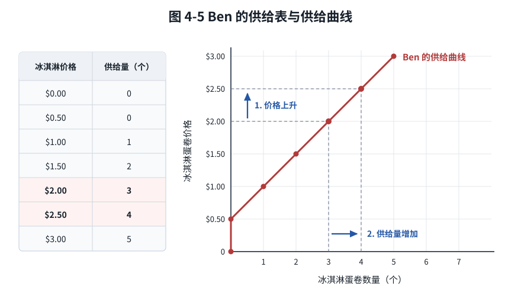

# 供给曲线与市场加总：价格与卖者愿意出售的数量

| | |
|---|---|
| 表面 | Book |
| 用时 | 约 13 分钟 |
| 原书 | 曼昆《经济学原理》微观分册第 8 版 · 第 4 章 · 4.3.1–4.3.2（图 4-5、图 4-6） |
| 本章深度 | 会读表、会加总 |
| 导航 | [学习台](../README.md) · [上一页](03_demand_shifts.md) · [下一页](05_supply_shifts.md) |

## 学完你能做什么

- 区分供给、供给量、供给表与供给曲线，并用符号写出供给定理。
- 从 Ben 的供给表写出线性供给方程，对照图 4-5 理解供给曲线为何向右上方倾斜。
- 用水平加总公式 $Q^s_{\text{market}}(P) = \sum_{i=1}^n Q^s_i(P)$ 把 Ben 与 Jerry 的个人供给合成市场供给（图 4-6）。

## 概念讲解

### 供给量、供给定理与供给曲线

**供给量（quantity supplied, $Q^s$）** 是卖者**愿意并且能够**出售的某种物品数量。有心生产却缺乏设备或原料，不算供给量；仓库里有货但在现行低价下不愿出售，也不计入该价格下的供给量。

冰淇淋价格起关键调节作用：价格高时，卖冰淇淋有利可图，店主愿意多买冰淇淋机、延长营业时间、多雇工人；价格过低时，卖冰淇淋无利可图，店主缩减产量甚至关门停业，$Q^s$ 降为 $0$。这种正向关系就是 **供给定理（law of supply）**：

$$\text{其他条件不变（ceteris paribus）时：}\quad \Delta P > 0 \implies \Delta Q^s \ge 0$$

在保持投入品成本、生产技术等其他因素不变的前提下，列出各价格与供给量对应关系的表格称为 **供给表（supply schedule）**；把价格 $P$ 标在纵轴、数量 $Q$ 标在横轴画出的曲线称为 **供给曲线（supply curve）**。更高价格对应更大供给量，因此供给曲线向右上方倾斜。

*图：曼昆图 4-5。价格低于 $\$1.00$ 时 Ben 完全不提供冰淇淋；价格从 $\$2.00$ 升至 $\$2.50$ 时，Ben 的供给量沿供给曲线从 $3$ 个增至 $4$ 个。*

### 用线性方程读懂供给表与停产阈值

在入门计算题中，正产出区间内的供给曲线常写成 **线性供给方程**：

$$Q^s = c + dP \qquad (d > 0)$$

其中 $d = \Delta Q^s / \Delta P > 0$ 度量价格每上升 $1$ 美元时供给量增加多少，而供给量不能为负（$Q^s \ge 0$）。对照曼昆图 4-5 中 Ben 的数字：价格每上升 $\$0.50$，Ben 多提供 $1$ 个蛋卷（即每上升 $\$1.00$ 多提供 $d = 2$ 个），在 $P = \$0.50$ 时刚好为 $0$，因此 Ben 的个人供给可精确写为：

$$Q^s_{\text{Ben}}(P) = \max\{0,\; -1 + 2P\}$$

检验一下：$P = 0$ 时取 $0$；$P = 0.50$ 时 $-1 + 2(0.50) = 0$；$P = 2.00$ 时 $-1 + 2(2.00) = 3$；$P = 3.00$ 时 $-1 + 2(3.00) = 5$，与原书供给表逐行吻合。

### 市场供给：每个价格下个人供给量的水平加总

与市场需求完全对称，**市场供给**是在每一个既定价格 $P$ 下所有 $n$ 个卖者供给量的总和：

$$Q^s_{\text{market}}(P) = \sum_{i=1}^{n} Q^s_i(P)$$

假设冰淇淋市场上只有 Ben 和 Jerry 两个卖者（$n = 2$）。Jerry 在价格不低于 $\$1.00$ 时每涨 $\$0.50$ 多卖 $2$ 个，即 $Q^s_{\text{Jerry}}(P) = \max\{0,\; -4 + 4P\}$。逐行相加就得到市场供给表：

| 每个冰淇淋蛋卷价格 $P$（美元） | Ben 供给量 $Q^s_{\text{Ben}}$（个） | $+$ | Jerry 供给量 $Q^s_{\text{Jerry}}$（个） | $=$ | 市场供给量 $Q^s_{\text{market}}$（个） |
|---:|---:|:---:|---:|:---:|---:|
| $0.00$ | $0$ | $+$ | $0$ | $=$ | $0$ |
| $0.50$ | $0$ | $+$ | $0$ | $=$ | $0$ |
| $1.00$ | $1$ | $+$ | $0$ | $=$ | $1$ |
| $1.50$ | $2$ | $+$ | $2$ | $=$ | $4$ |
| $2.00$ | $3$ | $+$ | $4$ | $=$ | $7$ |
| $2.50$ | $4$ | $+$ | $6$ | $=$ | $10$ |
| $3.00$ | $5$ | $+$ | $8$ | $=$ | $13$ |

当代数加总处于两人都营业的区间（$P \ge \$1.00$）时，直接把两条线性式相加：

$$Q^s_{\text{market}}(P) = Q^s_{\text{Ben}}(P) + Q^s_{\text{Jerry}}(P) = (-1 + 2P) + (-4 + 4P) = -5 + 6P \quad (P \ge 1.00)$$

代入 $P = 2.00$ 得 $Q^s_{\text{market}}(2.00) = -5 + 12 = 7$（对应 $3 + 4 = 7$）；代入 $P = 2.50$ 得 $-5 + 15 = 10$（对应 $4 + 6 = 10$）。而在 $\$0.50 \le P \le \$1.00$ 之间只有 Ben 供给，所以市场供给曲线在 $P = \$1.00$ 处出现一个自然的折点、随后变得更平缓（每涨 $\$0.50$ 市场多出 $3$ 个而非 $1$ 个）。

*图：曼昆图 4-6。固定纵轴上的任一价格，将横轴上 Ben 与 Jerry 的个人供给量水平相加，即得到市场供给曲线（例如 $\$2.00$ 时 $3 + 4 = 7$ 个）。*

> [!NOTE]
> **标注 · 课本例子**  
> Ben 在价格低于 $\$1.00$ 时供给量为 $0$，$\$2.00$ 时供给 $3$ 个；Jerry 在 $\$1.00$ 及以下供给量为 $0$，$\$2.00$ 时供给 $4$ 个。市场在 $\$1.50$、$\$2.00$、$\$2.50$ 时的供给量分别为 $4$、$7$、$10$ 个。

> [!WARNING]
> **注意**  
> 水平加总是**固定价格加数量**，绝不是固定数量加价格；另外，代数加总线性供给式时必须先检查各卖者在该价格下是否已经达到正产出阈值（不可把算出的负数供给量直接代进去抵消别人的正供给量）。

> [!TIP]
> **关键术语**  
> **供给量（$Q^s$）**：既定价格下卖者愿意并且能够出售的数量（一个点上的数）。  
> **供给定理**：其他条件不变时，$\Delta P > 0 \Rightarrow \Delta Q^s \ge 0$。  
> **市场供给**：每个既定价格下全体卖者供给量的水平加总，$Q^s_{\text{market}}(P) = \sum_i Q^s_i(P)$。

> [!IMPORTANT]
> **深度解析**  
> 供给曲线表示「若其他条件不变，面对每个价格卖者计划提供多少」，它本身还不能单独决定实际成交量。最后到底按哪个价格成交多少，必须等第 06 页把市场需求曲线一起画进来。

## 小测验

### B04-1 · 选择

价格为 $\$2.50$ 时，Ben、Jerry 和市场的供给量分别是多少？若用 $P \ge 1.00$ 时的线性式 $Q^s_{\text{market}} = -5 + 6P$ 检验是否一致？

- A. $2$、$2$、$4$
- B. $3$、$4$、$7$
- C. $4$、$6$、$10$（且 $-5 + 6 \times 2.50 = 10$，一致）
- D. $5$、$8$、$13$

要点

C。同一价格 $\$2.50$ 下水平相加：$4 + 6 = 10$ 个；代入 $Q^s_{\text{market}}(2.50) = -5 + 6 \times 2.50 = 10$，结果完全一致。

### B04-2 · 简答

假如价格只有 $\$0.75$，能直接用 $Q^s_{\text{Jerry}} = -4 + 4P$ 算出 $-1$ 再和 Ben 的 $0.5$ 相加得 $-0.5$ 吗？为什么？

要点

不能。供给量不能为负（$Q^s \ge 0$）。在 $\$0.75$ 时，Jerry 觉得无利可图，选择停产，供给量是 $0$ 而不是 $-1$；市场供给只由仍在营业的卖者提供，因此在分段加总前要先核对每个卖者的非负条件。

## 费曼输出（学完自己讲）

**一句：** 供给曲线在「其他条件不变」下画出价格与供给量的同向关系，市场供给是同一价格下各卖者供给量的水平和。  
**术语：** 供给量=卖者愿意并且能够出售的数量。你补：市场供给公式 $Q^s_{\text{market}}(P) =$ ______  
**例子：** $\$2.00$ 时 Ben 为 $3$、Jerry 为 $4$。你补关键一步：市场供给量是多少，在图上是横加还是纵加？______  
**提醒：** 价格变化引起的 $Q^s$ 增减只是沿同一条供给曲线移动，不叫供给曲线移动。

## 本页带走

其他条件不变时，价格上升使供给量增加（$\Delta P > 0 \Rightarrow \Delta Q^s \ge 0$），供给曲线向右上方倾斜。市场供给把每个既定价格下的个人供给量水平相加：冰淇淋市场在 $\$1.50$、$\$2.00$、$\$2.50$ 时供给量分别为 $4$、$7$、$10$ 个（在 $P \ge \$1.00$ 区间满足 $Q^s_{\text{market}} = -5 + 6P$）。

下一页改变卖方面对的轴外条件：[供给曲线的移动](05_supply_shifts.md)。

掌握路径上，本页对应 [C4-R07](../PRACTICE.md#c4-r07)。
