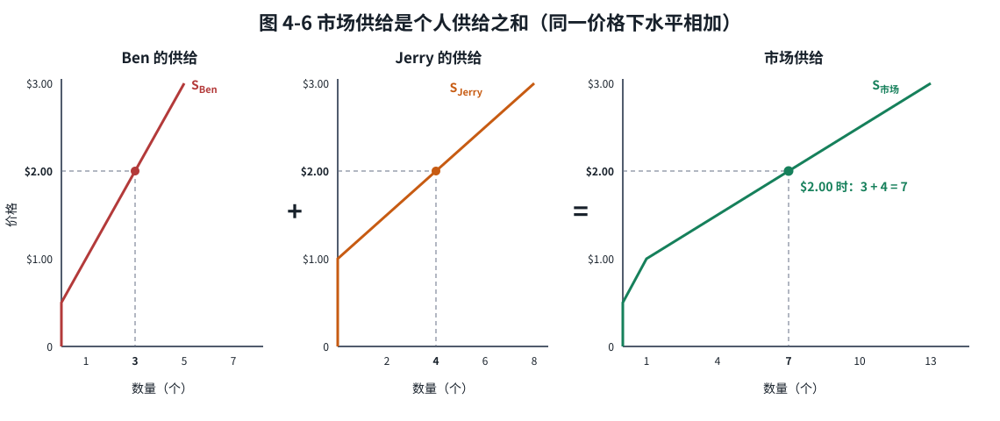

# 供给曲线与市场加总：价格与卖者愿意出售的数量

| | |
|---|---|
| 表面 | Book |
| 用时 | 约 11 分钟 |
| 原书 | 曼昆《经济学原理》微观分册第 8 版 · 第 4 章 · 4.3.1–4.3.2（图 4-5、图 4-6） |
| 本章深度 | 会读表、会加总 |
| 导航 | [学习台](../README.md) · [上一页](03_demand_shifts.md) · [下一页](05_supply_shifts.md) |

## 学完你能做什么

- 区分供给、供给量、供给表与供给曲线。
- 对照曼昆图 4-5，用 Ben 的供给表和供给曲线说明供给定理。
- 对照曼昆图 4-6，在每个既定价格下水平加总 Ben 与 Jerry 的供给量。

## 概念讲解

### 供给量、供给定理与 Ben 的供给曲线（图 4-5）

**供给量（quantity supplied）** 是卖者**愿意并且能够**出售的一种物品的数量。冰淇淋价格较高时，卖冰淇淋有利可图，卖者愿意延长工作时间、添置多台冰淇淋机并雇用更多工人，供给量较大；相反，价格较低时获利微薄，卖者减少供应；价格过低时，一些卖者甚至选择停止营业，供给量降为 $0$。

价格与供给量之间的这种普遍正向关系称为 **供给定理（law of supply）**：在其他条件不变时，一种物品价格上升，该物品供给量增加；价格下降，该物品供给量减少。

在影响生产者出售意愿的其他因素都保持不变的情况下，表示价格与供给量关系的表格称为 **供给表（supply schedule）**；把价格画在纵轴、数量画在横轴连接而成的图形称为 **供给曲线（supply curve）**。由于其他条件相同时价格越高意味着供给量越多，供给曲线向右上方倾斜。

*图：曼昆图 4-5。当价格低于 $\$1.00$ 时，Ben 完全不供给冰淇淋（供给量为 $0$）；随着价格上升，供给量逐步增加——如价格从 $\$2.00$ 升至 $\$2.50$ 时，Ben 的供给量沿供给曲线从 $3$ 个增至 $4$ 个。*

### 市场供给与个人供给：同一价格下水平相加（图 4-6）

正如市场需求是所有买者需求的总和，**市场供给（market supply）** 也是所有卖者供给的总和。假设冰淇淋市场上只有两个生产者——Ben 和 Jerry。原书图 4-6 给出的市场加总关系与买方完全对称：在**每一种既定价格水平**下，

$$\text{市场供给量} = \text{Ben 的供给量} + \text{Jerry 的供给量}$$

| 每个冰淇淋蛋卷价格（美元） | Ben 供给量（个） | $+$ | Jerry 供给量（个） | $=$ | 市场供给量（个） |
|---:|---:|:---:|---:|:---:|---:|
| $0.00$ | $0$ | $+$ | $0$ | $=$ | $0$ |
| $0.50$ | $0$ | $+$ | $0$ | $=$ | $0$ |
| $1.00$ | $1$ | $+$ | $0$ | $=$ | $1$ |
| $1.50$ | $2$ | $+$ | $2$ | $=$ | $4$ |
| $2.00$ | $3$ | $+$ | $4$ | $=$ | $7$ |
| $2.50$ | $4$ | $+$ | $6$ | $=$ | $10$ |
| $3.00$ | $5$ | $+$ | $8$ | $=$ | $13$ |

在价格为 $\$2.00$ 时，Ben 供给 $3$ 个，Jerry 供给 $4$ 个，市场供给量就是 $3 + 4 = 7$ 个；在 $\$2.50$ 时为 $4 + 6 = 10$ 个；在 $\$1.50$ 时为 $2 + 2 = 4$ 个。

*图：曼昆图 4-6。固定纵轴上的任一价格，把个人供给曲线横轴上标出的个人供给量水平相加，即得出市场供给曲线（如 $\$2.00$ 时 $3 + 4 = 7$ 个）。*

注意观察图 4-6 右侧的市场供给曲线：在 $\$1.00$ 时只有 Ben 供给 $1$ 个、Jerry 仍为 $0$；价格超过 $\$1.00$ 后 Jerry 也开始供应，因此市场供给曲线在 $\$1.00$ 之上变得更平缓（价格每涨 $\$0.50$，市场总供给量多出 $1 + 2 = 3$ 个）。和需求一样，**水平相加**始终是固定纵轴价格加横轴数量，不能把不同价格行的数量混加，也不能把价格相加。

> [!NOTE]
> **标注 · 课本例子**  
> Ben 在价格低于 $\$1.00$ 时供给量为 $0$，$\$2.00$ 时供给 $3$ 个；Jerry 在 $\$1.00$ 及以下供给量为 $0$，$\$2.00$ 时供给 $4$ 个。市场供给量在 $\$1.50$、$\$2.00$、$\$2.50$ 时分别为 $4$、$7$、$10$ 个。

> [!WARNING]
> **注意**  
> 「价格上升使卖者多提供冰淇淋」是沿着同一条供给曲线向上移动（**供给量增加**），不等于「供给曲线右移」。曲线本身移不移，要看下一页的投入品价格、技术等轴外条件。

> [!TIP]
> **关键术语**  
> **供给量**：卖者愿意并且能够出售的一种物品的数量。  
> **供给定理**：其他条件不变时，一种物品价格上升则供给量增加，价格下降则供给量减少。  
> **市场供给**：每一种既定价格下所有卖者供给量的水平加总。

> [!IMPORTANT]
> **深度解析**  
> 供给曲线同样是一张「其他条件不变」下的计划表：它回答在每种价格下卖者**愿意并且能够**卖多少，还不能单独决定最终真正成交多少。实际成交价格和成交量，要等第 06 页把市场需求曲线与市场供给曲线结合起来才能确定。

## 小测验

### B04-1 · 选择

价格为 $\$2.50$ 时，Ben、Jerry 和市场的供给量分别是多少？

- A. $2$、$2$、$4$
- B. $3$、$4$、$7$
- C. $4$、$6$、$10$
- D. $5$、$8$、$13$

要点

C。在同一价格 $\$2.50$ 下把两人的供给量水平相加：$4 + 6 = 10$ 个。

### B04-2 · 简答

为什么供给曲线向右上方倾斜，而需求曲线向右下方倾斜？市场供给曲线在图 4-6 中是怎么从个人曲线得出的？

要点

其他条件不变时，更高价格使出售更有利可图，卖者愿意多雇人、多用设备，供给量增加，因此供给曲线向右上方倾斜；而更高价格使买者减少购买，因此需求曲线向右下方倾斜。把每一个既定价格下所有卖者横轴上的个人供给量水平相加，就得到市场供给曲线。

## 费曼输出（学完自己讲）

**一句：** 供给表和供给曲线表示其他条件不变时价格与供给量的同向关系，市场供给由个人供给在同一价格下水平相加得到。  
**术语：** 供给量=卖者愿意并且能够出售的数量。你补：市场供给= ______  
**例子：** $\$2.00$ 时 Ben 为 $3$、Jerry 为 $4$。你补关键一步：市场供给量是多少，图上怎样相加？______  
**提醒：** 供给量是既定价格下愿卖的数量，既不等于整条供给曲线，也不等于尚未结合需求前的成交量。

## 本页带走

其他条件不变时，价格越高、供给量越多，因此供给曲线向右上方倾斜（图 4-5）。由个人供给得到市场供给的方法也是逐价格水平相加（图 4-6）：$\$1.50$ 时为 $2 + 2 = 4$，$\$2.00$ 时为 $3 + 4 = 7$，$\$2.50$ 时为 $4 + 6 = 10$。

下一页改变卖者面对的轴外条件：[供给曲线的移动](05_supply_shifts.md)。

掌握路径上，本页对应 [C4-R07](../PRACTICE.md#c4-r07)。
