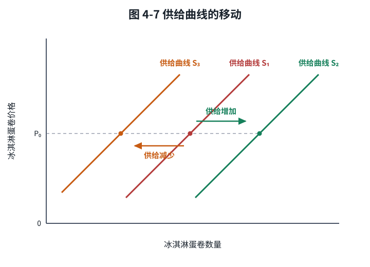

# 供给曲线的移动：成本、技术、预期与卖者数量

| | |
|---|---|
| 表面 | Book |
| 用时 | 约 13 分钟 |
| 原书 | 曼昆《经济学原理》微观分册第 8 版 · 第 4 章 · 4.3.3（表 4-2、图 4-7） |
| 本章深度 | 会判断 |
| 导航 | [学习台](../README.md) · [上一页](04_supply_curve.md) · [下一页](06_equilibrium.md) |

## 学完你能做什么

- 用供给函数把「沿供给曲线移动」与「整条供给曲线移动」分开。
- 用投入品价格、技术、预期和卖者数量四类因素判断供给曲线左移还是右移（图 4-7）。
- 对照曼昆表 4-2，严谨区分「供给变动」与「供给量变动」。

## 概念讲解

### 供给函数：区分自身价格与轴外成本参数

市场供给曲线画在 $(Q, P)$ 平面上时，固定了所有非价格的供给决定因素。把影响卖者出售决策的核心变量全部写出来，得到 **供给函数**：

$$Q^s = S(P,\; P_{\text{input}},\; \text{Tech},\; E,\; N_{\text{sellers}})$$

其中 $P$ 是本物品自身价格，$P_{\text{input}}$ 是投入品价格，$\text{Tech}$ 是生产技术，$E$ 是卖者对未来的预期，$N_{\text{sellers}}$ 是市场上的卖者数量。

据此直接判定图形动作：

- **沿着供给曲线移动（供给量变动）**：只有纵轴变量 $P$ 改变（$\Delta P \neq 0$），其余参数 $(P_{\text{input}}, \text{Tech}, E, N_{\text{sellers}})$ 不变，例如冰淇淋从 $\$2.00$ 升到 $\$2.50$ 时市场供给量从 $7$ 增至 $10$。
- **供给曲线本身移动（供给变动）**：括号里任一轴外变量变化，使**每一种既定价格 $P_0$** 下卖者愿意并且能够提供的数量都改变——每种价格下提供更多（$\Delta Q^s|_{P_0} > 0$）称为 **供给增加**，曲线从 $S_1$ 右移到 $S_2$；每种价格下提供更少（$\Delta Q^s|_{P_0} < 0$）称为 **供给减少**，曲线从 $S_1$ 左移到 $S_3$。

*图：曼昆图 4-7。在任意既定价格 $P_0$ 下，使供给量增加的任何变动都会使供给曲线向右移至 $S_2$；使供给量减少的任何变动都会使供给曲线向左移至 $S_3$。*

### 四类轴外供给移动因素

1. **投入品价格（$P_{\text{input}}$）**  
   生产冰淇淋需要奶油、糖、香料、冰淇淋机、店面建筑和工人劳动。供给量与投入品价格**负相关**（$\Delta Q^s / \Delta P_{\text{input}} < 0$）：
   - 糖价下降 → 单位生产成本降低，卖冰淇淋更有利可图 → 每种价格下供给更多，供给曲线**右移**。
   - 奶油、糖或工资上涨 → 利润空间压缩 → 每种价格下供给减少，供给曲线**左移**（成本极端高企时甚至停产）。

2. **技术（$\text{Tech}$）**  
   把投入转化为冰淇淋的技术决定企业成本。课本例子：**机械化冰淇淋机**的发明减少了生产每一蛋卷所需的劳动投入，降低了企业成本，使卖者在任意既定价格下愿意提供更多，供给曲线**右移**。

3. **预期（$E$）**  
   企业今天供给多少，取决于对未来的判断。若企业预期未来冰淇淋价格会上升，就会把一部分当前产出的冰淇淋先送进冷库储存留待将来高价出售，从而使**当前市场供给减少**（供给曲线左移）。

4. **卖者数量（$N_{\text{sellers}}$）**  
   市场供给由全体卖者水平加总（$Q^s_{\text{market}} = \sum_{i=1}^{N_{\text{sellers}}} Q^s_i$）。如果 Ben 退休退出冰淇淋生意，每种价格下的市场供给量都会少掉 Ben 的那一份，市场供给曲线**左移**；新店铺进入则使市场供给曲线**右移**。

### 曼昆表 4-2：影响卖者的变量汇总

| 变量 | 该变量的一场变动会…… | 课本情景对照 |
|---|---|---|
| **物品自身的价格（$P$）** | **表现为沿着供给曲线的移动** | 冰淇淋零售价从 $\$2.00$ 升至 $\$2.50$，供给量从 $7$ 增至 $10$ |
| **投入品价格（$P_{\text{input}}$）** | 使供给曲线移动 | 糖价下降使供给右移；糖、奶油或劳动涨价使供给左移 |
| **技术（$\text{Tech}$）** | 使供给曲线移动 | 机械化冰淇淋机节省劳动、降低成本，使供给右移 |
| **预期（$E$）** | 使供给曲线移动 | 预期未来涨价而入库惜售，使当前供给左移 |
| **卖者数量（$N_{\text{sellers}}$）** | 使供给曲线移动 | Ben 或 Jerry 退出使市场供给左移 |

> [!NOTE]
> **标注 · 课本例子**  
> 糖价下降与机械化冰淇淋机减少用工，都会使冰淇淋供给曲线右移；预期未来涨价而储存冰淇淋，或 Ben 退休退出市场，都会使当前供给曲线左移。

> [!WARNING]
> **注意**  
> 不要把「糖价上升」写成「冰淇淋供给量减少（沿曲线移动）」，也不要把「冰淇淋涨价」写成「冰淇淋供给增加（曲线右移）」。先查该变量是不是纵轴上的本物品价格 $P$：是 $P$ 就沿曲线走，不是 $P$ 才平移曲线。

> [!TIP]
> **关键术语**  
> **供给增加／减少**：任意既定价格 $P_0$ 下供给量都增加／减少，整条 $S$ 右移／左移。  
> **投入品价格（$P_{\text{input}}$）**：生产本物品所需原料、设备、劳动等要素价格，满足 $\Delta Q^s / \Delta P_{\text{input}} < 0$。  
> **当前供给**：现期愿意并且能够投放到市场的数量，会受跨期储存预期影响。

> [!IMPORTANT]
> **深度解析**  
> 代数上，若原线性供给方程为 $Q^s = c + dP$，糖价下降或技术进步相当于截距项 $c$ 增大（例如从 $-5 + 6P$ 变为 $1 + 6P$），同一价格 $P$ 下 $Q^s$ 全面变大；而冰淇淋自身价格 $P$ 变动只是代进同一个方程求不同的 $Q^s$。

## 小测验

### B05-1 · 选择

糖是冰淇淋的投入品。糖价下降（$\Delta P_{\text{input}} < 0$），其他条件不变，冰淇淋市场首先发生什么？

- A. 需求曲线右移
- B. 需求曲线左移
- C. 供给曲线右移
- D. 沿固定供给曲线向上移动

要点

C。糖价属于轴外投入品价格 $P_{\text{input}}$。糖价下降降低生产成本，使每一种既定冰淇淋价格下的供给量都增加，整条供给曲线向右移动。

### B05-2 · 简答

对照曼昆表 4-2，「冰淇淋价格上升使供给增加」这句话错在哪里？应该怎样改？

要点

在其他条件不变时，冰淇淋自身价格 $P$ 已在纵轴上，它的上升只会引起**供给量增加**（沿固定的供给曲线向上移动）。「供给增加」专指投入品降价、技术进步、卖者增加等轴外因素引起整条供给曲线右移。

## 费曼输出（学完自己讲）

**一句：** 在 $Q^s = S(P, P_{\text{input}}, \text{Tech}, E, N_{\text{sellers}})$ 中，自身价格 $P$ 改变供给量并沿曲线走，其余四类变量改变整条供给曲线。  
**术语：** 供给增加=每种价格下都愿卖更多，曲线右移。你补：供给量增加= ______  
**例子：** 机械化冰淇淋机与预期未来涨价。你补关键一步：这两个事件分别让当前供给曲线往哪边移？______  
**提醒：** 投入品价格与供给反向变动（成本升则供给左移），本物品价格与供给量同向变动。

## 本页带走

表 4-2 与表 4-1 结构完全对称：本物品价格 $P$ 在纵轴上，变动时沿供给曲线走；投入品价格 $P_{\text{input}}$、技术 $\text{Tech}$、预期 $E$ 和卖者数量 $N_{\text{sellers}}$ 在轴外，变动时平移整条供给曲线。

下一页把市场需求与市场供给画在同一张图上：[均衡、过剩与短缺](06_equilibrium.md)。

掌握路径上，本页对应 [C4-R08](../PRACTICE.md#c4-r08)。
