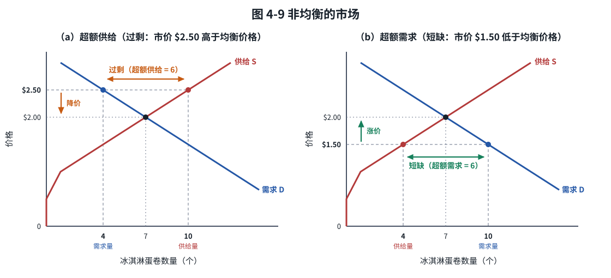

# 均衡、过剩与短缺：价格为什么有调整压力

| | |
|---|---|
| 表面 | Book |
| 用时 | 约 15 分钟 |
| 原书 | 曼昆《经济学原理》微观分册第 8 版 · 第 4 章 · 4.4.1（图 4-8、图 4-9） |
| 本章深度 | 会用 |
| 导航 | [学习台](../README.md) · [上一页](05_supply_shifts.md) · [下一页](07_three_steps.md) |

## 学完你能做什么

- 写出市场均衡条件 $Q^d(P^*) = Q^s(P^*)$，既能从供求表找交点，也能解线性供求方程组。
- 用不等式定义超额供给（过剩）与超额需求（短缺），对照图 4-9 讲清价格调整方向。
- 解释市场从非均衡回归均衡时，为什么买卖双方只是沿固定曲线移动而非平移曲线。

## 概念讲解

### 市场均衡：图上交点与代数联立解

把第 02 页的市场需求曲线与第 04 页的市场供给曲线画在同一张坐标图上，两条曲线相交于一点。这一点就是 **市场均衡（equilibrium）**——现行市场价格恰好使买者愿意并且能够购买的数量等于卖者愿意并且能够出售的数量：

$$Q^d(P^*) = Q^s(P^*) = Q^*$$

其中 $P^*$ 称为 **均衡价格（市场出清价格，market-clearing price）**，$Q^*$ 称为 **均衡数量**。在均衡价格下，每个想按该价买的买者都买得到，每个想按该价卖的卖者都卖得出，既无积压也无断货。

| 价格 $P$（美元／个） | 市场需求量 $Q^d$（个） | 市场供给量 $Q^s$（个） | 差额与市场状态 | 价格压力 |
|---:|---:|---:|---|---|
| $1.00$ | $13$ | $1$ | $Q^d - Q^s = 12$（短缺 $12$） | 上升 $\uparrow$ |
| $1.50$ | $10$ | $4$ | $Q^d - Q^s = 6$（短缺 $6$） | 上升 $\uparrow$ |
| **$2.00$** | **$7$** | **$7$** | **$Q^d = Q^s = 7$（均衡）** | **无调整压力** |
| $2.50$ | $4$ | $10$ | $Q^s - Q^d = 6$（过剩 $6$） | 下降 $\downarrow$ |
| $3.00$ | $1$ | $13$ | $Q^s - Q^d = 12$（过剩 $12$） | 下降 $\downarrow$ |

*图：曼昆图 4-8。市场需求曲线 $D$ 与市场供给曲线 $S$ 在 $P^* = \$2.00$、$Q^* = 7$ 个处相交。注意均衡数量是两侧共同等于 $7$，绝不是 $7 + 7 = 14$。*

#### 线性供求方程组的通解与课本验算

在定量计算中，设线性需求与线性供给分别为：

$$Q^d = a - bP \quad (b > 0), \qquad Q^s = c + dP \quad (d > 0)$$

代入均衡条件 $Q^d(P^*) = Q^s(P^*)$：

$$a - bP^* = c + dP^* \implies (b + d)P^* = a - c \implies P^* = \frac{a - c}{b + d}, \qquad Q^* = a - bP^* = \frac{ad + bc}{b + d}$$

用课本冰淇淋市场的精确线性式（$P \ge \$1.00$ 区间）直接验算：
- 市场需求（Catherine $+$ Nicholas）：每涨 $\$0.50$ 少买 $3$ 个，即 $Q^d = 19 - 6P$（$a = 19,\; b = 6$）。
- 市场供给（Ben $+$ Jerry）：每涨 $\$0.50$ 多卖 $3$ 个，即 $Q^s = -5 + 6P$（$c = -5,\; d = 6$）。
- 联立求解：

$$19 - 6P^* = -5 + 6P^* \implies 12P^* = 24 \implies P^* = \frac{19 - (-5)}{6 + 6} = \$2.00, \qquad Q^* = 19 - 6(2.00) = 7$$

与表和图 4-8 的交点分毫不差。

### 非均衡市场：过剩、短缺与供求定理

如果市场价格暂时偏离 $P^*$，买卖意愿不再匹配，图 4-9 的两个分图展示了两种非均衡状态及其自发修正过程：

1. **图 4-9（a）超额供给／过剩（surplus / excess supply）**  
   当现行价格高于均衡价格（$P > P^*$）时，供给量大于需求量：

   $$P > P^* \implies \text{过剩量} = Q^s(P) - Q^d(P) > 0$$

   课本数字：在 $P = \$2.50$ 时，$Q^s = 10$，$Q^d = 4$，出现 $10 - 4 = 6$ 个蛋卷的**过剩**。卖者冰柜里堆满卖不掉的冰淇淋，为了清掉库存纷纷削价竞争。随着价格向 $\$2.00$ 回落，买者**沿需求曲线**把购买量从 $4$ 增加到 $7$，卖者**沿供给曲线**把供给量从 $10$ 缩减到 $7$，直到过剩消除。

2. **图 4-9（b）超额需求／短缺（shortage / excess demand）**  
   当现行价格低于均衡价格（$P < P^*$）时，需求量大于供给量：

   $$P < P^* \implies \text{短缺量} = Q^d(P) - Q^s(P) > 0$$

   课本数字：在 $P = \$1.50$ 时，$Q^d = 10$，$Q^s = 4$，出现 $10 - 4 = 6$ 个蛋卷的**短缺**。太多买者追逐太少冰淇淋、门口排起长队，卖者发现提价也不会丢掉生意，于是上调价格。随着价格向 $\$2.00$ 回升，买者**沿需求曲线**把需求量从 $10$ 减到 $7$，卖者**沿供给曲线**把供给量从 $4$ 增到 $7$，市场重新回到均衡。

*图：曼昆图 4-9。图（a）价格 $\$2.50 > \$2.00$ 造成 $6$ 个过剩，推动价格下行；图（b）价格 $\$1.50 < \$2.00$ 造成 $6$ 个短缺，推动价格上行。两条曲线在整个回归过程中都保持不动。*

把这两种自发力量合起来，就是曼昆提出的 **供求定理（law of supply and demand）**：任何一种物品的价格都会自发调整，使该物品的供给与需求趋向平衡。

> [!NOTE]
> **标注 · 课本例子**  
> 冰淇淋均衡点：$P^* = \$2.00$，$Q^* = 7$ 个。$P = \$2.50$ 时供给 $10$、需求 $4$，过剩 $6$ 个并降价；$P = \$1.50$ 时需求 $10$、供给 $4$，短缺 $6$ 个并涨价。课本还对比了「稀缺性（scarcity）」与「短缺（shortage）」：大多数物品天生稀缺，但短缺只发生在现行价格低于均衡价格之时，一旦提价到 $P^*$ 短缺就会消失。

> [!WARNING]
> **注意**  
> 报出过剩或短缺时必须指明「在哪个价格下」，并且千万不要把「因为过剩而降价、需求量从 $4$ 升至 $7$」说成「需求曲线右移」——这里变的只是纵轴上的价格 $P$，两条曲线丝毫未动。

> [!TIP]
> **关键术语**  
> **均衡（$P^*, Q^*$）**：满足 $Q^d(P^*) = Q^s(P^*) = Q^*$ 的价格与数量组合。  
> **过剩（超额供给）**：$P > P^*$ 时 $Q^s(P) - Q^d(P) > 0$，产生降价压力。  
> **短缺（超额需求）**：$P < P^*$ 时 $Q^d(P) - Q^s(P) > 0$，产生涨价压力。  
> **供求定理**：自由变动的价格会调整到使供给量等于需求量。

> [!IMPORTANT]
> **深度解析**  
> 供求定理成立的前提是价格允许自由调整。如果政府用法律强行规定价格不许高于 $\$1.50$（价格上限）或不许低于 $\$2.50$（价格下限），图 4-9 中的短缺或过剩就会长期存续无法自动消除——这正是第 6 章分析价格管制的直接起点。

## 小测验

### B06-1 · 计算

设某竞争市场的需求为 $Q^d = 28 - 4P$，供给为 $Q^s = -2 + 6P$。求均衡价格 $P^*$ 与均衡数量 $Q^*$；若现行价格为 $P = 2$，市场出现过剩还是短缺，差额是多少？

要点

联立 $28 - 4P^* = -2 + 6P^* \Rightarrow 10P^* = 30 \Rightarrow P^* = 3$，代入得 $Q^* = 28 - 4(3) = 16$。当 $P = 2 < P^*$ 时，$Q^d(2) = 20$，$Q^s(2) = 10$，出现超额需求（短缺）$20 - 10 = 10$ 单位，价格有上涨压力。

### B06-2 · 简答

冰淇淋市场从 $\$2.50$ 降回 $\$2.00$ 的过程中，需求量和供给量各怎样变？为什么两条曲线不需要重画？

要点

价格从 $\$2.50$ 降到 $\$2.00$ 时，买者沿固定需求曲线把需求量从 $4$ 增加到 $7$，卖者沿固定供给曲线把供给量从 $10$ 减少到 $7$。因为收入、偏好、糖价、技术等所有轴外条件都没有改变，动的只是纵轴上的自身价格 $P$，所以两条曲线都不移动。

## 费曼输出（学完自己讲）

**一句：** 市场均衡满足 $Q^d(P^*) = Q^s(P^*)$；$P > P^*$ 产生过剩压低价格，$P < P^*$ 产生短缺推高价格。  
**术语：** 线性系统 $Q^d = a - bP,\; Q^s = c + dP$ 的均衡价格通解 $P^* =$ ______  
**例子：** 冰淇淋在 $\$1.50$ 时需求 $10$、供给 $4$。你补关键一步：这是过剩还是短缺？涨价回 $\$2.00$ 时两条曲线移不移？______  
**提醒：** 稀缺性是常态，而短缺只是现行价格低于均衡价格时的暂时失衡。

## 本页带走

市场均衡由 $Q^d(P^*) = Q^s(P^*)$ 决定（课本冰淇淋市场 $19 - 6P^* = -5 + 6P^* \Rightarrow P^* = \$2.00,\; Q^* = 7$）。高于 $P^*$ 出现过剩（$\$2.50$ 时过剩 $6$）驱动降价，低于 $P^*$ 出现短缺（$\$1.50$ 时短缺 $6$）驱动涨价；调整过程均沿着既定的需求与供给曲线完成。

下一页引入破坏旧均衡的外部冲击：[分析均衡变动的三个步骤](07_three_steps.md)。

掌握路径上，本页对应 [C4-R09](../PRACTICE.md#c4-r09)。
