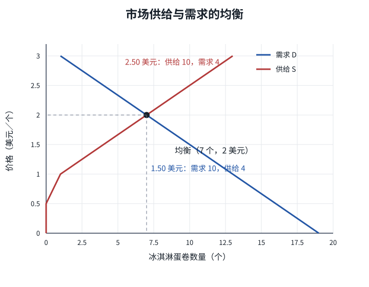

# 均衡、过剩与短缺：价格为什么有调整压力

| | |
|---|---|
| 表面 | Book |
| 用时 | 约 13 分钟 |
| 原书 | 曼昆《经济学原理》微观分册第 8 版 · 第 4 章 · 4.4.1 |
| 本章深度 | 会用 |
| 导航 | [学习台](../README.md) · [上一页](05_supply_shifts.md) · [下一页](07_three_steps.md) |

## 学完你能做什么

- 从市场表找出均衡价格与均衡数量。
- 计算过剩或短缺，并讲清价格调整机制。
- 解释回归均衡时为什么是沿两条曲线移动，而不是曲线移动。

## 概念讲解

把市场需求表和市场供给表放在一起，就能比较每个价格下双方愿意交易的数量。

| 价格（美元／个） | 市场需求量（个） | 市场供给量（个） | 市场状态 |
|---:|---:|---:|---|
| 1.00 | 13 | 1 | 短缺 12 |
| 1.50 | 10 | 4 | 短缺 6 |
| 2.00 | 7 | 7 | 均衡 |
| 2.50 | 4 | 10 | 过剩 6 |
| 3.00 | 1 | 13 | 过剩 12 |

**均衡**是市场价格使需求量与供给量相等的状态。交点对应的价格是 **均衡价格**，数量是 **均衡数量**。本例为 2 美元和 7 个。7 不是需求量与供给量相加，而是两侧都等于 7。

*图：供给曲线与需求曲线在 2 美元、7 个处相交。2.50 美元时供给量为 10、需求量为 4；1.50 美元时则相反。*

### 价格太高：过剩推动降价

在 2.50 美元时，供给量为 10，需求量为 4，**过剩**为 `10 - 4 = 6` 个，也叫超额供给。卖者无法卖出想卖的全部冰淇淋，库存积压，于是有降价压力。

价格下降时，需求量沿需求曲线增加，供给量沿供给曲线减少，差距缩小，直到 2 美元时两侧都为 7。

### 价格太低：短缺推动涨价

在 1.50 美元时，需求量为 10，供给量为 4，**短缺**为 `10 - 4 = 6` 个，也叫超额需求。买者排队抢购，卖者即使提价也能卖出，于是有涨价压力。

价格上升时，需求量沿需求曲线减少，供给量沿供给曲线增加，直到重新相等。

这种自发调整称为 **供求定理**：物品价格会调整，使供给与需求趋向平衡。不同市场的调整速度不同；「会趋向」不等于「瞬时到达」，现实中也并非所有价格都能自由调整。

> [!NOTE]
> **标注 · 课本例子**  
> 均衡：2 美元、7 个。2.50 美元：供给 10、需求 4，过剩 6。1.50 美元：需求 10、供给 4，短缺 6。

> [!WARNING]
> **注意**  
> 过剩和短缺都必须报「在哪个价格下」。只说市场上有 10 个冰淇淋，无法判断状态；要比较同一价格下的供给量与需求量。

> [!TIP]
> **关键术语**  
> **均衡价格**：使供给量与需求量相等的价格。  
> **过剩**：现行价格下供给量大于需求量。  
> **短缺**：现行价格下需求量大于供给量。  
> **供求定理**：价格调整使供给与需求趋向平衡。

> [!IMPORTANT]
> **深度解析**  
> 回归均衡的过程中，两条曲线本身不动。价格变化让买卖双方在各自既定曲线上移动。只有轴外因素变化，才需要重画曲线并寻找新均衡。

## 小测验

### B06-1 · 计算

价格为 2.50 美元和 1.50 美元时，各是过剩还是短缺？数量是多少？价格分别向哪边调整？

要点

2.50 美元时供给 10、需求 4，过剩 6，价格下降；1.50 美元时需求 10、供给 4，短缺 6，价格上升。两者都趋向 2 美元、7 个。

### B06-2 · 简答

从 2.50 美元降到 2 美元时，需求量与供给量怎样变？两条曲线为什么不需要移动？

要点

需求量从 4 沿需求曲线增至 7，供给量从 10 沿供给曲线减至 7。变化来自纵轴上的本物品价格，收入、成本等轴外条件未变，所以两条曲线都不移动。

## 费曼输出（学完自己讲）

**一句：** 高于均衡会过剩并推动降价，低于均衡会短缺并推动涨价。  
**术语：** 均衡=需求量与供给量相等。你补：短缺= ______  
**例子：** 2.50 美元时供给 10、需求 4。你补关键一步：过剩多少，降价后两量怎样变？______  
**提醒：** 均衡数量是两侧共同的 7，不是 7+7。

## 本页带走

均衡为 2 美元、7 个。2.50 美元时过剩 6并推动降价，1.50 美元时短缺 6并推动涨价。调整表现为沿两条固定曲线移动，而非曲线本身移动。

下一页处理外部事件：[分析均衡变动的三个步骤](07_three_steps.md)。

掌握路径上，本页对应 [C4-R09](../PRACTICE.md#c4-r09)。
