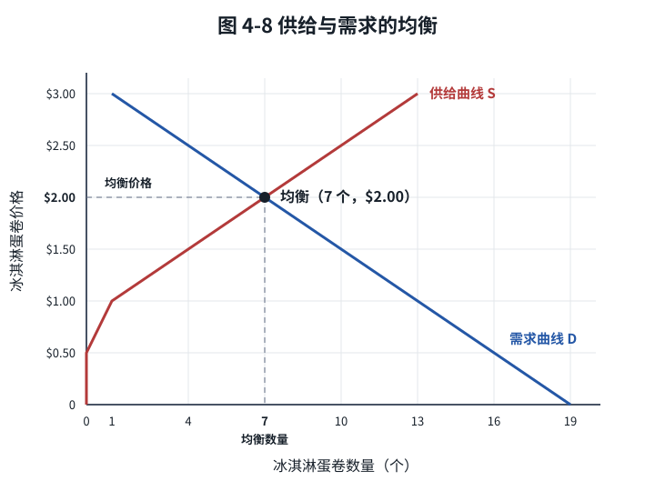

# 均衡、过剩与短缺：价格为什么有调整压力

| | |
|---|---|
| 表面 | Book |
| 用时 | 约 13 分钟 |
| 原书 | 曼昆《经济学原理》微观分册第 8 版 · 第 4 章 · 4.4.1（图 4-8、图 4-9） |
| 本章深度 | 会用 |
| 导航 | [学习台](../README.md) · [上一页](05_supply_shifts.md) · [下一页](07_three_steps.md) |

## 学完你能做什么

- 对照曼昆图 4-8，从市场供求表与供求曲线交点找出均衡价格和均衡数量。
- 对照曼昆图 4-9，计算过剩量或短缺量，并讲清价格如何自发回到均衡（供求定理）。
- 解释从非均衡回归均衡时，为什么表现为沿着两条曲线变动，而不是曲线移动。

## 概念讲解

### 市场均衡：需求曲线与供给曲线的交点（图 4-8）

分别看完市场需求（图 4-2）和市场供给（图 4-6）之后，把两张表和两条曲线放在一起，就能看出市场价格和销售量怎样确定。

两条曲线相交于一点，这一点称为市场的 **均衡（equilibrium）**。相交处的价格称为 **均衡价格（equilibrium price）**，相交处的数量称为 **均衡数量（equilibrium quantity）**。在均衡价格下，买者愿意而且能够购买的物品量，正好与卖者愿意而且能够出售的数量相平衡：

$$\text{均衡条件：}\quad \text{市场需求量} = \text{市场供给量}$$

均衡价格有时也称为 **市场出清价格（market-clearing price）**：在这一价格下，想按该价买的买者买到了想买的所有东西，想按该价卖的卖者卖出了想卖的所有东西，既没有积压也没有断货。

把前两节的冰淇淋市场需求量与市场供给量合并对照：

| 冰淇淋蛋卷价格（美元／个） | 市场需求量（个） | 市场供给量（个） | 供求差额与状态 | 价格调整压力 |
|---:|---:|---:|---|---|
| $0.00$ | $19$ | $0$ | 短缺 $19$ | 上升 |
| $0.50$ | $16$ | $0$ | 短缺 $16$ | 上升 |
| $1.00$ | $13$ | $1$ | 短缺 $12$ | 上升 |
| $1.50$ | $10$ | $4$ | 短缺 $10 - 4 = 6$ | 上升 |
| **$2.00$** | **$7$** | **$7$** | **需求量 $=$ 供给量 $= 7$（均衡）** | **平衡（无压力）** |
| $2.50$ | $4$ | $10$ | 过剩 $10 - 4 = 6$ | 下降 |
| $3.00$ | $1$ | $13$ | 过剩 $13 - 1 = 12$ | 下降 |

在这里，冰淇淋蛋卷的均衡价格为 **$\$2.00$**，均衡数量为 **$7$ 个**。注意：$7$ 个不是需求量与供给量相加（不是 $7 + 7 = 14$），而是买卖双方在该价格下的数量共同等于 $7$。

*图：曼昆图 4-8。市场供给曲线 $S$ 与市场需求曲线 $D$ 在价格 $\$2.00$、数量 $7$ 个处相交。在该均衡价格下，供给量等于需求量。*

### 非均衡的市场：过剩、短缺与供求定理（图 4-9）

当现行市场价格不等于均衡价格时，买卖双方的行为会自然而然地把市场推向均衡。图 4-9 展示了两种非均衡情况：

1. **图 4-9（a）超额供给／过剩（surplus / excess supply）——市场价格高于均衡价格**  
   当现行价格高于均衡价格时，供给量超过需求量，在现行价格下卖者无法卖出他们想卖的所有物品：

   $$\text{过剩量} = \text{市场供给量} - \text{市场需求量}$$

   在每个蛋卷 $\$2.50$ 时，供给量为 $10$ 个，需求量为 $4$ 个，存在 $10 - 4 = 6$ 个蛋卷的**过剩**。卖者发现冰柜里装满了想卖却卖不掉的冰淇淋，于是通过**降低价格**来增加销量。价格下降反过来使买者的需求量增加（$4 \to 7$）、卖者的供给量减少（$10 \to 7$）。这一调整过程表现为**沿着供给曲线和需求曲线的变动**，而不是曲线移动，直到价格降到 $\$2.00$ 达到均衡为止。

2. **图 4-9（b）超额需求／短缺（shortage / excess demand）——市场价格低于均衡价格**  
   当现行价格低于均衡价格时，需求量超过供给量，在现行价格下买者无法买到他们想买的所有物品：

   $$\text{短缺量} = \text{市场需求量} - \text{市场供给量}$$

   在每个蛋卷 $\$1.50$ 时，需求量为 $10$ 个，供给量为 $4$ 个，存在 $10 - 4 = 6$ 个蛋卷的**短缺**。买者不得不排长队抢购有限的几个蛋卷；太多买者追逐太少物品，卖者可以提高价格而不会损失销量。价格上升引起需求量减少（$10 \to 7$）、供给量增加（$4 \to 7$），同样表现为**沿着供给曲线和需求曲线的变动**，把市场推回 $\$2.00$、$7$ 个的均衡。

*图：曼昆图 4-9。（a）$\$2.50$ 高于均衡价格，供给量 $10$ 超过需求量 $4$，过剩 $6$ 个推动卖者降价；（b）$\$1.50$ 低于均衡价格，需求量 $10$ 超过供给量 $4$，短缺 $6$ 个使卖者提价。两种情况下价格调整都沿着固定的 $D$ 和 $S$ 回到均衡。*

因此，无论起初价格偏高还是偏低，众多买者与卖者的活动都会自发把市场价格推向均衡价格。在大多数自由市场中，过剩与短缺都只是暂时的（达到均衡的快慢取决于各市场价格调整的速度）。这一普遍规律称为 **供求定理（law of supply and demand）**：任何一种物品的价格都会自发调整，使该物品的供给与需求达到平衡。

> [!NOTE]
> **标注 · 课本例子**  
> 冰淇淋市场均衡：$\$2.00$、$7$ 个。$\$2.50$ 时供给 $10$、需求 $4$，过剩 $6$ 个并降价；$\$1.50$ 时需求 $10$、供给 $4$，短缺 $6$ 个并涨价。

> [!WARNING]
> **注意**  
> 第一，说「过剩」或「短缺」必须指明是在哪个现行价格下比较供给量与需求量；第二，不要把第 1 章的**稀缺性**与这里的**短缺**混为一谈——大多数物品因为资源有限而永远稀缺，但短缺只发生在现行价格低于均衡价格之时，一旦价格涨回均衡水平，短缺就会消失。

> [!TIP]
> **关键术语**  
> **均衡**：市场价格达到使供给量与需求量相等的水平时的状态。  
> **过剩（超额供给）**：供给量大于需求量的状态（发生于现行价格高于均衡价格时）。  
> **短缺（超额需求）**：需求量大于供给量的状态（发生于现行价格低于均衡价格时）。  
> **供求定理**：任何一种物品的价格都会自发调整，使该物品的供给与需求达到平衡。

> [!IMPORTANT]
> **深度解析**  
> 为什么消除过剩或短缺时两条曲线都不移动？因为降价或涨价改变的只是纵轴上的本物品价格，买者的收入、偏好和卖者的糖价、技术等轴外条件全都未变。反过来，如果法律强行禁止价格调整（如第 6 章将学的价格上限与价格下限），图 4-9 中的短缺或过剩就无法自发消除。

## 小测验

### B06-1 · 计算

冰淇淋价格为 $\$2.50$ 和 $\$1.50$ 时，市场各处于过剩还是短缺？差额各是多少个？价格分别向哪边调整？

要点

$\$2.50$ 时供给量 $10$、需求量 $4$，出现过剩 $10 - 4 = 6$ 个，价格下降；$\$1.50$ 时需求量 $10$、供给量 $4$，出现短缺 $10 - 4 = 6$ 个，价格上升。两者最终都趋向 $\$2.00$、$7$ 个的均衡。

### B06-2 · 简答

从 $\$2.50$ 降回 $\$2.00$ 的过程中，需求量与供给量各怎样变化？为什么两条曲线不需要移动？

要点

价格从 $\$2.50$ 降到 $\$2.00$ 时，需求量沿需求曲线从 $4$ 增至 $7$，供给量沿供给曲线从 $10$ 减至 $7$。变化完全来自纵轴上的本物品自身价格，收入、爱好、糖价、技术等轴外因素均未改变，因此两条曲线本身都不移动。

## 费曼输出（学完自己讲）

**一句：** 价格高于均衡会出现过剩并推动降价，价格低于均衡会出现短缺并推动涨价，直到需求量等于供给量。  
**术语：** 均衡=市场价格使供给量与需求量相等的状态。你补：短缺= ______  
**例子：** $\$2.50$ 时供给量 $10$、需求量 $4$。你补关键一步：过剩多少个？降价回到 $\$2.00$ 时两量怎样变？______  
**提醒：** 均衡数量是买卖双方共同达到的 $7$ 个，不是 $7 + 7 = 14$ 个。

## 本页带走

市场均衡位于供求曲线交点（图 4-8：$\$2.00$、$7$ 个，需求量 $=$ 供给量）。高于均衡价格时过剩（图 4-9a：$\$2.50$ 时过剩 $6$）推动降价，低于均衡价格时短缺（图 4-9b：$\$1.50$ 时短缺 $6$）推动涨价；整个回归过程都沿着固定的需求曲线与供给曲线完成。

下一页引入改变曲线位置的外部事件：[分析均衡变动的三个步骤](07_three_steps.md)。

掌握路径上，本页对应 [C4-R09](../PRACTICE.md#c4-r09)。
