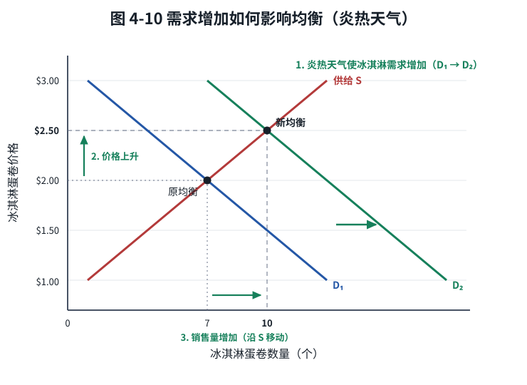
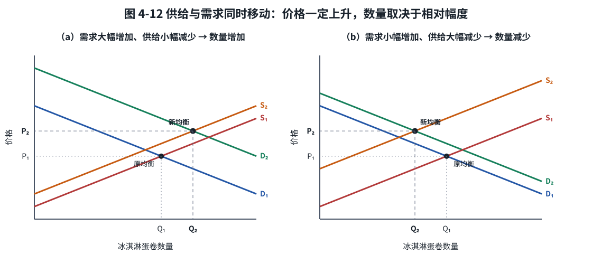

# 分析均衡变动的三个步骤：先移曲线，再比新旧均衡

| | |
|---|---|
| 表面 | Book |
| 用时 | 约 17 分钟 |
| 原书 | 曼昆《经济学原理》微观分册第 8 版 · 第 4 章 · 4.4.2（图 4-10～4-12、表 4-3） |
| 本章深度 | 会用 |
| 导航 | [学习台](../README.md) · [上一页](06_equilibrium.md) · [下一页](08_price_allocation.md) |

## 学完你能做什么

- 用比较静态「三个步骤」分析需求单移动（图 4-10）、供给单移动（图 4-11）和双移动（图 4-12）。
- 用线性供求方程的截距变动式验算 $P^*$ 与 $Q^*$ 的变化方向，解释双移动为何必有一项不确定。
- 不靠死记硬背，自己推导出曼昆表 4-3 的 $3 \times 3$ 九宫格结论，并严格区分「供给增加」与「供给量增加」。

## 概念讲解

### 比较静态分析的三个固定步骤

均衡价格和均衡数量取决于供求曲线的位置。一旦外部事件改变了某个背景因素，经济学家用 **比较静态分析（comparative statics）** 比较旧均衡与新均衡，固定走三步：

1. **定曲线**：确定该事件使需求曲线移动、使供给曲线移动，还是使两条曲线都移动。
2. **定方向**：确定曲线是向右移动（增加）还是向左移动（减少）。
3. **比均衡**：用供求图（或联立方程）比较原均衡与新均衡，说明均衡价格 $P^*$ 和均衡数量 $Q^*$ 如何变动。

#### 代数方向核验公式（与图形一一对应）

在线性系统 $Q^d = a - bP$、$Q^s = c + dP$（$b, d > 0$）中，记需求冲击为 $\Delta a$（右移 $\Delta a > 0$，左移 $\Delta a < 0$），供给冲击为 $\Delta c$（右移 $\Delta c > 0$，左移 $\Delta c < 0$），对上页通解求差分立得：

$$\Delta P^* = \frac{\Delta a - \Delta c}{b + d}, \qquad \Delta Q^* = \frac{d\,\Delta a + b\,\Delta c}{b + d}$$

下面三个课本经典案例，既可以用图走三步，也可以用这一行式子瞬间验算。

---

### 例一：需求变动——炎热天气如何影响冰淇淋市场（图 4-10）

假设今年夏天天气异常炎热：

- **第一步（定曲线）**：炎热改变消费者的偏好 $T$（任意价格下更想吃冰淇淋），影响**需求曲线**；天气不直接改变制造冰淇淋的投入成本，**供给曲线不变**（$\Delta c = 0$）。
- **第二步（定方向）**：每种价格下买得更多，需求曲线从 $D_1$ **向右移动**到 $D_2$（$\Delta a > 0$）。
- **第三步（比均衡）**：在原价格 $\$2.00$ 下出现超额需求（短缺），推动价格上升。新均衡从 $(\$2.00, 7)$ 移至 $(\$2.50, 10)$——**均衡价格上升，均衡数量增加**。
- **代数核验**：原需求 $Q^d_1 = 19 - 6P$ 右移 $6$ 个单位至 $Q^d_2 = 25 - 6P$（$\Delta a = +6, \Delta c = 0$），供给仍为 $Q^s = -5 + 6P$，则 $\Delta P^* = \frac{6 - 0}{6 + 6} = +\$0.50$（$\$2.00 \to \$2.50$），$\Delta Q^* = \frac{6 \times 6 + 0}{12} = +3$（$7 \to 10$）。

*图：曼昆图 4-10。炎热天气使 $D_1$ 右移到 $D_2$，均衡价格从 $\$2.00$ 升至 $\$2.50$，均衡数量从 $7$ 增至 $10$。注意：供给曲线 $S$ 未动，卖者多卖是因为涨价后**沿 $S$ 向上移动**（供给量增加，而非供给增加）。*

---

### 例二：供给变动——台风推高糖价如何影响冰淇淋市场（图 4-11）

假设另一年夏天，一场台风摧毁了南美洲部分甘蔗田，推高了世界糖价：

- **第一步（定曲线）**：糖是制造冰淇淋的投入品（$P_{\text{input}}$ 上升），影响**供给曲线**；家庭对冰淇淋的偏好未变，**需求曲线不变**（$\Delta a = 0$）。
- **第二步（定方向）**：生产成本上升使每种价格下企业愿意出售的数量减少，供给曲线从 $S_1$ **向左移动**到 $S_2$（$\Delta c < 0$）。
- **第三步（比均衡）**：在原价格 $\$2.00$ 下出现超额需求（短缺），推动价格上升。新均衡从 $(\$2.00, 7)$ 移至 $(\$2.50, 4)$——**均衡价格上升，均衡数量减少**。
- **代数核验**：原供给 $Q^s_1 = -5 + 6P$ 左移 $6$ 个单位至 $Q^s_2 = -11 + 6P$（$\Delta a = 0, \Delta c = -6$），需求仍为 $Q^d = 19 - 6P$，则 $\Delta P^* = \frac{0 - (-6)}{12} = +\$0.50$（$\$2.00 \to \$2.50$），$\Delta Q^* = \frac{0 + 6 \times (-6)}{12} = -3$（$7 \to 4$）。

*图：曼昆图 4-11。糖价上升使 $S_1$ 左移到 $S_2$，均衡价格从 $\$2.00$ 升至 $\$2.50$，均衡数量从 $7$ 减至 $4$。注意：需求曲线 $D$ 未动，买者少买是因为涨价后**沿 $D$ 向上移动**（需求量减少，而非需求减少）。*

---

### 例三：供给与需求同时移动——热浪与台风同时发生（图 4-12）

现在假设酷暑和台风在同一个夏天发生：

- **第一步与第二步**：炎热使需求右移（$D_1 \to D_2,\; \Delta a > 0$），糖价上涨使供给左移（$S_1 \to S_2,\; \Delta c < 0$）。
- **第三步（为什么价格确定、数量不确定？）**：把符号代进差分公式一看便知：
  - **均衡价格**：$\Delta P^* = \dfrac{\overbrace{\Delta a}^{(+)} - \overbrace{\Delta c}^{(-)}}{b + d} > 0$。需求右移推高价格，供给左移**也**推高价格，两股力量同向叠加，因此**均衡价格一定上升**（$P_2 > P_1$）。
  - **均衡数量**：$\Delta Q^* = \dfrac{\overbrace{d\,\Delta a}^{(+)} + \overbrace{b\,\Delta c}^{(-)}}{b + d}$。需求右移拉高数量，供给左移压低数量，两股力量**反向对冲**！如果不给出两条曲线各自移动的具体幅度，净数量方向**不确定（ambiguous）**：
    - 若需求增加幅度远大于供给减少幅度（$d|\Delta a| > b|\Delta c|$），如图 4-12（a），均衡数量增加（$Q_2 > Q_1$）；
    - 若供给减少幅度远大于需求增加幅度（$d|\Delta a| < b|\Delta c|$），如图 4-12（b），均衡数量减少（$Q_2 < Q_1$）。

*图：曼昆图 4-12。两种情形下新价格 $P_2$ 都高于原价格 $P_1$；但图（a）需求右移占主导使 $Q_2 > Q_1$，图（b）供给左移占主导使 $Q_2 < Q_1$。*

### 曼昆表 4-3：供给与需求移动对价格和数量的影响（$3 \times 3$ 矩阵）

*注：英文原版编为 Table 3（表 4-3），部分中译本由于前文把个人与市场供求表编号，也将本表印作表 4-4；内容完全相同。*

| 需求变动 ＼ 供给变动 | **供给不变（$\Delta c = 0$）** | **供给增加（$S$ 右移，$\Delta c > 0$）** | **供给减少（$S$ 左移，$\Delta c < 0$）** |
|---|---|---|---|
| **需求不变（$\Delta a = 0$）** | $P^*$ 不变 $Q^*$ 不变 | $P^*$ 下降（$\downarrow$） $Q^*$ 增加（$\uparrow$） | $P^*$ 上升（$\uparrow$） $Q^*$ 减少（$\downarrow$） |
| **需求增加（$D$ 右移，$\Delta a > 0$）** | $P^*$ 上升（$\uparrow$） $Q^*$ 增加（$\uparrow$） | **$P^*$ 不确定**（$\uparrow$ 对冲 $\downarrow$） $Q^*$ 增加（$\uparrow$） | $P^*$ 上升（$\uparrow$） **$Q^*$ 不确定**（$\uparrow$ 对冲 $\downarrow$） |
| **需求减少（$D$ 左移，$\Delta a < 0$）** | $P^*$ 下降（$\downarrow$） $Q^*$ 减少（$\downarrow$） | $P^*$ 下降（$\downarrow$） **$Q^*$ 不确定**（$\downarrow$ 对冲 $\uparrow$） | **$P^*$ 不确定**（$\downarrow$ 对冲 $\uparrow$） $Q^*$ 减少（$\downarrow$） |

**免死记拆解法**：遇到双移动时，在草稿纸上拆成两行——先写单独需求移动对 $(P^*, Q^*)$ 的符号，再写单独供给移动对 $(P^*, Q^*)$ 的符号：**同号相加则方向确定，异号相抵则方向不确定（取决于相对移动幅度）**。

> [!NOTE]
> **标注 · 课本例子**  
> 例一热天：$D$ 右移，$P^*: \$2.00 \to \$2.50$，$Q^*: 7 \to 10$（供给量增加，供给未变）。  
> 例二台风推高糖价：$S$ 左移，$P^*: \$2.00 \to \$2.50$，$Q^*: 7 \to 4$（需求量减少，需求未变）。  
> 例三热天加台风：$D$ 右移且 $S$ 左移，$P^*$ 必升，$Q^*$ 取决于相对幅度。

> [!WARNING]
> **注意**  
> 两个最致命的失分点：第一，把热天引起涨价后的多产说成「供给也右移」，结果白白把一道单移动确定题画成双移动；第二，把「数量不确定」误解成「数量不变」——不确定是指可能增、可能减、也可能恰巧相抵不变。

> [!TIP]
> **关键术语**  
> **三个步骤**：定哪条曲线移 $\to$ 定左移或右移 $\to$ 比新旧均衡 $(P^*, Q^*)$。  
> **供给变动 vs. 供给量变动**：供给曲线位置平移叫供给变动；沿固定供给曲线滑动叫供给量变动。  
> **方向不确定（ambiguous）**：两股相反方向力量同时作用于同一变量，缺乏幅度信息时无法唯一判定增减。

> [!IMPORTANT]
> **深度解析**  
> 只要题目进一步给出具体幅度（例如 $\Delta a = +6,\; \Delta c = -2$），原本定性上「不确定」的 $\Delta Q^*$ 立刻可由 $\Delta Q^* = \frac{d\Delta a + b\Delta c}{b+d}$ 算出确定符号。所谓不确定，本质上是「纯方向信息不足以定号」。

## 小测验

### B07-1 · 简答

炎热天气使冰淇淋均衡数量从 $7$ 增至 $10$，为什么只能说「供给量增加」，绝不能说「供给增加」？

要点

炎热只改变买者偏好，使需求曲线从 $D_1$ 右移到 $D_2$；企业的投入品成本和技术都没变，供给曲线 $S$ 留在原地未动。卖者之所以愿意把提供量从 $7$ 提高到 $10$，是因为短缺把市场价格从 $\$2.00$ 推高到了 $\$2.50$，卖者沿着同一条供给曲线 $S$ 向上移动，因此叫供给量增加。

### B07-2 · 选择

如果新技术（机械化冰淇淋机）降低了冰淇淋生产成本，同时夏季异常炎热增加了消费者对冰淇淋的偏好，可以确定什么？

- A. 均衡价格一定上升，均衡数量方向不确定
- B. 均衡价格方向不确定，均衡数量一定增加
- C. 均衡价格一定下降，均衡数量一定增加
- D. 均衡价格和均衡数量都一定上升

要点

B。对应表 4-3「需求增加 $+$ 供给增加」一格：炎热使 $D$ 右移（$P \uparrow, Q \uparrow$），新技术使 $S$ 右移（$P \downarrow, Q \uparrow$）。两者都推高数量，故 $Q^*$ 一定增加；对价格一推高一压低，故 $P^*$ 方向不确定，取决于两条曲线右移的相对幅度。

### B07-3 · 计算

沿用课本原均衡 $Q^d_1 = 19 - 6P$、$Q^s_1 = -5 + 6P$（$P^*_1 = 2, Q^*_1 = 7$）。若热天让需求变为 $Q^d_2 = 28 - 6P$（$\Delta a = +9$），台风让供给变为 $Q^s_2 = -8 + 6P$（$\Delta c = -3$），这对应图 4-12 的哪一幅分图？新均衡 $(P^*_2, Q^*_2)$ 是多少？

要点

需求右移幅度（$+9$）大于供给左移幅度（$|-3| = 3$），对应图 4-12（a）。联立 $28 - 6P^*_2 = -8 + 6P^*_2 \Rightarrow 12P^*_2 = 36 \Rightarrow P^*_2 = \$3.00$，$Q^*_2 = 28 - 6(3.00) = 10 > 7$：价格上升，数量增加。

## 费曼输出（学完自己讲）

**一句：** 先定哪条曲线动、再定左右方向、最后比新旧交点；双移动时同向效应叠加确定，反向效应对冲不确定。  
**术语：** 供给量变动=沿固定供给曲线移动。你补：供给变动= ______  
**例子：** 需求减少（$D$ 左移）与供给减少（$S$ 左移）同时发生。你补关键一步：$P^*$ 和 $Q^*$ 哪个确定、哪个不确定？为什么？______  
**提醒：** 绝不要为了凑「有买有卖」把单侧冲击引发的沿另一条曲线滑动画成第二条曲线平移。

## 本页带走

三步法是全章做题总骨架：图 4-10（$D$ 右移 $\Rightarrow P^*\uparrow, Q^*\uparrow$）、图 4-11（$S$ 左移 $\Rightarrow P^*\uparrow, Q^*\downarrow$）、图 4-12 与表 4-3（双移动必有一项确定、一项取决于相对幅度）。

下一页收束到市场经济的大图景与全章速查表：[价格配置与全章收成](08_price_allocation.md)。

掌握路径上，本页对应 [C4-R10](../PRACTICE.md#c4-r10)。
