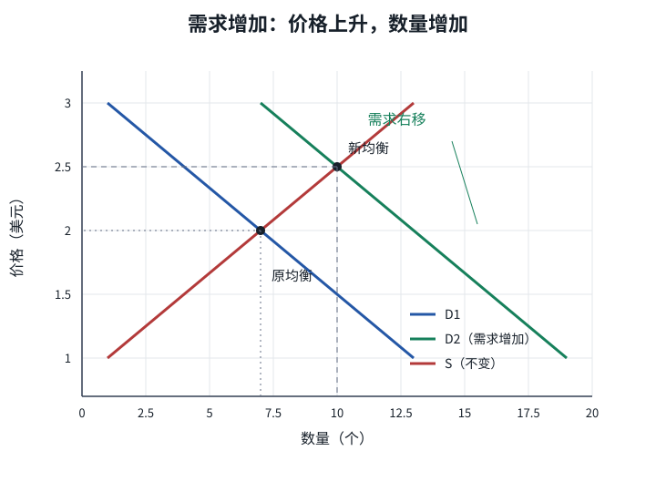
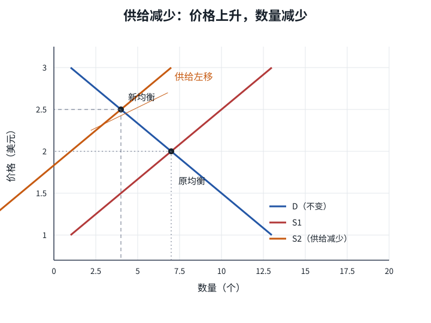
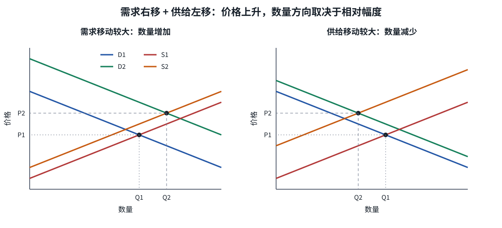

# 分析均衡变动的三个步骤：先移曲线，再比新旧均衡

| | |
|---|---|
| 表面 | Book |
| 用时 | 约 16 分钟 |
| 原书 | 曼昆《经济学原理》微观分册第 8 版 · 第 4 章 · 4.4.2 |
| 本章深度 | 会用 |
| 导航 | [学习台](../README.md) · [上一页](06_equilibrium.md) · [下一页](08_price_allocation.md) |

## 学完你能做什么

- 用三个步骤分析需求单移动、供给单移动和双移动。
- 分开「供给增加」与「供给量增加」、「需求增加」与「需求量增加」。
- 在双移动中识别哪个结果确定、哪个取决于相对幅度。

## 概念讲解

分析任何事件，固定走三步：

1. 确定事件使需求曲线、供给曲线，还是两条曲线移动。
2. 确定曲线向左还是向右。
3. 用供求图比较原均衡与新均衡，说明均衡价格和均衡数量怎样变。

不要从新闻标题直接猜价格。先判断曲线，结论才有依据。

### 例一：炎热天气使需求右移

**第一步：** 炎热改变人们在每种价格下想吃多少冰淇淋，影响需求；它不直接改变企业的生产成本，供给曲线不动。

**第二步：** 每种价格下都想买更多，需求曲线向右移动。

**第三步：** 在原价格 2 美元下出现超额需求，短缺推动价格上升。新均衡价格从 2 美元升至 2.50 美元，均衡数量从 7 个增至 10 个。

*图：D₁ 右移到 D₂，价格 2→2.50，数量 7→10。供给曲线没有移动。*

这里企业提供的数量从 7 增至 10，但应说 **供给量增加**，不是 **供给增加**。天气炎热只移动了需求；更高的价格使卖者沿原供给曲线向上移动。

### 例二：糖价上升使供给左移

**第一步：** 台风损毁甘蔗田，糖价上升。糖是投入品，所以影响供给；家庭的购买偏好不直接改变，需求曲线不动。

**第二步：** 每种价格下企业愿意出售的数量都减少，供给曲线向左移动。

**第三步：** 在原价格 2 美元下出现超额需求，短缺推动价格上升。新均衡价格从 2 美元升至 2.50 美元，均衡数量从 7 个减至 4 个。

*图：S₁ 左移到 S₂，价格 2→2.50，数量 7→4。需求曲线没有移动。*

这里买者购买量从 7 减至 4，应说 **需求量减少**，不是需求曲线左移。是糖价推动供给左移，随后更高价格使买者沿原需求曲线移动。

### 例三：炎热与糖价上升同时发生

炎热使需求右移，糖价上升使供给左移，所以两条曲线都移动。

- 对价格：需求增加推高价格，供给减少也推高价格，因此 **均衡价格一定上升**。
- 对数量：需求增加推高数量，供给减少压低数量，因此 **均衡数量方向不确定**。

若需求增加幅度大而供给减少很少，数量可增加；若供给减少幅度大而需求增加很少，数量可减少。课本没有给出足够信息让两种可能二选一，就不能武断写「数量增加」。

*图：两种情形价格都上升；左图数量增加，右图数量减少，取决于两种移动的相对幅度。*

### 九种组合：同向作用确定，反向作用不确定

| 需求／供给 | 供给未变 | 供给增加 | 供给减少 |
|---|---|---|---|
| 需求未变 | 价格不变，数量不变 | 价格下降，数量增加 | 价格上升，数量减少 |
| 需求增加 | 价格上升，数量增加 | 价格不确定，数量增加 | 价格上升，数量不确定 |
| 需求减少 | 价格下降，数量减少 | 价格下降，数量不确定 | 价格不确定，数量减少 |

读表方法：分别写出需求移动对价格、数量的作用，再写供给移动的作用。两者同向，结果确定；两者反向，结果不确定。不要孤立背九格。

> [!NOTE]
> **标注 · 课本例子**  
> 热天：需求右移，价格 2→2.50，数量 7→10。糖价上升：供给左移，价格 2→2.50，数量 7→4。两者同时：价格上升，数量不确定。

> [!WARNING]
> **注意**  
> 「需求增加后供给也增加」是常见口误。热天例子中供给曲线没动，只是价格上升使供给量增加。用词一旦错了，下一步就容易画错曲线。

> [!TIP]
> **关键术语**  
> **三个步骤**：定曲线、定方向、比均衡。  
> **相对幅度**：两条曲线各自移动的强弱；双移动反向作用时，它决定净结果。  
> **不确定**：在已给信息下，两种方向都有可能，而不是「不会变化」。

> [!IMPORTANT]
> **深度解析**  
> 「不确定」不是模型失效，而是正确的比较静态结论。若补充两条曲线的具体方程或移动幅度，才能进一步算出确定的数值；本章多数事件只给方向信息。

## 小测验

### B07-1 · 简答

炎热天气为什么使均衡价格和数量都上升，却只叫「供给量增加」而不叫「供给增加」？

要点

炎热使需求右移，在原价格下造成短缺，价格从 2 升至 2.50、数量从 7 增至 10。企业的成本和供给曲线未变，只是更高价格使其沿原供给曲线提供更多，所以是供给量增加。

### B07-2 · 选择

需求增加与供给减少同时发生，可以确定什么？

- A. 价格上升，数量一定增加
- B. 价格上升，数量方向不确定
- C. 价格不确定，数量一定减少
- D. 价格和数量都不变

要点

B。两种移动都推高价格；需求增加推高数量，供给减少压低数量，所以净数量取决于相对幅度。

### B07-3 · 简答

需求增加与供给增加同时发生，为什么数量确定增加而价格不确定？

要点

两种移动都使均衡数量增加，所以数量确定增加。需求增加推高价格，供给增加压低价格，价格净方向取决于相对幅度。

## 费曼输出（学完自己讲）

**一句：** 先定哪条曲线、再定方向、最后比新旧均衡；双移动反向作用时不确定。  
**术语：** 供给量变动=沿固定供给曲线移动。你补：供给变动= ______  
**例子：** 热天与糖价上升同时发生。你补关键一步：为什么价格确定而数量不确定？______  
**提醒：** 「不确定」是两种方向都可能，不是数量不变。

## 本页带走

热天使需求右移：价格升、数量增，供给量增加但供给不变。糖价上升使供给左移：价格升、数量减，需求量减少但需求不变。两者同时发生：价格升，数量取决于相对幅度。

下一页收束到价格的经济作用：[价格配置与全章收成](08_price_allocation.md)。

掌握路径上，本页对应 [C4-R10](../PRACTICE.md#c4-r10)。
