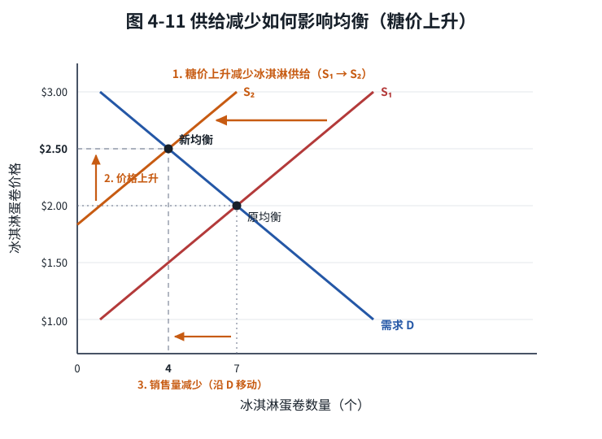

# 分析均衡变动的三个步骤：先移曲线，再比新旧均衡

| | |
|---|---|
| 表面 | Book |
| 用时 | 约 16 分钟 |
| 原书 | 曼昆《经济学原理》微观分册第 8 版 · 第 4 章 · 4.4.2（表 4-3、图 4-10～4-12、表 4-4） |
| 本章深度 | 会用 |
| 导航 | [学习台](../README.md) · [上一页](06_equilibrium.md) · [下一页](08_price_allocation.md) |

## 学完你能做什么

- 按曼昆表 4-3 的「三个步骤」分析需求单移动（图 4-10）、供给单移动（图 4-11）和供求双移动（图 4-12）。
- 严格分开「供给变动」与「供给量的变动」、「需求变动」与「需求量的变动」。
- 读懂并能独立推出曼昆表 4-4 的九种组合，明白双移动中为何有一项确定、一项取决于相对幅度。

## 概念讲解

### 曼昆表 4-3：分析均衡变动的三个步骤

均衡价格和均衡数量取决于供给曲线与需求曲线的位置。当某个事件使其中一条（或两条）曲线移动时，市场会产生新的均衡价格和均衡数量。原书将这种比较旧均衡与新均衡的方法概括为固定的三个步骤：

| 步骤 | 你要回答的问题 |
|---|---|
| **第一步** | 确定该事件是使供给曲线移动还是使需求曲线移动（或者在某些情况下，使两种曲线都移动）。 |
| **第二步** | 确定曲线是向右移动还是向左移动。 |
| **第三步** | 用供求图来比较原来的均衡与新均衡，说明这种移动如何影响均衡价格和均衡数量。 |

遇到任何事件都不要凭直觉跳猜价格涨跌，严格按这三步走。下面依次演练原书的三个冰淇淋市场案例。

---

### 例一：需求移动引起的均衡变动——异常炎热的夏季（图 4-10）

假设某一年夏季天气特别炎热，冰淇淋市场会发生什么变化？

1. **定曲线**：天气炎热通过改变人们对冰淇淋的爱好而影响**需求曲线**（改变了任何既定价格下人们想购买的数量）；天气并不直接影响销售冰淇淋的企业成本，因此**供给曲线不变**。
2. **定方向**：炎热使人们想吃更多冰淇淋，在每种价格下需求量都增加，**需求曲线向右移动**（从 $D_1$ 移到 $D_2$）。
3. **比均衡**：在原有价格 $\$2.00$ 下出现了对冰淇淋的超额需求（短缺），促使企业提高价格。如图 4-10 所示，均衡价格从 $\$2.00$ 上升到 $\$2.50$，均衡数量从 $7$ 个增加到 $10$ 个。

*图：曼昆图 4-10。异常炎热使需求曲线从 $D_1$ 右移到 $D_2$，均衡价格从 $\$2.00$ 升至 $\$2.50$，均衡数量从 $7$ 个增至 $10$ 个。*

**曲线的移动 vs. 沿着曲线的变动**：在这个例子里，尽管供给曲线丝毫未动，企业供给的冰淇淋数量却从 $7$ 个增加到了 $10$ 个。此时经济学家说：**「供给量」增加了，但「供给」不变**。「供给」指整条供给曲线的位置，「供给量」指卖者在某一价格下希望出售的数量——炎热推高了均衡价格，更高价格让卖者**沿着固定的供给曲线向上移动**。

---

### 例二：供给移动引起的均衡变动——台风推高糖价（图 4-11）

假设在另一个夏季，台风摧毁了部分甘蔗田，使糖的价格上升：

1. **定曲线**：糖是制造冰淇淋的投入品，糖价上升提高了生产成本，减少了企业在既定价格下愿意生产并销售的数量，因此影响**供给曲线**；投入成本上升并未直接改变家庭对冰淇淋的购买愿望，**需求曲线不变**。
2. **定方向**：在任一价格下企业愿意并能够出售的总量减少，**供给曲线向左移动**（从 $S_1$ 移到 $S_2$）。
3. **比均衡**：在原有价格 $\$2.00$ 下出现超额需求（短缺），促使企业提高价格。如图 4-11 所示，均衡价格从 $\$2.00$ 上升到 $\$2.50$，均衡数量从 $7$ 个减少到 $4$ 个。

*图：曼昆图 4-11。糖价上升使供给曲线从 $S_1$ 左移到 $S_2$，均衡价格从 $\$2.00$ 升至 $\$2.50$，均衡数量从 $7$ 个减至 $4$ 个。*

同样注意用词：买者购买的数量从 $7$ 个降到 $4$ 个，应说**「需求量」减少，而「需求」不变**——需求曲线留在原地，只是更高的价格让买者沿着原需求曲线向上移动。

---

### 例三：供给和需求都移动——炎热与台风发生在同一夏季（图 4-12）

假设酷暑和台风在同一个夏季同时发生，仍然按三步走：

1. **定曲线**：天气炎热改变既定价格下家庭想买的数量，移动**需求曲线**；台风推高糖价改变既定价格下企业想卖的数量，移动**供给曲线**——两条曲线都移动。
2. **定方向**：方向与前两例一致——**需求曲线向右移动**（$D_1 \to D_2$），**供给曲线向左移动**（$S_1 \to S_2$）。
3. **比均衡**：根据需求和供给**移动幅度的相对大小**，会出现图 4-12 的两种可能结果：
   - 在**图 4-12（a）**中，需求大幅增加而供给只小幅减少：均衡价格从 $P_1$ 上升到 $P_2$，均衡数量从 $Q_1$ **增加**到 $Q_2$。
   - 在**图 4-12（b）**中，供给大幅减少而需求只小幅增加：均衡价格同样从 $P_1$ 上升到 $P_2$，但均衡数量从 $Q_1$ **减少**到 $Q_2$。

因此，这两个事件同时发生**肯定会提高冰淇淋的价格**，但对冰淇淋销售量的影响是**不确定的（ambiguous）**——朝哪个方向变动都有可能，取决于哪条曲线移动得更多。

*图：曼昆图 4-12。需求增加与供给减少同时发生时，两种情况下价格都从 $P_1$ 升至 $P_2$；但图（a）需求移动更大使数量增加（$Q_2 > Q_1$），图（b）供给移动更大使数量减少（$Q_2 < Q_1$）。*

---

### 曼昆表 4-4：当供给或需求移动时，价格和数量会发生什么变动

原书表 4-4 给出了两条曲线任意移动组合下的预期结果：

|  | **供给没有变动** | **供给增加** | **供给减少** |
|---|---|---|---|
| **需求没有变动** | $P$ 相同 $Q$ 相同 | $P$ 下降 $Q$ 增加 | $P$ 上升 $Q$ 减少 |
| **需求增加** | $P$ 上升 $Q$ 增加 | **$P$ 不确定** $Q$ 增加 | $P$ 上升 **$Q$ 不确定** |
| **需求减少** | $P$ 下降 $Q$ 减少 | $P$ 下降 **$Q$ 不确定** | **$P$ 不确定** $Q$ 减少 |

#### 助学拆解法：不用背九格，「单移先定号、双移看同异向」

为了方便做题，不必死背上面九格，只需记住四个单移动的基本方向，遇到双移动时把两股力量叠在一起看：

1. **四个单移动基准**（直接在脑中画十字叉）：
   - 需求增加（$D$ 右移）：$P \uparrow,\; Q \uparrow$ ｜ 需求减少（$D$ 左移）：$P \downarrow,\; Q \downarrow$
   - 供给增加（$S$ 右移）：$P \downarrow,\; Q \uparrow$ ｜ 供给减少（$S$ 左移）：$P \uparrow,\; Q \downarrow$
2. **双移动叠加口诀**：把两个单移动对 $P$ 和 $Q$ 的箭头上下对齐——**同向叠加（$\uparrow + \uparrow$ 或 $\downarrow + \downarrow$）则结果确定；反向对冲（$\uparrow + \downarrow$）则结果不确定（取决于哪条曲线移动幅度更大）**。
   - 检验例三（需求增加 $+$ 供给减少）：对价格是 $\uparrow + \uparrow \Rightarrow$ **$P$ 上升**；对数量是 $\uparrow + \downarrow \Rightarrow$ **$Q$ 不确定**。
   - 再试一格（需求增加 $+$ 供给增加）：对价格是 $\uparrow + \downarrow \Rightarrow$ **$P$ 不确定**；对数量是 $\uparrow + \uparrow \Rightarrow$ **$Q$ 增加**。

> [!NOTE]
> **标注 · 课本例子**  
> 热天：$D$ 右移，价格 $\$2.00 \to \$2.50$，数量 $7 \to 10$（供给量增加，供给不变）。  
> 台风推高糖价：$S$ 左移，价格 $\$2.00 \to \$2.50$，数量 $7 \to 4$（需求量减少，需求不变）。  
> 热天与台风同时发生：$D$ 右移且 $S$ 左移，价格必升，数量不确定。

> [!WARNING]
> **注意**  
> 两处最容易丢分的说法：第一，热天例子里千万别说「需求增加引起供给也增加」，供给曲线没动，增加的只是**供给量**；第二，表 4-4 里的「不确定」不是「保持不变」，而是可能增加、可能减少、也可能恰巧相抵不变。

> [!TIP]
> **关键术语**  
> **三个步骤（表 4-3）**：定哪条曲线移动 $\to$ 定左移还是右移 $\to$ 用供求图比较原均衡与新均衡。  
> **供给变动 vs. 供给量的变动**：供给曲线移动叫供给变动；沿着固定供给曲线移动叫供给量的变动（需求侧同理）。  
> **不确定（ambiguous）**：两股相反力量作用于同一均衡量，缺乏移动幅度信息时无法断定净方向。

> [!IMPORTANT]
> **深度解析**  
> 书末「即问即答」给出两道极好的自测：如果西红柿（投入品）涨价，比萨饼供给曲线左移，比萨饼均衡价格上升、数量减少；如果汉堡包（替代品）降价，比萨饼需求曲线左移，比萨饼均衡价格下降、数量减少。用三步法走一遍，就能检验自己是否已把本章核心方法跑通。

## 小测验

### B07-1 · 简答

炎热天气为什么使均衡价格和均衡数量都上升，却只叫「供给量增加」而不叫「供给增加」？

要点

炎热改变买者爱好，使需求曲线右移，在原价格 $\$2.00$ 下产生短缺，推动价格升至 $\$2.50$、数量增至 $10$。企业的投入成本和供给曲线并未改变，只是更高的市场价格引导卖者沿着原来的供给曲线多提供冰淇淋，所以是供给量增加而非供给增加。

### B07-2 · 选择

需求增加与供给减少同时发生，可以确定什么？

- A. 价格上升，数量一定增加
- B. 价格上升，数量方向不确定
- C. 价格不确定，数量一定减少
- D. 价格和数量都不变

要点

B。需求增加（$P\uparrow, Q\uparrow$）与供给减少（$P\uparrow, Q\downarrow$）都推高价格，因此均衡价格一定上升；但对数量一推高一压低，净数量取决于两条曲线移动的相对幅度。

### B07-3 · 简答

需求增加与供给增加同时发生（如炎热天气遇上糖价下降），均衡价格和均衡数量哪个确定、哪个不确定？为什么？

要点

均衡数量一定增加，均衡价格方向不确定。需求右移（$P\uparrow, Q\uparrow$）与供给右移（$P\downarrow, Q\uparrow$）都使均衡数量增加；但需求右移推高价格、供给右移压低价格，两股力量反向对冲，价格最终涨跌取决于哪条曲线右移幅度更大。

## 费曼输出（学完自己讲）

**一句：** 分析事件固定走「定曲线、定方向、比新旧均衡」三步；双移动时同向作用确定，反向作用不确定。  
**术语：** 供给量的变动=沿着固定供给曲线变动。你补：供给变动= ______  
**例子：** 热天（需求右移）与糖价上升（供给左移）同时发生。你补关键一步：为什么价格确定上升而数量不确定？______  
**提醒：** 表 4-4 里的「不确定」指增减都有可能，不等于「不变」。

## 本页带走

表 4-3 的三步法统领所有供求变动分析：热天使需求右移（图 4-10：价格升、数量增，供给量增加但供给不变）；糖价上升使供给左移（图 4-11：价格升、数量减，需求量减少但需求不变）；两者同时发生时价格一定上升、数量取决于相对幅度（图 4-12、表 4-4）。

下一页收束到价格在市场经济中的协调作用与全章总结：[价格配置与全章收成](08_price_allocation.md)。

掌握路径上，本页对应 [C4-R10](../PRACTICE.md#c4-r10)。
