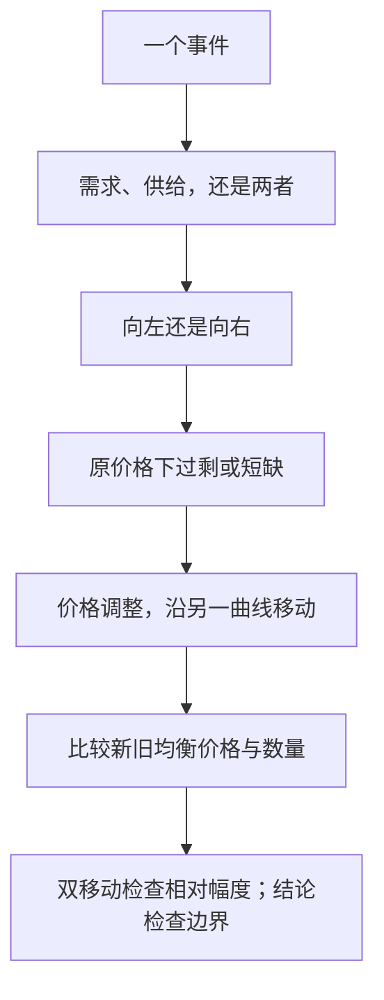

# 价格配置与全章收成：市场怎样协调，不等于结果必然公平

| | |
|---|---|
| 表面 | Book |
| 用时 | 约 10 分钟 |
| 原书 | 曼昆《经济学原理》微观分册第 8 版 · 第 4 章 · 4.5 |
| 本章深度 | 会讲、会限定 |
| 导航 | [学习台](../README.md) · [上一页](07_three_steps.md) · [掌握路径](../MASTERY_PATH.md) |

## 学完你能做什么

- 用海滩土地和农业说明价格怎样配置稀缺资源。
- 把价格的协调作用与公平、效率评价分开。
- 用一套固定流程收束全章，而不只背曲线口诀。

## 概念讲解

每种经济都要回答：稀缺资源给谁用、谁生产什么、生产多少。市场经济没有一个总计划者逐项安排，而是由千百万分散决策通过价格协调。

海滩土地有限，不可能人人都住在海边。土地价格调整，直到愿意并且能够支付价格的人的需求量与可用供给量平衡。价格在这里既传递稀缺性，也配置土地给谁使用。

农业也需要有人劳动。食物价格与农民工资——劳动的价格——会影响人们是否进入农业、生产多少。分散的工作和生产决策根据价格信号调整，不需要一个机构点名谁必须当农民。

这接上第 1 章的「市场通常是一种组织经济活动的好方法」：如果说市场像看不见的手，价格就是它用来引导决策的信号。

### 协调结论不是全部评价

本章解释价格怎样出清市场、配置资源，但还没有证明结果公平，也没有完成效率论证。

- 「愿意并且能够支付」包含支付能力，不等于「最需要的人一定得到」。
- 「均衡时需求量等于供给量」不等于每个人都满意，也不等于没有外部影响。
- 市场是否有效率，需要消费者剩余、生产者剩余等工具；是否公平，还涉及价值判断。

因此，本章可以说「价格是一种配置机制」，不能直接说「均衡价格就是社会最应该采用的价格」。

### 全章收成一套流程

| 步骤 | 要写下什么 | 常见错误 |
|---|---|---|
| 1. 定市场与假设 | 哪种物品、哪个时期、是否采用竞争市场模型 | 把垄断定价直接套进价格接受者模型 |
| 2. 定曲线 | 事件影响需求、供给，还是两者 | 把相关物品价格与本物品价格混淆 |
| 3. 定方向 | 每种既定价格下数量增加还是减少 | 把本物品价格变动画成曲线移动 |
| 4. 看旧价格 | 原均衡下出现过剩还是短缺 | 跳过调整机制直接报新价格 |
| 5. 比新旧均衡 | 价格、数量各怎样变 | 双移动反向作用仍武断给方向 |
| 6. 检查用词 | 曲线移动还是沿曲线移动 | 把供给量增加说成供给增加 |
| 7. 限定结论 | 是否只解释协调，未评价福利与公平 | 从均衡直接推出「应该」 |

第 4 章给出方向判断。下一章的弹性将进一步衡量：价格变动一定幅度时，需求量或供给量究竟反应多大。

> [!NOTE]
> **标注 · 课本例子**  
> 海滩土地由愿意并且能够支付价格的人获得；食物价格与农民工资引导农业劳动和生产决策。价格像指挥棒，协调分散的经济活动。

> [!WARNING]
> **注意**  
> 「价格能配置资源」是机制描述，不是公平证书。它也没有自动证明每种市场结果都有效率；福利分析需要后章工具。

> [!TIP]
> **关键术语**  
> **价格配置资源**：价格作为信号，引导谁购买、谁生产以及生产多少。  
> **实证与规范**：本章主要解释「怎样运行」；「应该怎样」还需额外标准。

> [!IMPORTANT]
> **深度解析**  
> 价格同时传递信息、提供激励并分配既有稀缺物品。本章重点在协调；后面会把配置结果拆成效率、分配和政策影响分别评价。

## 小测验

### B08-1 · 简答

海滩土地和农业各自怎样说明价格的配置作用？

要点

海滩土地价格调整，使有限土地配置给愿意并且能够支付的人。食物价格与农民工资影响谁进入农业、生产多少，协调分散的工作和生产决策。

### B08-2 · 判断

市场达到均衡，就证明分配公平、每个人都满意，而且已经证明社会福利最大。

要点

不对。均衡只表示现行价格下需求量与供给量相等。支付能力不等于需要程度，公平与福利还要另外分析。

## 费曼输出（学完自己讲）

**一句：** 价格通过信号和激励协调分散决策，但均衡不自动等于公平或福利最大。  
**术语：** 价格配置资源=引导谁买、谁生产及生产多少。你补：均衡只说明 ______  
**例子：** 海滩土地。你补关键一步：为什么「愿意并且能够支付」不等于「最需要」？______  
**提醒：** 先完成机制分析，再单独提出福利或规范问题。

## 本页带走

价格协调谁获得海滩土地、谁从事农业以及生产多少。它配置稀缺资源，却不自动证明公平或效率。做题时固定走「定曲线—定方向—比均衡—查用词与边界」。

回到 [学习台](../README.md)，按 [掌握路径](../MASTERY_PATH.md) 完成四关。后章方向见 [进一步阅读](../FURTHER_READING.md)。
