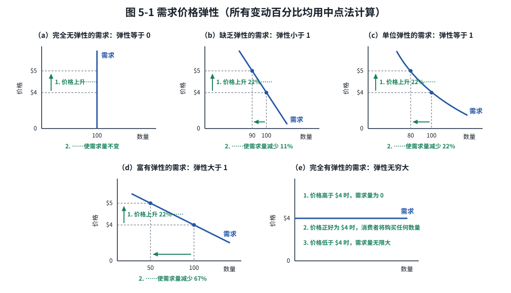
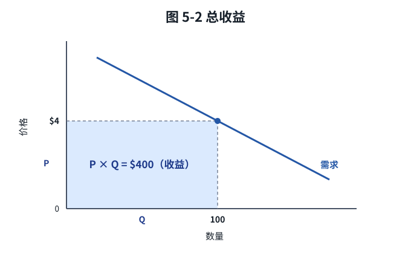
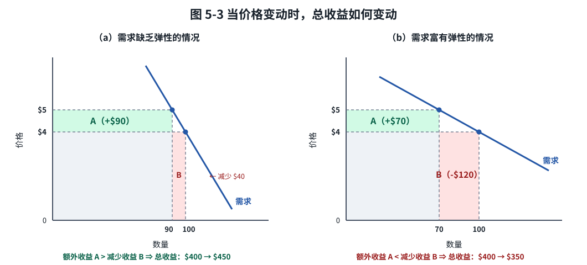
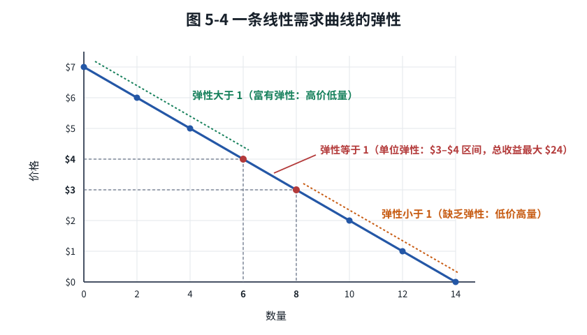

# 各种需求曲线、总收益与线性需求弹性：涨价一定多赚钱吗

| | |
|---|---|
| 表面 | Book |
| 用时 | 约 17 分钟 |
| 原书 | 曼昆《经济学原理》微观分册第 8 版 · 第 5 章 · 5.1.4–5.1.6（图 5-1～5-4、参考资料） |
| 本章深度 | 会读图、会判总收益、会算线性需求表 |
| 导航 | [学习台](../README.md) · [上一页](01_demand_elasticity_basics.md) · [下一页](03_other_demand_elasticities.md) |

## 学完你能做什么

- 对照曼昆图 5-1，按需求价格弹性把需求曲线分成五类，并用「过同一点越平坦弹性越大」判断陡平。
- 对照曼昆图 5-2 与图 5-3，用矩形面积 $P \times Q$ 和得失面积 $A$、$B$ 说明价格变动如何影响总收益。
- 对照曼昆图 5-4 及其需求弹性表，解释为何线性需求曲线斜率不变、弹性却从高价段到低价段递减。

## 概念讲解

### 五种需求曲线与陡平经验法则（5.1.4，图 5-1）

经济学家根据需求价格弹性的大小对需求曲线分类：

- **富有弹性（elastic）**：弹性 $> 1$，需求量变动比例大于价格变动比例；
- **缺乏弹性（inelastic）**：弹性 $< 1$，需求量变动比例小于价格变动比例；
- **单位弹性（unit elastic）**：弹性 $= 1$，需求量与价格同比例变动；
- **完全无弹性（perfectly inelastic）**：弹性 $= 0$，垂直线，无论价格如何变动，需求量总是相同；
- **完全有弹性（perfectly elastic）**：弹性 $= \infty$，水平线，价格极小变动都会引起需求量极大变动（高于该价格需求量为 $0$，低于该价格需求量无限大）。

经验法则：**通过给定一点的需求曲线越平坦，需求价格弹性就越大；通过给定一点的需求曲线越陡峭，需求价格弹性就越小。** 原书还给了一个考试记忆窍门：完全无弹性（**I**nelastic）的垂直需求曲线，长得很像英文字母 **I**。

*图：曼昆图 5-1（所有变动百分比均用中点法计算：$\$4$ 升至 $\$5$ 为 $+22\%$）。从（a）垂直线（弹性 $=0$）到（b）缺乏弹性（量减 $11\%$）、（c）单位弹性（量减 $22\%$）、（d）富有弹性（量减 $67\%$），再到（e）水平线（弹性 $=\infty$），曲线越来越平坦。*

#### 原书参考资料：现实世界中的几种需求价格弹性

经济学家收集市场数据并用统计技术估算出的若干物品需求价格弹性如下：

| 物品 | 需求价格弹性 | 物品 | 需求价格弹性 |
|---|---:|---|---:|
| 鸡蛋 | $0.1$ | 牛肉 | $1.6$ |
| 医疗 | $0.2$ | 花生酱 | $1.7$ |
| 香烟 | $0.4$ | 餐馆用餐 | $2.3$ |
| 大米 | $0.5$ | 山民私酿的威士忌酒 | $4.4$ |
| 住房 | $0.7$ |  |  |

读这些估算数字时要有保留态度，原书给出两个原因：第一，统计估算依赖对现实世界的若干假设（属于计量经济学范畴），这些假设未必完全成立；第二，同一条需求曲线不同点上的弹性未必相同（见下文图 5-4）。

---

### 总收益与需求价格弹性（5.1.5，图 5-2、图 5-3）

研究市场供求变动时，常要考察 **总收益（total revenue）**——某种物品的买者支付从而卖者得到的总量。在任何市场上，总收益等于物品价格乘以销售量：

$$\text{总收益} = P \times Q$$

如图 5-2 所示，需求曲线下方矩形的高是 $P$、宽是 $Q$，方框面积 $P \times Q$ 就是总收益：当 $P = \$4$、$Q = 100$ 时，总收益为 $\$4 \times 100 = \$400$。

*图：曼昆图 5-2。价格为 $\$4$、需求量为 $100$ 时，需求曲线下方矩形面积 $P \times Q = \$400$ 即为总收益。*

当价格沿着需求曲线变动时，总收益如何变动？图 5-3 对比了两种情况：

1. **图 5-3（a）需求缺乏弹性**：价格从 $\$4$ 上升到 $\$5$，需求量只从 $100$ 降到 $90$，总收益从 $\$400$ **增加**到 $\$450$。因为 $Q$ 减少的比例小于 $P$ 上升的比例——以更高价格出售保留销量所获得的额外收益（面积 $A = \$1 \times 90 = \$90$），超过了因销量减少而损失的收益（面积 $B = \$4 \times 10 = \$40$）。
2. **图 5-3（b）需求富有弹性**：价格同样从 $\$4$ 上升到 $\$5$，需求量大幅从 $100$ 减为 $70$，总收益从 $\$400$ **减少**为 $\$350$。因为 $Q$ 减少的比例大于 $P$ 上升的比例——提价带来的额外收益（面积 $A = \$1 \times 70 = \$70$），小于销量萎缩造成的收益损失（面积 $B = \$4 \times 30 = \$120$）。

*图：曼昆图 5-3。价格从 $\$4$ 升至 $\$5$ 时：（a）缺乏弹性下 $A > B$，总收益从 $\$400$ 增至 $\$450$；（b）富有弹性下 $A < B$，总收益从 $\$400$ 减为 $\$350$。*

由此总结出三条一般规律：

- **当需求缺乏弹性（价格弹性 $< 1$）时，价格和总收益同方向变动**：价格上升 $\Rightarrow$ 总收益增加；价格下降 $\Rightarrow$ 总收益减少。
- **当需求富有弹性（价格弹性 $> 1$）时，价格和总收益反方向变动**：价格上升 $\Rightarrow$ 总收益减少；价格下降 $\Rightarrow$ 总收益增加。
- **如果需求是单位弹性的（价格弹性 $= 1$），当价格变动时，总收益保持不变。**

---

### 沿着一条线性需求曲线的弹性和总收益（5.1.6，图 5-4）

直线的斜率是不变的。在图 5-4 这条线性需求曲线上，价格每上升 $\$1$（「向上量」），需求量总是固定减少 $2$ 个单位（「向前量」）。**但斜率不变绝不等于弹性不变**——斜率是两个变量**变动量**的比率，而弹性是两个变量**变动百分比**的比率。

*图：曼昆图 5-4。同一条直线需求曲线斜率处处相等，但在价格高而数量少的上半段富有弹性（$>1$），在 $\$3\text{–}\$4$（数量 $6\text{–}8$）区间为单位弹性（$=1$），在价格低而数量多的下半段缺乏弹性（$<1$）。*

对照原书图 5-4 附带的线性需求曲线数值表（变动百分比与弹性均按相邻两行间的中点法计算）：

| 价格（美元） | 数量 | 总收益（价格 $\times$ 数量，美元） | 价格变动百分比（%） | 数量变动百分比（%） | 弹性 | 弹性程度 |
|---:|---:|---:|---:|---:|---:|---|
| $7$ | $0$ | $0$ | — | — | — | — |
| $6$ | $2$ | $12$ | $15$ | $200$ | $13.0$ | 富有弹性 |
| $5$ | $4$ | $20$ | $18$ | $67$ | $3.7$ | 富有弹性 |
| $4$ | $6$ | $24$ | $22$ | $40$ | $1.8$ | 富有弹性 |
| $3$ | $8$ | $24$ | $29$ | $29$ | **$1.0$** | **单位弹性** |
| $2$ | $10$ | $20$ | $40$ | $22$ | $0.6$ | 缺乏弹性 |
| $1$ | $12$ | $12$ | $67$ | $18$ | $0.3$ | 缺乏弹性 |
| $0$ | $14$ | $0$ | $200$ | $15$ | $0.1$ | 缺乏弹性 |

原因很直观：
- **低价高量段**（如价格从 $\$1$ 升至 $\$2$，数量从 $12$ 减至 $10$）：同样涨 $\$1$ 占低价格基数的百分比很大（$67\%$），同样减 $2$ 单位占大数量基数的百分比很小（$18\%$），因此弹性很小（$0.3 < 1$，缺乏弹性），涨价使总收益从 $\$12$ 增至 $\$20$；
- **高价低量段**（如价格从 $\$5$ 升至 $\$6$，数量从 $4$ 减至 $2$）：同样涨 $\$1$ 占高价格基数的百分比很小（$18\%$），同样减 $2$ 单位占小数量基数的百分比很大（$67\%$），因此弹性很大（$3.7 > 1$，富有弹性），涨价使总收益从 $\$20$ 减至 $\$12$；
- **中间段**（价格在 $\$3$ 与 $\$4$ 之间）：价格变动百分比与数量变动百分比都是 $29\%$，为单位弹性（$1.0$），两个价格下的总收益同为最大值 $\$24$。

> [!NOTE]
> **标注 · 课本例子**  
> 现实估算：鸡蛋 $0.1$、医疗 $0.2$、香烟 $0.4$（缺乏弹性）；餐馆用餐 $2.3$、山民私酿威士忌 $4.4$（富有弹性）。  
> 图 5-3：$\$4 \to \$5$ 时，缺乏弹性（$100 \to 90$）总收益 $\$400 \to \$450$；富有弹性（$100 \to 70$）总收益 $\$400 \to \$350$。  
> 图 5-4：直线需求曲线从 $(\$0, 14)$ 到 $(\$7, 0)$，中点弹性由下往上从 $0.1$ 递增到 $13.0$。

> [!WARNING]
> **注意**  
> 两句高频陷阱：第一，「直线需求曲线斜率不变，所以弹性也不变」是错的——只有水平线（恒为 $\infty$）和垂直线（恒为 $0$）例外，向右下方倾斜的直线需求曲线各段弹性都不同；第二，比较陡平判断弹性时，必须强调**「通过给定同一点」**，否则不同价格—数量位置本身就会改变百分比基数。

> [!TIP]
> **关键术语**  
> **富有弹性／缺乏弹性／单位弹性**：需求价格弹性分别大于 $1$、小于 $1$、等于 $1$。  
> **完全无弹性／完全有弹性**：弹性等于 $0$（垂直线）与弹性趋于无穷大（水平线）。  
> **总收益（total revenue）**：一种物品的买者支付从而卖者得到的量，等于 $P \times Q$。

> [!IMPORTANT]
> **深度解析**  
> 原书「问题与应用」把总收益规律放进了一个经典场景：如果你是急需增加门票收益的博物馆馆长，应该提价还是降价？答案不能拍脑袋，而取决于当前票价下参观需求是缺乏弹性还是富有弹性——若缺乏弹性应提价，若富有弹性则降价反而能显著多卖票、增加总收益。

## 小测验

### B02-1 · 选择

向右下方倾斜的线性需求曲线是？

- A. 缺乏弹性的
- B. 单位弹性的
- C. 富有弹性的
- D. 在一些点缺乏弹性，在另一些点富有弹性

要点

D。线性需求曲线斜率不变，但在高价低量段富有弹性（$>1$），中点附近为单位弹性（$=1$），在低价高量段缺乏弹性（$<1$）。

### B02-2 · 简答

价格变动引起一种物品的需求量减少了 $30\%$，而该物品的总收益增加了 $15\%$。这种物品的需求曲线是富有弹性还是缺乏弹性？为什么？

要点

缺乏弹性。需求量减少说明价格上升了；价格上升的同时总收益增加（同方向变动），表明价格上升的百分比大于需求量减少的百分比（$30\%$），因此需求价格弹性小于 $1$，属于缺乏弹性。

### B02-3 · 计算与辨析

两位司机开车去加油站，没看油价前，Walt 说「我想加 $10$ 加仑汽油」，Jessie 说「我想加 $10$ 美元汽油」。两人的需求价格弹性各是多少？

要点

Walt 无论油价高低都固定买 $10$ 加仑（数量不变），需求完全无弹性，弹性 $= 0$（图 5-1a）；Jessie 无论油价高低总支出 $P \times Q$ 恒为 $\$10$（总收益保持不变），因此需求具有单位弹性，弹性 $= 1$（图 5-1c）。

## 费曼输出（学完自己讲）

**一句：** 缺乏弹性时价格与总收益同向变动，富有弹性时反向变动；向下倾斜的直线需求曲线斜率恒定，但弹性由高价段向低价段递减。  
**术语：** 总收益 $= P \times Q$。你补：图 5-3 中涨价后多收的部分（面积 $A$）与少卖损失的部分（面积 $B$）满足什么关系时总收益增加？______  
**例子：** 图 5-4 中价格从 $\$5$ 升至 $\$6$ 与从 $\$1$ 升至 $\$2$ 都是涨 $\$1$、少买 $2$ 个。你补关键一步：为什么前者弹性为 $3.7$ 而后者只有 $0.3$？______  
**提醒：** 不要把「斜率不变」混同于「弹性不变」；垂直线像字母 I（Inelastic），弹性为 $0$。

## 本页带走

五种需求曲线覆盖了弹性从 $0$（垂直）到 $\infty$（水平）的完整谱系（图 5-1）。总收益 $P \times Q$（图 5-2）在缺乏弹性时与价格同向变动、富有弹性时与价格反向变动、单位弹性时不变（图 5-3）。线性需求曲线斜率不变，但高价低量段富有弹性、低价高量段缺乏弹性（图 5-4）。

下一页补齐买者一侧另外两个定量指标：[其他需求弹性：收入弹性与交叉价格弹性](03_other_demand_elasticities.md)。

掌握路径上，本页对应 [C5-R04](../PRACTICE.md#c5-r04)、[C5-R05](../PRACTICE.md#c5-r05)。
