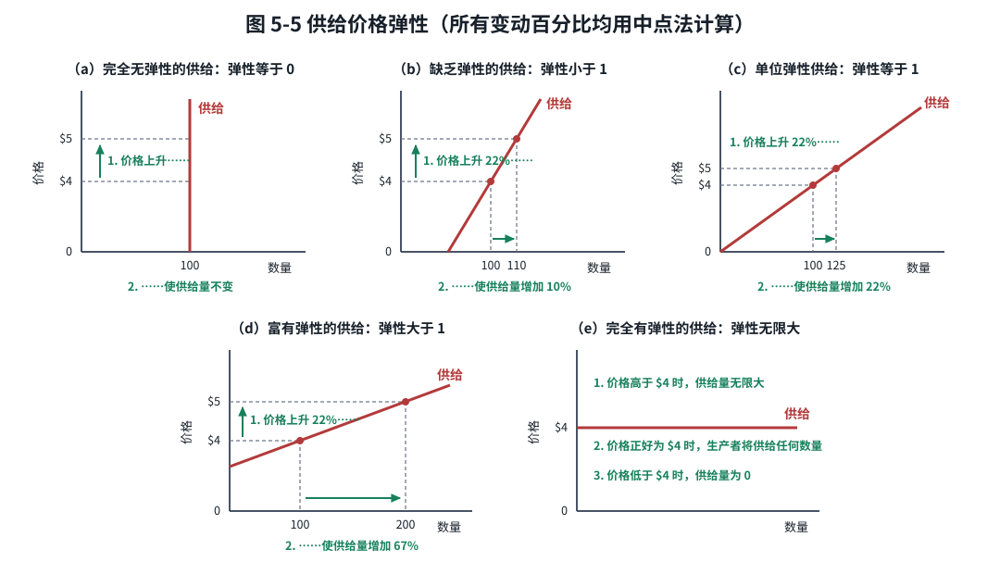
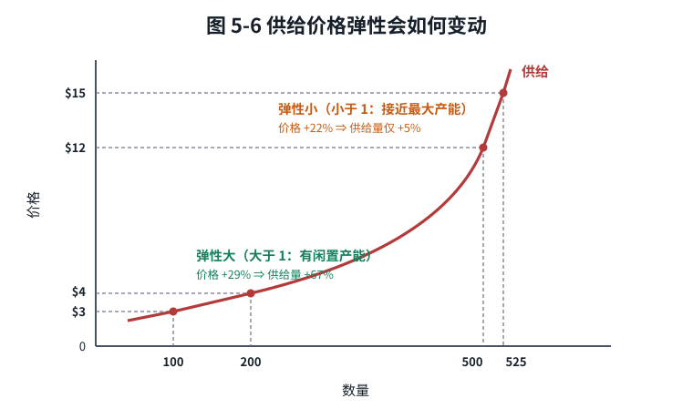

# 供给价格弹性：产能与时间如何塑造供给曲线

| | |
|---|---|
| 表面 | Book |
| 用时 | 约 13 分钟 |
| 原书 | 曼昆《经济学原理》微观分册第 8 版 · 第 5 章 · 5.2（图 5-5、图 5-6） |
| 本章深度 | 会算、会读图、会分短长期与产能区间 |
| 导航 | [学习台](../README.md) · [上一页](03_other_demand_elasticities.md) · [下一页](05_three_applications.md) |

## 学完你能做什么

- 定义供给价格弹性，从生产灵活性与时间范围解释什么决定供给弹性的大小。
- 用中点法复原课本牛奶供给算例，并对照图 5-5 辨认五种供给曲线。
- 对照曼昆图 5-6，解释为什么有产能上限的行业在低产量时供给富有弹性、高产量时缺乏弹性。

## 概念讲解

### 供给价格弹性及其决定因素（5.2.1）

第 4 章的供给定理指出，价格上升使供给量增加。为了把对供给的说明从定性转向定量，我们定义 **供给价格弹性（price elasticity of supply）**：衡量一种物品供给量对其价格变动反应程度的指标。反应很大称供给**富有弹性**，反应很小称供给**缺乏弹性**。

什么决定供给价格弹性的大小？

1. **卖者改变产量的灵活性**：例如，**海滩土地**供给缺乏弹性，因为几乎不可能生产出更多海滩土地；相反，**书、汽车和电视**这类制成品供给富有弹性，因为价格上升时生产企业可以让工厂运转更长时间来增产。
2. **所考虑的时间长短（大多数市场上最关键的因素）**：**供给在长期中通常比在短期中更富有弹性。**
   - 在**短期**中，企业不能轻易改变工厂规模来增减产量，供给量对价格不那么敏感；
   - 在**长期**中，企业可以开设新工厂或关闭旧工厂，此外新企业可以进入市场、旧企业可以退出市场，因此长期供给量能对价格变动做出相当大的反应。

---

### 供给价格弹性的计算：牛奶算例（5.2.2）

经济学家用供给量变动百分比除以价格变动百分比来计算供给价格弹性：

$$\text{供给价格弹性} = \frac{\text{供给量变动百分比}}{\text{价格变动百分比}}$$

由于价格与供给量同方向变动，供给价格弹性天然为正数。看原书牛奶算例：假设每加仑牛奶价格从 $\$2.85$ 上升到 $\$3.15$，牧场主每月生产的牛奶量从 $9\,000$ 加仑增加到 $11\,000$ 加仑。用中点法计算：

- 价格中点为 $(\$2.85 + \$3.15)/2 = \$3.00$，价格变动百分比 $= (3.15 - 2.85)/3.00 \times 100\% = 10\%$；
- 数量中点为 $(9\,000 + 11\,000)/2 = 10\,000$，供给量变动百分比 $= (11\,000 - 9\,000)/10\,000 \times 100\% = 20\%$；
- 因此，$\text{供给价格弹性} = \dfrac{20\%}{10\%} = 2$，表明供给量变动比例是价格变动比例的两倍。

---

### 五种供给曲线与产能受限时的弹性变动（5.2.3，图 5-5、图 5-6）

图 5-5 展示了供给价格弹性在供给曲线形状上的五种体现：从（a）垂直线（**完全无弹性**，弹性 $= 0$，无论价格怎样变供给量恒为 $100$），随着弹性增大曲线越来越平坦，依次经过（b）缺乏弹性（$<1$）、（c）单位弹性（$=1$）、（d）富有弹性（$>1$），直到（e）水平线（**完全有弹性**，弹性 $= \infty$，价格略高于 $\$4$ 供给量无限大、低于 $\$4$ 供给量为 $0$）。

*图：曼昆图 5-5（变动百分比均按中点法计算：价格从 $\$4$ 升至 $\$5$ 为 $+22\%$）。供给价格弹性越大，过同一点的供给曲线越平坦。*

在许多行业中，供给弹性并不是整条曲线固定不变，而是沿着供给曲线变化。图 5-6 展示了一个**工厂生产能力有限**的典型行业：

- **低供给量阶段（富有弹性，弹性 $> 1$）**：企业存在未被利用的闲置生产能力（如全天或部分时间闲置的厂房和设备），价格小幅上升就能使动用闲置产能有利可图。图中价格从 $\$3$ 升至 $\$4$（中点法 $+29\%$），供给量从 $100$ 大幅增至 $200$（中点法 $+67\%$），$67\% > 29\%$，供给富有弹性。
- **高供给量阶段（缺乏弹性，弹性 $< 1$）**：随着产量增加，工厂逐渐接近最大生产能力；一旦现有产能充分利用，再要增产就必须建立新工厂，只有价格大幅上升才足以弥补这笔额外支出。图中价格从 $\$12$ 升至 $\$15$（中点法 $+22\%$），供给量只从 $500$ 微增至 $525$（中点法 $+5\%$），$5\% < 22\%$，供给缺乏弹性。

*图：曼昆图 5-6。有闲置产能的低产量段供给曲线平坦（富有弹性），接近最大产能的高产量段供给曲线陡峭（缺乏弹性）。*

> [!NOTE]
> **标注 · 课本例子**  
> 海滩土地供给缺乏弹性；书、汽车、电视供给富有弹性。  
> 牛奶价格 $\$2.85 \to \$3.15$（$+10\%$），月产量 $9\,000 \to 11\,000$ 加仑（$+20\%$），供给价格弹性 $= 2$。  
> 图 5-6：$\$3 \to \$4$（$+29\%$）使量 $100 \to 200$（$+67\%$）；$\$12 \to \$15$（$+22\%$）使量 $500 \to 525$（$+5\%$）。

> [!WARNING]
> **注意**  
> 不要误以为同一行业的供给弹性永远是一个常数：第一，跨时间看，长期供给弹性大于短期（因为可建新厂和企业进出）；第二，在同一时期沿同一条供给曲线看，从有闲置产能走到满负荷运转，供给弹性也会由大变小（图 5-6）。

> [!TIP]
> **关键术语**  
> **供给价格弹性**：衡量一种物品供给量对其价格变动反应程度的指标，用供给量变动百分比除以价格变动百分比来计算。

> [!IMPORTANT]
> **深度解析**  
> 把供给弹性装进脑子里后，后面两处关键分析就顺理成章了：一是下一页 5.3.2 的世界石油市场——短期已知储量与开采能力难改（缺乏弹性），长期可勘探建新井（富有弹性）；二是第 6 章的租金控制与门票税——短期公寓存量或球场固定座位数（$38\,000$ 座）接近垂直供给曲线，而长期住房供给则平坦得多。

## 小测验

### B04-1 · 选择

企业可以在一定时期内进入和退出一个市场，这意味着在长期中？

- A. 需求曲线更有弹性
- B. 需求曲线更少弹性
- C. 供给曲线更有弹性
- D. 供给曲线更少弹性

要点

C。长期内不仅现有企业可以新建或关闭工厂，新企业还可以进入市场、旧企业可以退出市场，使行业供给量对价格变动反应更大，供给曲线更有弹性。

### B04-2 · 简答与核对

（1）如果一种物品可获取的量是固定的，而且再也不能多生产（例如伦勃朗的画作或固定座位数的球场），它的供给价格弹性是多少？（2）核对图 5-6 高产量段：价格从 $\$12$ 升至 $\$15$、供给量从 $500$ 增至 $525$，写出中点法算式并判断弹性是否小于 $1$。

要点

（1）供给完全无弹性，供给价格弹性等于 $0$（垂直供给曲线，图 5-5a）。（2）价格中点为 $(12+15)/2 = 13.5$，价格变动百分比 $= 3/13.5 \approx 22.2\%$；数量中点为 $(500+525)/2 = 512.5$，数量变动百分比 $= 25/512.5 \approx 4.9\%$（约 $5\%$）。供给价格弹性 $\approx 5\% / 22\% \approx 0.22 < 1$，属于缺乏弹性。

## 费曼输出（学完自己讲）

**一句：** 供给价格弹性衡量卖者随价格调整产量的灵活程度，长期通常大于短期，且在产能受限时随产量逼近上限而由大变小。  
**术语：** 供给价格弹性=供给量变动百分比除以价格变动百分比。你补：长期供给比短期更有弹性的两条机制是 ______  
**例子：** 图 5-6 工厂产能。你补关键一步：为什么从 $100$ 增产到 $200$ 容易，从 $500$ 增产到 $525$ 却需要价格大涨？______  
**提醒：** 固定不可再生产的存量物品对应图 5-5（a）的垂直供给曲线，弹性为 $0$。

## 本页带走

供给价格弹性取决于卖者调整产量的灵活性与时间范围（长期大于短期）。五种供给曲线见图 5-5；当企业存在产能上限时，低产量段因有闲置产能而富有弹性，高产量段因需新建工厂而缺乏弹性（图 5-6）。

下一页把第 4 章的供求三步法与本章的弹性合起来解决三个著名现实问题：[供求与弹性的三个应用：农业、石油与禁毒](05_three_applications.md)。

掌握路径上，本页对应 [C5-R07](../PRACTICE.md#c5-r07)、[C5-R08](../PRACTICE.md#c5-r08)。
