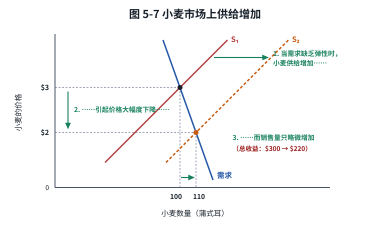
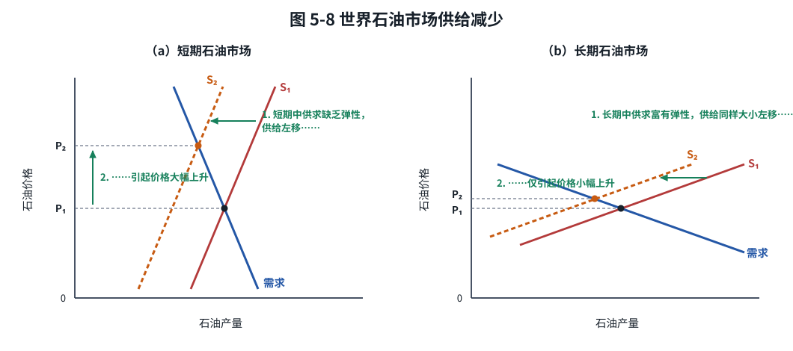
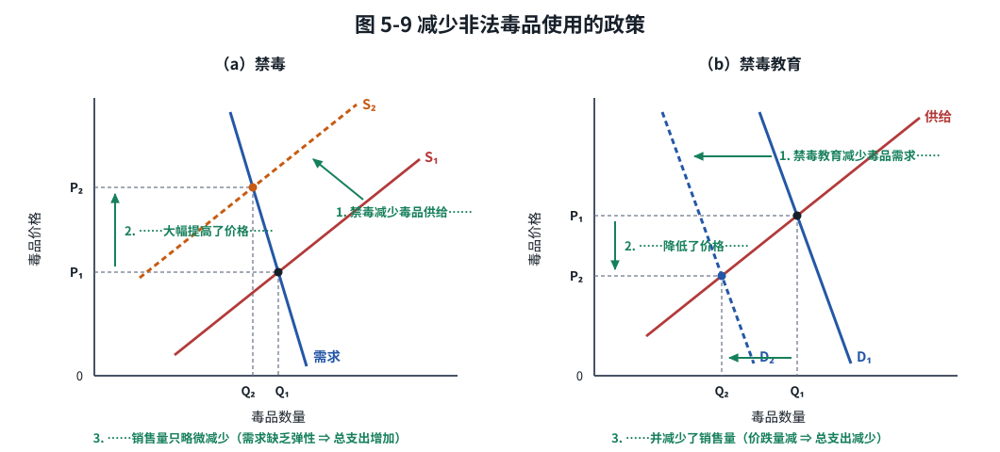

# 供求与弹性的三个应用：农业、石油与禁毒

| | |
|---|---|
| 表面 | Book |
| 用时 | 约 17 分钟 |
| 原书 | 曼昆《经济学原理》微观分册第 8 版 · 第 5 章 · 5.3（图 5-7～5-9） |
| 本章深度 | 会连三步法与弹性做完整推演 |
| 导航 | [学习台](../README.md) · [上一页](04_supply_elasticity.md) · [下一页](06_ch05_summary.md) |

## 学完你能做什么

- 对照曼昆图 5-7，用「三步法 $+$ 需求缺乏弹性」解释农业技术进步为何减少农民总收益，以及竞争农民为何仍会采用新品种。
- 对照曼昆图 5-8，用短期与长期供求弹性解释 OPEC 为何只能在短期抬高油价而难以长期维持。
- 对照曼昆图 5-9，比较「禁毒」与「禁毒教育」对毒品数量、价格与涉毒犯罪的不同影响，并区分禁毒的短长期效应。

## 概念讲解

表面上看，小麦增产、世界石油价格与非法毒品管制风马牛不相及；但在经济学里，三个问题共用同一套通用引擎：**先走第 4 章的供求变动三步骤，再用第 5 章的弹性判断价格变动幅度与总收益（买者总支出）增减。**

---

### 应用一：农业的好消息可能对农民来说是坏消息吗（5.3.1，图 5-7）

设想你是堪萨斯州种植小麦的农民。某天堪萨斯州立大学培育出一种新的小麦杂交品种，使每英亩小麦产量增加 $20\%$。按三步法分析小麦市场：

1. **定曲线**：新品种提高了每英亩土地产量，影响**供给曲线**；消费者在既定价格下买小麦产品的愿望不受影响，**需求曲线不变**。
2. **定方向**：农民在每一种既定价格水平下愿意供给更多小麦，**供给曲线向右移动**（$S_1 \to S_2$）。
3. **比均衡与算总收益**：如图 5-7 所示，小麦销售量从 $100$ 蒲式耳增加到 $110$ 蒲式耳，价格从 $\$3$ 下降为 $\$2$。由于小麦这类基本食品较为便宜且很少有好的替代品，其**需求缺乏弹性**；沿着缺乏弹性的需求曲线降价时，销量增加比例小于价格下降比例，农民的总收益 $P \times Q$ 从 $\$3 \times 100 = \$300$ **减少为** $\$2 \times 110 = \$220$。

*图：曼昆图 5-7。农业技术进步使供给从 $S_1$ 右移到 $S_2$；由于小麦需求缺乏弹性，价格从 $\$3$ 大跌至 $\$2$，销量仅从 $100$ 增至 $110$ 蒲式耳，总收益从 $\$300$ 减少为 $\$220$。*

这里紧接着引出三个极深刻的追问：

- **既然全行业减收，为什么农民还要采用新品种？** 因为小麦市场是竞争市场，每个农民只是微不足道的价格接受者，把小麦价格视为既定。给定市场价格不变，单个农民种新品种就能多产多卖、改善自身处境；但当所有农民都这样做时，市场总供给右移压低了价格，全体农民的总收益反而下降。
- **美国农业人口为什么大幅减少？** $1950$ 年美国有 $1\,000$ 万人务农（占劳动力 $17\%$）；如今不到 $300$ 万人（仅占劳动力 $2\%$），农场产出却是 $1950$ 年的约 $5$ 倍。正是农业生产率进步叠加食物需求缺乏弹性，使农业收益下降，促使劳动力离开农业转向其他行业。
- **为什么会有「补贴休耕」政策，又该如何评价？** 某些农业计划给农民补贴（如原书漫画中政府每年付 $17.5$ 万美元让农场主把 $5\,000$ 英亩地闲置不种），目的是减少农产品供给以抬高价格；在需求缺乏弹性下，供给减少会增加农民整体的总收益。但必须记住：**对农民有利的不一定对整个社会有利**——技术进步虽压缩农业收益，却让广大消费者买到更便宜的食物；反之，限制供给的政策虽增加农民收入，却必然以损害消费者利益为代价。

---

### 应用二：为什么 OPEC 不能保持石油的高价格（5.3.2，图 5-8）

20 世纪 70 年代，石油输出国组织（OPEC）成员国联手减产以提高油价、增加收入：$1973\text{–}1974$ 年油价（经通胀调整）上涨 $50\%$ 以上；$1979\text{–}1981$ 年油价几乎翻番。然而好景不长：$1982\text{–}1985$ 年油价以每年 $10\%$ 的速度下滑，$1986$ 年成员国合作破裂后猛跌 $45\%$，$1990$ 年实际油价又跌回 $1970$ 年的水平（$21$ 世纪前 $15$ 年油价再起波澜，主要推手已是世界经济冷暖引起的需求波动与开采技术进步引起的供给大增，而非 OPEC 限产）。

为什么 OPEC 只在短期成功抬价，长期却守不住？答案在于**短期与长期的供求弹性截然不同**：

- **图 5-8（a）短期石油市场**：短期内已知石油储量与开采能力无法迅速改变（供给缺乏弹性），消费者的用车和购买习惯也不会立即改变（需求缺乏弹性），两条曲线都很陡峭。当供给从 $S_1$ 左移到 $S_2$ 时，价格从 $P_1$ 到 $P_2$ **大幅度上升**，涨幅远超销量跌幅，OPEC 收入大增。
- **图 5-8（b）长期石油市场**：长期内 OPEC 以外的生产者回应高油价，加强石油勘探并建立新开采能力（供给富有弹性）；消费者则更为节俭，用新型节油汽车替代老式耗油汽车（需求富有弹性），两条曲线都变得平坦。此时**同样大小的水平供给减少**（$S_1 \to S_2$）只引起价格从 $P_1$ 到 $P_2$ **小幅度上升**，共同限产在长期变得无利可图。

*图：曼昆图 5-8。（a）短期供求缺乏弹性，供给左移引起油价大幅上升；（b）长期供求富有弹性，供给同样幅度的水平左移仅引起油价小幅上升。*

---

### 应用三：禁毒增加还是减少了与毒品相关的犯罪（5.3.3，图 5-9）

海洛因、可卡因、摇头丸、冰毒等非法毒品不仅毁坏吸毒者及其家庭生活，还常诱使吸毒成瘾者通过抢劫等暴力犯罪筹集毒资。比较两种减少毒品使用的政策：

1. **图 5-9（a）禁毒（打击毒品供给）**  
   政府增派联邦缉毒人员拦截毒品入境、逮捕走私者，直接提高了出售毒品的成本，减少任一既定价格下的供给量——**供给曲线左移**（$S_1 \to S_2$），而买者在既定价格下的购买意愿未变（**需求曲线不变**）。均衡数量从 $Q_1$ 减为 $Q_2$（确实减少了毒品使用），均衡价格从 $P_1$ 升至 $P_2$。  
   但涉毒犯罪怎样变？由于已上瘾者极少因涨价戒毒，短期毒品需求**缺乏弹性**；涨价比例大于吸毒量减少比例，使吸毒者支付的**总货币支出 $P \times Q$ 增加**，靠行窃筹钱的瘾君子需要更多现金，反而在短期内**增加**了与毒品相关的犯罪。

2. **图 5-9（b）禁毒教育（减少毒品需求）**  
   推行禁毒教育直接压低任何既定价格下的购买意愿——**需求曲线左移**（$D_1 \to D_2$），供给曲线不变。均衡数量从 $Q_1$ 减至 $Q_2$，同时均衡价格也从 $P_1$ **下降**到 $P_2$。价格与数量双双下降，毒品市场的总支出必然减少，从而**既减少吸毒，又减少与毒品相关的犯罪**。

*图：曼昆图 5-9。（a）禁毒左移供给，在缺乏弹性的需求下量微减、价大涨，吸毒总支出增加；（b）禁毒教育左移需求，量价齐跌，吸毒总支出减少。*

**禁毒的短期效应 vs. 长期效应**：禁毒支持者指出，需求弹性取决于时间长短——短期内高价对老瘾君子影响很小（需求缺乏弹性，增加犯罪），但**长期内**高价会阻止年轻人尝试吸毒，随时间推移减少成瘾者人数（长期需求较富有弹性），因此禁毒可能在短期增加涉毒犯罪、而在长期减少这种犯罪。

> [!NOTE]
> **标注 · 课本例子**  
> 小麦新品种增产 $20\%$：$S_1 \to S_2$，价格 $\$3 \to \$2$，数量 $100 \to 110$，总收益 $\$300 \to \$220$；美国务农人口从 $1950$ 年 $1\,000$ 万（$17\%$）降至不到 $300$ 万（$2\%$）。  
> OPEC：$1973\text{–}1974$ 油价涨超 $50\%$，$1979\text{–}1981$ 翻番，$1986$ 合作破裂跌 $45\%$，$1990$ 回到 $1970$ 年水平。  
> 毒品政策：禁毒左移供给（短期量减价升、总支出增），禁毒教育左移需求（量价齐降、总支出减）。

> [!WARNING]
> **注意**  
> 做原书「全球干旱 vs. 堪萨斯州干旱」这类变式题时，别漏看**市场边界**！全世界干旱使全球粮食供给左移，因全球粮食需求缺乏弹性，涨价幅度超过减产幅度，全球农民总收入增加；但若**只有堪萨斯州干旱**，堪萨斯小麦存在全美乃至全球小麦作为极相近的替代品，当地农民面对的需求极其富有弹性（几乎是价格接受者），无法靠涨价弥补减产，当地农民总收入必然减少。

> [!TIP]
> **关键术语**  
> **个体理性与集体结果的张力**：竞争市场中单个价格接受者增产有利，但全行业同时增产并在缺乏弹性的需求曲线上压低价格时，行业总收益反而下降。  
> **供给政策 vs. 需求政策**：同样减少均衡数量 $Q$，左移供给会推高价格 $P$，左移需求会压低价格 $P$，对总支出 $P \times Q$ 的作用截然不同。

> [!IMPORTANT]
> **深度解析**  
> 原书第 5.3 节末的「即问即答」反过来考了旱灾：一场摧毁一半农作物的旱灾可能对农民整体是「好事」（供给左移 $+$ 需求缺乏弹性 $\Rightarrow$ 价格暴涨使总收益增加）；那为什么风调雨顺的年份农民不自己烧掉一半庄稼？道理与新品种完全对称：单个农民销毁自家庄稼丝毫抬不起市场价格，只会白白损失一半产量；只有全体农民共同减产（或由政府农业计划组织休耕），价格才会上升。

## 小测验

### B05-1 · 选择

如果一种物品的 ____，该物品的供给增加将减少生产者得到的总收益。

- A. 需求曲线缺乏弹性
- B. 需求曲线富有弹性
- C. 供给曲线缺乏弹性
- D. 供给曲线富有弹性

要点

A。供给增加（右移）使均衡价格沿着需求曲线下降、均衡数量增加；只有当**需求曲线缺乏弹性**时，价格下降的百分比大于数量增加的百分比，总收益 $P \times Q$ 才会减少（如图 5-7 小麦市场）。

### B05-2 · 简答

为什么 OPEC 在 20 世纪 70 年代通过减产大幅提高了石油收入，到了 80 年代中后期却无法维持高油价？

要点

短期内石油供给（已知储量与现有开采能力）和需求（既有驾驶习惯与车型）都缺乏弹性，OPEC 联合减产左移供给会使油价暴涨，涨幅远超销量降幅，从而增加收入（图 5-8a）。但长期内高油价促使非 OPEC 生产者加强勘探扩产，也促使消费者换用节油汽车，长期供给与需求都变得富有弹性，同样的减产只能小幅抬高油价（图 5-8b），联合限产在长期不再有利可图，最终导致合作破裂。

### B05-3 · 简答

对比「缉毒拦截（禁毒）」与「禁毒教育」：两者都能减少毒品使用量，为什么短期内对涉毒抢劫犯罪的影响却相反？

要点

缉毒拦截打击卖者，使毒品供给曲线左移，均衡数量减少但均衡价格大幅上升；因短期内成瘾者需求缺乏弹性，涨价幅度大于减量幅度，吸毒总货币支出增加，促使其增加犯罪筹资（图 5-9a）。禁毒教育改变买者意愿，使需求曲线左移，均衡数量与均衡价格双双下降，吸毒总货币支出减少，从而同时减少吸毒与涉毒犯罪（图 5-9b）。

## 费曼输出（学完自己讲）

**一句：** 把供求三步法与弹性合用，就能解释为何增产可能减收、卡特尔短期易抬价而长期难维持、打击供给与减少需求会产生相反的总支出后果。  
**术语：** 供给右移 $+$ 需求缺乏弹性 $\Rightarrow$ 总收益 ______；需求左移 $+$ 正常向上供给 $\Rightarrow$ 总支出 ______  
**例子：** 小麦新品种。你补关键一步：为什么单个农民明知全行业总收益会从 $\$300$ 降到 $\$220$，自己仍会种新品种？______  
**提醒：** 判断总收益变化时，如果移动的是供给曲线，决定总收益增减的是**需求曲线**的弹性（因为均衡点在沿着需求曲线走）！

## 本页带走

三个经典应用展示了弹性的威力：小麦技术进步右移供给，因需求缺乏弹性使农民总收益从 $\$300$ 降至 $\$220$，但竞争个体仍会采用且消费者受益（图 5-7）；石油供求短期缺乏弹性、长期富有弹性，使 OPEC 短期大赚而长期难守高价（图 5-8）；禁毒左移供给在短期抬高毒价和总支出，而禁毒教育左移需求使量价齐跌、总支出减少（图 5-9）。

下一页收拢全章公式、图形与防错边界：[全章收成：第 5 章弹性工具箱总览](06_ch05_summary.md)。

掌握路径上，本页对应 [C5-R09](../PRACTICE.md#c5-r09)、[C5-R10](../PRACTICE.md#c5-r10)。
