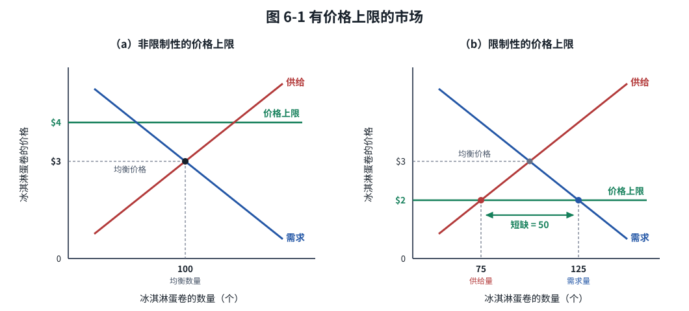
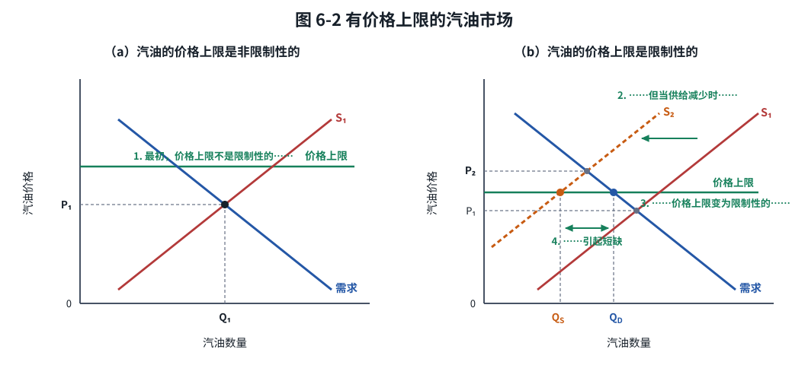
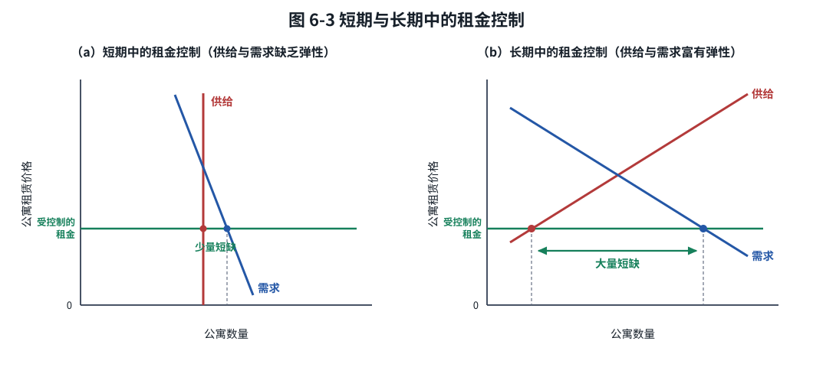

# 价格上限与非价格配给：限价为什么会造成短缺和长队

| | |
|---|---|
| 表面 | Book |
| 用时 | 约 16 分钟 |
| 原书 | 曼昆《经济学原理》微观分册第 8 版 · 第 6 章 · 导言、6.1、6.1.1（图 6-1～6-3、专家看法） |
| 本章深度 | 会判限制性、会算短缺、会分短长期后果 |
| 导航 | [学习台](../README.md) · [下一页](02_price_floors.md) |

## 学完你能做什么

- 对照曼昆图 6-1，区分非限制性与限制性价格上限，并计算短缺量。
- 说明限制性价格上限为何诱发排长队、卖者偏好歧视等无效率且往往不公平的非价格配给机制。
- 对照图 6-2（汽油长队）与图 6-3（租金控制），分析供给左移和长短期供求弹性怎样放大限价后果。

## 概念讲解

### 从科学家走向政策顾问：价格控制从何而来

经济学家兼具两种角色：前两章作为**科学家**分析供求如何决定价格与数量、弹性如何决定变动幅度；本章开始作为**政策顾问**，仅用供求与弹性工具考察政府政策——首先就是直接规定法定最高价或最低价的**价格控制（price controls）**。

设想自由竞争市场中冰淇淋蛋卷的均衡价格是 $\$3$、均衡数量是 $100$ 个。即便市场已达均衡，并非每个人都满意：消费者协会抱怨 $\$3$ 太贵，游说政府规定法定最高售价，称为 **价格上限（price ceiling）**；制造商组织抱怨「割颈式竞争」把价格压得太低，游说政府规定法定最低售价，称为 **价格下限（price floor）**。

---

### 价格上限如何影响市场结果（6.1.1，图 6-1）

当政府对冰淇淋市场实行价格上限时，会出现图 6-1 所示的两种截然不同的结果：

1. **图 6-1（a）非限制性的价格上限（non-binding）**：政府规定价格上限为 $\$4$。由于均衡价格 $\$3$ 低于上限 $\$4$，上限不起约束作用，市场力量自发走向 $\$3$、$100$ 个的均衡，价格上限对价格或销售量**没有影响**。
2. **图 6-1（b）限制性的价格上限（binding）**：政府规定价格上限为 $\$2$。均衡价格 $\$3$ 高于上限，法律禁止市场价格继续往均衡上升，因此实际市场价格停留在 $\$2$。在这一价格下，需求量（$125$ 个）超过供给量（$75$ 个），产生超额需求即**短缺**：

$$\text{短缺量} = \text{需求量} - \text{供给量} = 125 - 75 = 50\text{（个）}$$

*图：曼昆图 6-1。（a）价格上限 $\$4$ 高于均衡价格 $\$3$，非限制性，市场维持 $100$ 个均衡；（b）价格上限 $\$2$ 低于均衡价格 $\$3$，具有限制性，需求量 $125$ 大于供给量 $75$，产生 $50$ 个短缺，实际只能成交 $75$ 个。*

由此得出一般性结论：**当政府对竞争市场实行限制性价格上限时，就产生了物品短缺，卖者必须在大量潜在买者中配给稀缺物品。**

这种替代价格的非价格配给机制很少是合意的：
- **排长队**：谁愿意提前赶到并花几小时等候谁买到，浪费了买者宝贵的时间，是**无效率**的；
- **按卖者个人偏好配给**：只卖给亲友或同一种族、民族成员，既**无效率**（物品未必落到对它估价最高的买者手里），又可能**不公平**。

还要注意：尽管设置价格上限的初衷是帮助买者，但**并非所有买者都受益**——买到的 $75$ 人虽付了更低价格（却往往付出排队时间），另外想买的那部分买者则根本买不到。相比之下，自由竞争市场靠**价格**配给物品，任何愿意支付均衡价格的人都能买到，既有效率又客观。

---

### 案例研究一：1973 年加油站前的长队（图 6-2）

1973 年 OPEC 提高世界原油价格后，美国各地加油站前排起长龙，驾车人常要等上好几个小时才能买到几加仑汽油。公众普遍怪罪 OPEC，但经济学家指出：若没有政府限制汽油最高售价的管制法，长队并不会出现。

- **图 6-2（a）**：OPEC 提价前，汽油均衡价格 $P_1$ 低于法定价格上限，价格上限是**非限制性的**，没有影响。
- **图 6-2（b）**：原油（主要投入品）涨价增加了炼油成本，使汽油供给曲线从 $S_1$ 向左移到 $S_2$。在无管制市场上，价格会从 $P_1$ 升至 $P_2$ 并消除短缺；但价格上限阻止了涨价，使原本无效的上限变为**限制性的**。在上限价格下，消费者想买 $Q_D$，生产者只愿卖 $Q_S$，出现严重短缺 $Q_D - Q_S$。最终，美国废除了汽油价格管制法律。

*图：曼昆图 6-2。原油涨价使供给从 $S_1$ 左移到 $S_2$，无管制均衡价升至上限之上，使价格上限由非限制性变为限制性，造成 $Q_D - Q_S$ 的汽油短缺。*

---

### 案例研究二：短期与长期中的租金控制（图 6-3）

许多城市为让穷人租得起房而规定房租上限（租金控制）。一位经济学家曾尖锐评价租金控制是「除了轰炸之外，毁灭一个城市的最好方法」。为什么它的恶果起初不明显，多年后却格外严重？这里直接用上第 5 章的**短长期弹性**：

- **图 6-3（a）短期影响**：短期内房东出租公寓的数量几乎固定，租房者调整居住安排也需要时间，因此住房的短期供给与需求都相对**缺乏弹性**。受控制的租金在短期只引起**少量短缺**，主要效果确实是压低了房租。
- **图 6-3（b）长期影响**：随着时间推移，供给端房东回应低租金而**不建新公寓、也不修缮旧公寓**；需求端低租金鼓励年轻人搬离父母或室友独立租房，并吸引更多人迁居城市。长期供给与需求都变得**富有弹性**，受控制的租金造成**大量短缺**。

*图：曼昆图 6-3。（a）短期供求缺乏弹性，仅出现少量短缺；（b）长期供求富有弹性，出现大量住房短缺。*

结合第 1 章十大原理中的 **「人们会对激励做出反应」**，长期租金控制还会扭曲配给与住房质量：
1. **配给扭曲与暗箱交易**：房东让租客排长队等待、偏爱没有孩子的家庭、按种族歧视筛选租客，甚至把房子分给暗中贿赂大楼管理者的人（贿赂加房租使实际总价格重新逼近均衡价格）。
2. **房屋失修降质**：自由市场里清洁安全的公寓能租出高价；而在短缺排队的受控市场里，不愁租不出去的房东失去了花钱维护和改善房屋状况的激励，房客虽少交了房租，住的房子质量却越来越差。政府若再追加反歧视法或最低居住标准法，不仅执行困难而且代价高昂。

原书「专家看法」专栏引用 IGM 经济专家调查（2012 年 2 月）：对于「纽约和旧金山等地的限租法规过去三十年对出租房屋数量和质量有积极影响」这一命题，**$95\%$ 的经济学家表示不同意**（$4\%$ 不确定，仅 $1\%$ 同意）。

> [!NOTE]
> **标注 · 课本例子**  
> 冰淇淋市场均衡 $(\$3, 100)$：上限 $\$4$ 无影响；上限 $\$2$ 时需求 $125$、供给 $75$，短缺 $50$ 个，实际只卖出 $75$ 个。  
> $1973$ 年汽油限价因供给左移变为限制性；租金控制短期短缺小、长期短缺大且房屋降质（$95\%$ 受访经济学家反对）。

> [!WARNING]
> **注意**  
> 两处极易犯反的判断：第一，价格上限在图形上只有画在均衡价格**下方**（低于均衡价）才具限制性，别因名字叫「上限」就误以为画在上方才有效；第二，在限制性价格上限下，市场实际买卖成交量等于较小的**供给量**（如 $75$ 个），因此限价使实际买到物品的人变少了，而不是变多了。

> [!TIP]
> **关键术语**  
> **价格上限（price ceiling）**：出售一种物品的法定最高价格。  
> **非限制性 vs. 限制性价格上限**：高于均衡价格时无约束（非限制性）；低于均衡价格时阻止价格升至均衡，造成持续短缺（限制性）。

> [!IMPORTANT]
> **深度解析**  
> 回看第 4 章图 4-9（b）：自由市场里价格低于均衡也会暂时出现短缺，但买者抢购会推动价格上升，沿着供求曲线自动消除短缺。限制性价格上限的本质，就是用法律卡住了这根回调指针，使原本暂时的短缺变成长期滞留的制度性短缺。

## 小测验

### B01-1 · 选择

在有限制性价格上限的市场上，把价格上限适当调高（但仍低于均衡价格）会 ____ 供给量，____ 需求量，并减少 ____。

- A. 增加，减少，过剩
- B. 减少，增加，过剩
- C. 增加，减少，短缺
- D. 减少，增加，短缺

要点

C。限制性价格上限原本造成短缺。将上限调高使其向均衡价格靠近，会激励卖者沿供给曲线增加供给量、促使买者沿需求曲线减少需求量，从而缩小短缺。

### B01-2 · 简答

古典音乐爱好者说服国会实行每张门票 $\$40$ 的价格上限。这项政策会使实际听上古典音乐会的人变多还是变少？请分情况说明。

要点

分两种情况：（1）若原本自由市场均衡票价低于或等于 $\$40$，价格上限是非限制性的，听音乐会的人数**不变**；（2）若原本均衡票价高于 $\$40$，价格上限具有限制性，虽然想买票的需求量增加，但演出方愿意提供的门票供给量减少，市场实际入场人数受限于供给量，因此实际听上音乐会的人反而**变少**。

### B01-3 · 简答

为什么租金控制在刚实施的第一年看起来问题不大，十年后却造成严重房荒与房屋破败？

要点

第一年属于短期，公寓存量固定、租客居住安排难立刻调整，住房供求均缺乏弹性，因此短缺很小（图 6-3a）。十年后属于长期，房东因低租金不再新建公寓且停止修缮维护旧房，低租金又吸引更多人独立租房和迁入城市，长期供求均富有弹性，造成大量短缺与房屋质量恶化（图 6-3b）。

## 费曼输出（学完自己讲）

**一句：** 低于均衡价格的限制性价格上限会阻止市场出清、制造短缺，并迫使市场用排长队、歧视和降低品质等低效方式配给资源，长期尤甚。  
**术语：** 价格上限=出售一种物品的法定最高价格。你补：价格上限在什么条件下是限制性的？此时实际成交量由谁决定？______  
**例子：** $1973$ 年加油站长队（图 6-2）。你补关键一步：为什么在 OPEC 提价前同样的汽油限价法没有引发排队？______  
**提醒：** 名字叫「上限」，但在图上必须低于均衡价格才会卡住上涨、产生短缺。

## 本页带走

高于均衡价的价格上限无影响，低于均衡价的限制性价格上限引起短缺与低效非价格配给（图 6-1）。供给左移可把非限制性上限变成限制性上限（图 6-2）；由于长期供求比短期更富有弹性，租金控制在长期会造成远比短期严重的短缺与住房失修（图 6-3）。

下一页考察反方向的法定价格管制：[价格下限、最低工资与价格控制评价](02_price_floors.md)。

掌握路径上，本页对应 [C6-R01](../PRACTICE.md#c6-r01)、[C6-R02](../PRACTICE.md#c6-r02)、[C6-R03](../PRACTICE.md#c6-r03)。
