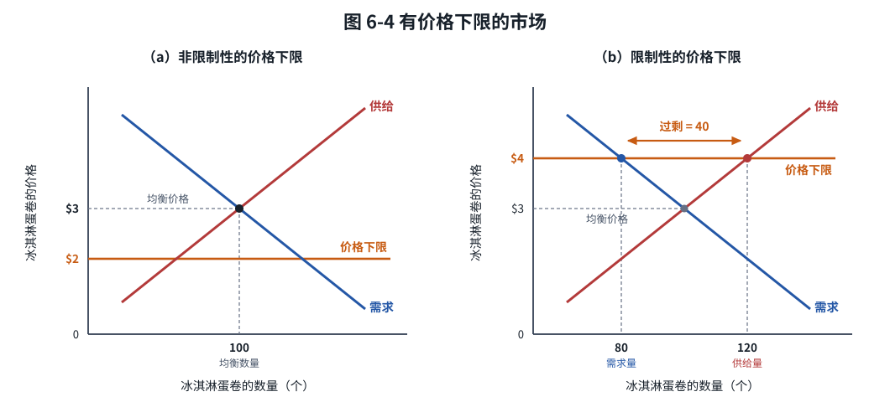
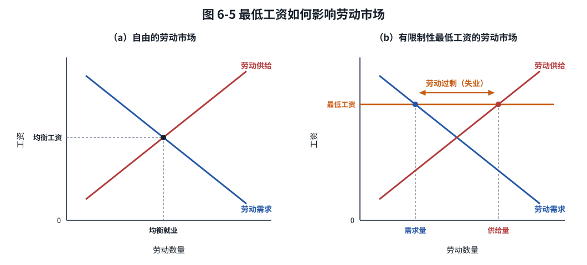

# 价格下限、最低工资与价格控制评价：帮穷人有没有更好的办法

| | |
|---|---|
| 表面 | Book |
| 用时 | 约 15 分钟 |
| 原书 | 曼昆《经济学原理》微观分册第 8 版 · 第 6 章 · 6.1.2–6.1.3（图 6-4、图 6-5、专家看法） |
| 本章深度 | 会判限制性、会析最低工资、会比替代政策 |
| 导航 | [学习台](../README.md) · [上一页](01_price_ceilings.md) · [下一页](03_taxes_on_sellers_and_buyers.md) |

## 学完你能做什么

- 对照曼昆图 6-4，区分非限制性与限制性价格下限，并计算过剩量与实际销售量。
- 对照曼昆图 6-5，分析最低工资对不同技能劳动市场（尤其是青少年市场）的就业与失业影响。
- 从十大原理视角评价价格控制，对比租金补贴、工资补贴（劳动收入税收减免）与直接限价的利弊。

## 概念讲解

### 价格下限如何影响市场结果（6.1.2，图 6-4）

回到均衡为 $(\$3, 100\text{ 个})$ 的冰淇淋蛋卷市场。如果政府采纳制造商组织的游说而设定法定最低价格——**价格下限（price floor）**，同样有两种可能结果：

1. **图 6-4（a）非限制性的价格下限**：政府设定的价格下限为 $\$2$。由于均衡价格 $\$3$ 高于下限 $\$2$，下限没有约束力，市场自发达到 $\$3$、$100$ 个的均衡，**没有影响**。
2. **图 6-4（b）限制性的价格下限**：政府设定的价格下限为 $\$4$。均衡价格 $\$3$ 低于下限，法律不允许市场价格降回均衡水平，实际市场价格停在 $\$4$。在这一价格下，供给量（$120$ 个）超过需求量（$80$ 个），出现超额供给即**过剩**：

$$\text{过剩量} = \text{供给量} - \text{需求量} = 120 - 80 = 40\text{（个）}$$

*图：曼昆图 6-4。（a）价格下限 $\$2$ 低于均衡价格 $\$3$，非限制性；（b）价格下限 $\$4$ 高于均衡价格 $\$3$，具有限制性，供给量 $120$ 大于需求量 $80$，产生 $40$ 个过剩，实际只能卖出 $80$ 个。*

与价格上限类似，限制性价格下限导致的过剩也会催生不合意的非价格配给：想按 $\$4$ 卖货的卖者多于买者，那些因种族或家族纽带等**买者个人偏好**而受青睐的卖者更容易把货卖掉，其他卖者则卖不出去；而在自由市场中，卖者按均衡价格可以卖出自己想卖的全部数量。

---

### 案例研究：最低工资（图 6-5）

价格下限最重要的现实案例是 **最低工资（minimum wage）**——法律规定雇主必须支付的最低劳动价格。美国国会在《1938 年公平劳动标准法案》中首次确立联邦最低工资；2015 年联邦法定最低工资为每小时 $\$7.25$（部分州高于联邦标准；大多数欧洲国家最低工资更高，例如法国平均收入比美国低 $30\%$，最低工资却比美国高 $30\%$ 以上）。

把劳动市场放进供求图（纵轴为工资，横轴为劳动数量）：
- **图 6-5（a）自由的劳动市场**：工人决定劳动供给，企业决定劳动需求，工资自发调整使劳动供求平衡，实现均衡工资与均衡就业。
- **图 6-5（b）有限制性最低工资的劳动市场**：当法定最低工资高于均衡工资时，愿意工作的劳动供给量大于企业愿意雇用的劳动需求量，出现劳动过剩即 **失业（unemployment）**。最低工资提高了保住工作的工人的收入，却降低了那些因此找不到工作的工人的收入。

*图：曼昆图 6-5。（a）自由劳动市场实现均衡就业；（b）高于均衡水平的最低工资使劳动供给量超过劳动需求量，导致失业。*

理解最低工资必须把握**不同劳动市场的差异**：
1. **高技能、有经验工人不受影响**：他们的市场均衡工资远高于法定最低工资，最低工资对他们是**非限制性的**。
2. **青少年劳动市场受冲击最大**：青少年技能最低、经验最少，且常愿接受较低起薪来换取在职培训（无报酬的「实习」之所以存在，正是因为不付工资从而不受最低工资法约束；若强行适用，许多实习岗位就会消失）。
3. **数量估算与结构效应**：有代表性的实证研究发现，**最低工资每上升 $10\%$，青少年就业减少 $1\%\text{–}3\%$**（考虑到不少青少年原本工资已高于最低线且执法并非百分百严格，这一降幅相当显著）。同时，更高最低工资还增加了找工作的劳动供给量——诱使部分在读高中生退学就业，并挤出此前已退学工作的低技能青年使其失业。
4. **政策争论与专家看法**：
   - **支持者**指出低薪工人生活艰难（2015 年两名成年人按 $\$7.25/\text{小时}$ 全职每周工作 $40$ 小时，年总收入仅 $\$30\,160$，虽比四口之家官方贫困线高出 $24\%$，却不到美国中等家庭收入的一半），认为就业负面效应不大，总体能改善穷人处境；
   - **反对者**认为它会造成失业、诱发高中生退学、剥夺不熟练工人的在职培训机会，而且**政策瞄准度欠佳**——不到三分之一的最低工资领取者生活在贫困线以下家庭，许多人其实是中产阶级家庭出来兼职赚零花钱的青少年。
   - **IGM 专家调查（2015 年 9 月 22 日）**：针对「若到 2020 年联邦最低工资逐步提高到每小时 $\$15$，美国低工资工人就业率将比维持现状大幅下降」，受访经济学家中 $34\%$ 同意，其余为不确定与不同意——可见对大幅提标的具体就业冲击幅度，学界内部也存在分歧。

---

### 对价格控制的评价：有没有更好的替代办法？（6.1.3）

第 1 章的两条原理在这里正面交汇：
- **原理六（市场通常是组织经济活动的一种好方法）**：价格不是偶然数字，而是千百万企业与消费者决策汇成的协调信号。法令强行规定价格，就模糊了指引资源配置的信号，因此经济学家通常反对价格上限和价格下限。
- **原理七（政府有时可以改善市场结果）**：政策制定者之所以限价，常是因为觉得市场结果对穷人不公平，希望帮穷人租得起房、挣够生活费。

问题在于，**价格控制往往伤害了它本想帮助的人**（租金控制令房源萎缩失修，最低工资令部分低技能工人失业）。如果想帮助穷人又不破坏价格信号，原书指出更优的替代政策是**补贴**：

| 政策目标 | 价格控制做法（扭曲价格信号） | 替代政策做法（保留价格信号） | 替代政策的代价 |
|---|---|---|---|
| **帮穷人住得起房** | **租金控制**（压缩住房供给量、造成房荒与房屋失修） | **租金补贴**（政府替贫困家庭分担部分房租，不减少住房供给量，不引起短缺） | 需要花费政府财政资金，因此要求**更高的税收** |
| **帮低薪工人增收** | **最低工资**（抬高用工成本，刺激企业少雇低技能工人） | **工资补贴**，如 **劳动收入税收减免（EITC）**（补贴低工资工人收入，不刺激企业少雇人） | 同样需要政府财政资金与税收支持 |

补贴政策虽往往优于直接价格控制，却绝非免费的午餐——筹措财政资金必须征税，而税收本身如何影响市场，正是下一页 6.2 节的主题。

> [!NOTE]
> **标注 · 课本例子**  
> 冰淇淋市场均衡 $(\$3, 100)$：下限 $\$2$ 无影响；下限 $\$4$ 时供给 $120$、需求 $80$，过剩 $40$ 个，实际只卖出 $80$ 个。  
> 最低工资：1938 年法案确立，2015 年联邦标准 $\$7.25/\text{小时}$；每提高 $10\%$ 使青少年就业减少 $1\%\text{–}3\%$；不到 $1/3$ 领取者来自贫困线以下家庭。

> [!WARNING]
> **注意**  
> 把价格上限与价格下限放一起记牢「反向对称」：**上限在均衡下方才有效（造成短缺，成交量看供给量 $Q_S$）；下限在均衡上方才有效（造成过剩，成交量看需求量 $Q_D$）**。无论哪种限制性管制，实际成交量都受市场「短边」（$\min\{Q_D, Q_S\}$）约束而小于自由均衡量！

> [!TIP]
> **关键术语**  
> **价格下限（price floor）**：出售一种物品的法定最低价格。  
> **最低工资（minimum wage）**：法律规定雇主必须支付给工人的最低劳动价格，属于劳动市场上的价格下限。  
> **劳动收入税收减免**：通过税收减免补贴低工资工人收入的政府工资补贴计划。

> [!IMPORTANT]
> **深度解析**  
> 原书课后题提出了一个极妙的追问：奶酪生产者游说到了限制性价格下限，事后却抱怨总收益反而减少了——这可能吗？完全可能！价格下限把奶酪价格抬高到均衡之上，买者只能沿着需求曲线减少购买量；回顾第 5 章，**只要奶酪需求富有弹性（弹性 $> 1$）**，需求量减少的比例就会超过价格上升的比例，生产者整体的总收益 $P \times Q$ 就会下降！

## 小测验

### B02-1 · 选择

以下哪一种情况会增加供给量，减少需求量，并提高消费者支付的价格？

- A. 实施限制性价格下限
- B. 取消限制性价格下限
- C. 把税收加在生产者一方
- D. 取消对生产者征税

要点

A。实施限制性价格下限把市场价格强行抬高到原均衡价格之上：更高价格使消费者支付的价格提高、需求量沿着需求曲线减少，同时使供给量沿着供给曲线增加（产生过剩）。注意 C 项向生产者征税会使供给曲线左移，均衡成交量（供给量）是减少而非增加。

### B02-2 · 简答

如果劳工部提高原本已具限制性的最低工资：（1）就业人数的变动取决于劳动需求弹性还是劳动供给弹性？（2）失业人数的变动又取决于哪一个？

要点

（1）**就业人数**等于受雇数量，由高工资下的**劳动需求量**决定，因此就业变动只取决于**劳动需求弹性**（需求越富有弹性，就业减少越多）。（2）**失业人数**等于劳动供给量减去劳动需求量（$Q_S - Q_D$），提高最低工资既减少劳动需求量又增加找工作的劳动供给量，因此失业变动**同时取决于劳动需求弹性和劳动供给弹性**。

### B02-3 · 简答

为什么租金补贴和工资补贴（如劳动收入税收减免）不会像租金控制和最低工资那样引起住房短缺或低技能工人失业？它们的代价是什么？

要点

租金补贴和工资补贴不强制扭曲市场价格信号：房东仍能拿到市场租金（不减少住房供给量），企业仍按市场均衡工资雇人（不减少劳动需求量），因此不会制造短缺或失业。代价是补贴需要动用政府财政支出，必须通过提高税收来筹资，而税收本身也会带来市场扭曲成本。

## 费曼输出（学完自己讲）

**一句：** 高于均衡价格的限制性价格下限会制造过剩（在低技能劳动市场上表现为失业）；用补贴替代价格控制能保住价格协调信号，但必须承担征税筹资的代价。  
**术语：** 价格下限=出售一种物品的法定最低价格。你补：限制性价格下限下，过剩量等于 ______，实际销售量等于 ______  
**例子：** 最低工资（图 6-5）。你补关键一步：为什么它几乎不影响资深工程师，却显著冲击青少年就业？______  
**提醒：** 切记区分「就业量变动（只看劳动需求弹性）」与「失业量变动（同时看劳动供求两个弹性）」。

## 本页带走

低于均衡价的价格下限无影响，高于均衡价的限制性价格下限引起过剩（图 6-4：$\$4$ 下过剩 $40$ 个）。最低工资作为劳动价格下限，在青少年等低技能劳动市场上造成劳动过剩即失业（图 6-5）。租金补贴与工资补贴优于直接限价，但需要税收支持。

下一页进入第 6 章的另一大政策工具：[向卖者征税与向买者征税：税收楔子与等效性](03_taxes_on_sellers_and_buyers.md)。

掌握路径上，本页对应 [C6-R04](../PRACTICE.md#c6-r04)、[C6-R05](../PRACTICE.md#c6-r05)。
