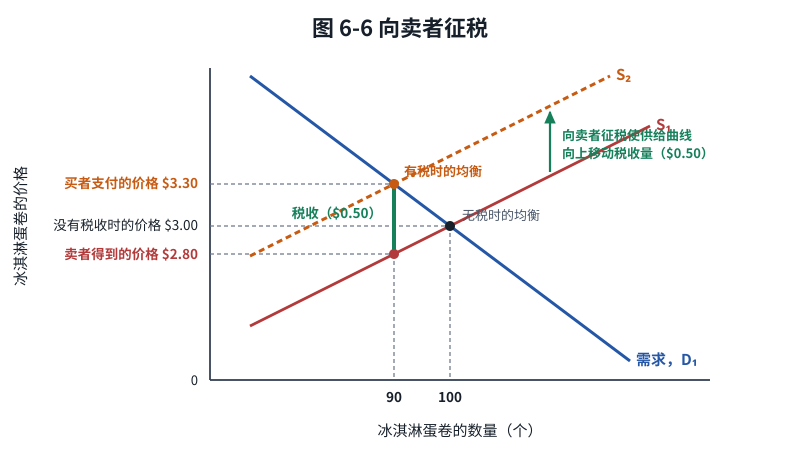
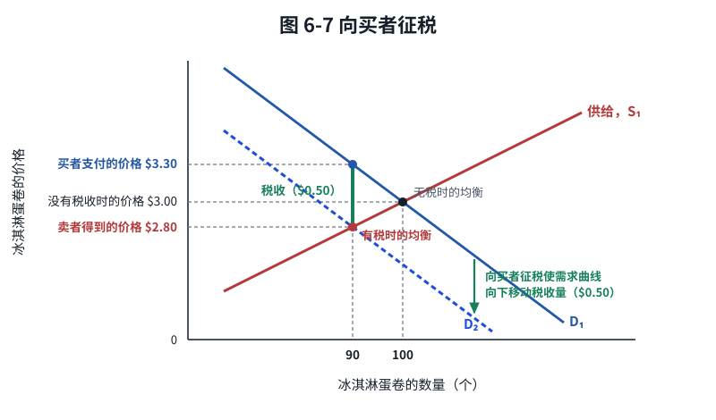
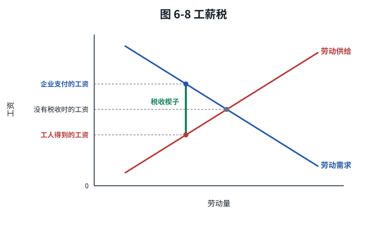

# 向卖者征税与向买者征税：税收楔子与等效性

| | |
|---|---|
| 表面 | Book |
| 用时 | 约 16 分钟 |
| 原书 | 曼昆《经济学原理》微观分册第 8 版 · 第 6 章 · 6.2、6.2.1–6.2.2（图 6-6～6-8） |
| 本章深度 | 会按三步移线、会算买价卖价、会证征税等效 |
| 导航 | [学习台](../README.md) · [上一页](02_price_floors.md) · [下一页](04_elasticity_and_tax_incidence.md) |

## 学完你能做什么

- 定义税收归宿，严格按供求三步法画出并计算向卖者征税（图 6-6）与向买者征税（图 6-7）。
- 说明为什么对买者征税和对卖者征税在经济结果上完全等同，理解「税收楔子」的含义。
- 对照图 6-8（FICA 工薪税），解释为什么立法者能规定谁把税款交给政府，却不能用法律规定税负的真实分摊。

## 概念讲解

### 税收归宿问题：税单寄给谁，谁就承担税负吗？

设想地方政府为筹办年度冰淇淋节，决定对每个售出的冰淇淋蛋卷征收 $\$0.50$ 的税（无税时市场均衡价格为 $\$3.00$、均衡数量为 $100$ 个）。消费者协会要求向卖者征税，制造商组织要求向买者征税，市长则建议折中各付一半。

要评估这些方案，必须回答核心问题：**当政府对一种物品征税时，谁实际上承担了税收负担？** 经济学把税收负担在市场参与者之间进行分配的方式称为 **税收归宿（tax incidence）**。下面直接用第 4 章的「三个步骤」分别推演向卖者征税与向买者征税。

---

### 向卖者征税如何影响市场结果（6.2.1，图 6-6）

假设法律规定：**卖者**每卖出一个冰淇淋蛋卷，必须向政府交纳 $\$0.50$ 税收。

1. **第一步（定曲线）**：并不向买者收税，在任何既定市场价格下买者的需求量不变，**需求曲线 $D_1$ 不变**；税收直接减少了卖者在每一价格水平下的获利，使**供给曲线移动**。
2. **第二步（定方向与幅度）**：征税提高了生产销售成本，供给曲线向左（向上）移动。移动幅度可以精确确定：在任一市场价格下，卖者纳税后实得的有效价格都降低 $\$0.50$；换言之，要让卖者提供任何既定数量，市场价格必须比原先**高出正好 $\$0.50$** 才能弥补税款。因此，**供给曲线从 $S_1$ 向上平移 $\$0.50$ 到 $S_2$**。
3. **第三步（比新旧均衡）**：如图 6-6 所示，均衡数量从 $100$ 个减少为 $90$ 个；市场均衡价格从 $\$3.00$ 上升到 $\$3.30$。
   - **买者支付的价格**：从 $\$3.00$ 升至 **$\$3.30$**（每个多付 $\$0.30$）；
   - **卖者得到的有效价格（税后）**：$\$3.30 - \$0.50 =$ **$\$2.80$**（比无税时的 $\$3.00$ 少得 $\$0.20$）。

*图：曼昆图 6-6。向卖者征 $\$0.50$ 税使供给曲线从 $S_1$ 向上移动 $\$0.50$ 到 $S_2$。均衡量从 $100$ 减为 $90$；买者支付 $\$3.30$（承担 $\$0.30$），卖者税后实得 $\$2.80$（承担 $\$0.20$）。*

由此得出两条基本结论：
- **税收抑制了市场活动**：新均衡下的销售量减少了（$100 \to 90$），市场规模缩小；
- **买者与卖者分摊了税收负担**：尽管全部税款由卖者上交政府，新均衡下买者支付得更多（$\$3.30$），卖者得到得更少（$\$2.80$）。

---

### 向买者征税如何影响市场结果（6.2.2，图 6-7）

现在反过来假设法律规定：**买者**每买一个冰淇淋蛋卷，必须向政府交纳 $\$0.50$ 税收。仍按三步走：

1. **第一步（定曲线）**：既定市场价格下卖者出售激励未变，**供给曲线 $S_1$ 不变**；买者买冰淇淋除了付给卖者货款还要交税，因此**需求曲线移动**。
2. **第二步（定方向与幅度）**：买者关心的是含税总成本。要让买者愿意购买任何既定数量，付给卖者的市场标价必须比原先**降低正好 $\$0.50$** 以抵消税款。因此，**需求曲线从 $D_1$ 向下平移 $\$0.50$ 到 $D_2$**。
3. **第三步（比新旧均衡）**：如图 6-7 所示，均衡数量同样从 $100$ 个减少为 $90$ 个；付给卖者的市场价格从 $\$3.00$ 降到 $\$2.80$。
   - **卖者得到的价格**：从 $\$3.00$ 降至 **$\$2.80$**（每个少得 $\$0.20$）；
   - **买者支付的有效价格（含税）**：$\$2.80 + \$0.50 =$ **$\$3.30$**（比无税时的 $\$3.00$ 多付 $\$0.30$）。

*图：曼昆图 6-7。向买者征 $\$0.50$ 税使需求曲线从 $D_1$ 向下移动 $\$0.50$ 到 $D_2$。均衡数量（$90$）、买者含税支付价（$\$3.30$）与卖者实得价（$\$2.80$）与向卖者征税分毫不差。*

---

### 令人惊讶的等效结论与工薪税案例（图 6-8）

把图 6-6 和图 6-7 叠在一起对比，就得到本章最著名的结论：**对买者征税和对卖者征税是完全等同的！** 在两种征税方式下，税收都在买者支付的价格与卖者得到的价格之间打入了一个相同大小的 **楔子（wedge）**：

$$\text{买者支付的价格} - \text{卖者得到的价格} = \text{单位税收}$$

（在本例中均为 $\$3.30 - \$2.80 = \$0.50$，成交量均为 $90$ 个。）两种征税方式的**唯一区别只是谁负责把这笔钱交给政府**——就像政府在冰淇淋店柜台上放了一只收税碗，无论要求买者直接把 $\$0.50$ 放进碗里，还是先交给卖者再由卖者放进碗里，一旦市场达到新均衡，买卖双方的真实处境完全一样。

#### 案例研究：国会能分配工薪税的负担吗？（图 6-8）

美国联邦政府根据《联邦保险税法案》（FICA）征收工薪税，用于社会保障（Social Security）和医疗保险（Medicare）；2015 年普通工人的 FICA 税总额占其收入的 $15.3\%$。国会立法时特地规定：**企业支付一半，工人从工资单里扣除一半**，试图让劳资双方对半分担。

但把工薪税放进劳动市场供求图（图 6-8），物品是劳动、价格是工资：工薪税本质上只是打入**企业支付的工资**与**工人得到的工资**之间的一个税收楔子。征税后企业用工总成本上升、工人到手工资下降，双方确实分摊了税负，**但真实分摊比例完全由劳动供给与劳动需求决定，与国会在法律条文里写的五五开毫无关系**——就算法律改成全部向企业收或全部向工人收，实得工资、用工成本与就业量也丝毫不变。

*图：曼昆图 6-8。工薪税是打入企业支付的工资和工人得到的工资之间的税收楔子；立法者能决定税款从谁口袋里扣交，却不能用法律规定税负的真实归宿。*

> [!NOTE]
> **标注 · 课本例子**  
> 冰淇淋每卷征 $\$0.50$ 税（原均衡 $\$3.00, 100$ 个）：无论向卖者征（$S_1$ 上移 $\$0.50$，市价 $\$3.30$）还是向买者征（$D_1$ 下移 $\$0.50$，市价 $\$2.80$），新均衡量都是 $90$ 个，买者含税实付都是 $\$3.30$（担 $\$0.30$），卖者税后实得都是 $\$2.80$（担 $\$0.20$）。  
> 美国 FICA 工薪税（2015 年占收入 $15.3\%$）：法定各付一半，真实归宿与立法无关。

> [!WARNING]
> **注意**  
> 做题时必须看清问的是**「买者向卖者支付的市场标价」**还是**「买者含税支付的总价格／卖者税后实得价格」**！如果政府取消向买者征税、改为向卖者征同样大小的税：买者交给卖者的**市场标价会上升**（从 $\$2.80$ 升到 $\$3.30$），但买者含税总支出（$\$3.30$）、卖者税后净收入（$\$2.80$）和销售量（$90$ 个）**全都保持不变**！

> [!TIP]
> **关键术语**  
> **税收归宿（tax incidence）**：税收负担在市场参与者之间进行分配的方式。  
> **税收楔子（tax wedge）**：税收在买者支付的含税价格与卖者得到的税后价格之间拉开的差额。

> [!IMPORTANT]
> **深度解析**  
> 既然对卖者征税和对买者征税结果完全相同，画图分析税收归宿时甚至不必纠结移哪条线——正如下一页图 6-9 将采用的画法：直接保留最初的供给曲线和需求曲线，在两条曲线纵向距离正好等于单位税收量的那个数量处嵌入一根垂直「税收楔子」，上端读买者支付价、下端读卖者得到价，一眼就能看出谁担大头！

## 小测验

### B03-1 · 选择

对一种物品的消费者征收每单位 $\$1$ 的税收，相当于？

- A. 向这种物品的生产者征收每单位 $\$1$ 的税收
- B. 对这种物品的生产者支付每单位 $\$1$ 的补贴
- C. 使该物品每单位价格提高了 $\$1$ 的价格下限
- D. 使该物品每单位价格提高了 $\$1$ 的价格上限

要点

A。对买者征税与对卖者征同额税收完全等同，都会在买者含税价与卖者税后价之间打入 $\$1$ 的税收楔子，产生相同的销售量与税负分摊。

### B03-2 · 简答

假设政府取消向一种物品的买者征税，改为向该物品的卖者征收同样大小的税。请分别说明这四个变量如何变化：（1）买者付给卖者的市场价格；（2）买者包括税在内的总支付；（3）卖者扣除税之后的净收入；（4）销售量。

要点

（1）买者付给卖者的市场标价**上升**，上升幅度正好等于单位税额（例如从 $\$2.80$ 升至 $\$3.30$，因为现在改由卖者代收并上交税款）；（2）买者含税总支付**不变**；（3）卖者扣税后净收入**不变**；（4）市场销售量**不变**。

### B03-3 · 简答

一位参议员想同时实现「增加政府税收收入」和「使工人状况变好」两个目标。幕僚建议：大幅提高由企业缴纳的工薪税，再拿其中一部分新增税收去减少工人缴纳的工薪税。这个建议能帮工人改善处境吗？为什么？

要点

不能。工薪税的归宿只取决于劳动供求弹性，与向企业收还是向工人收无关。如果总工薪税额提高了（企业增税大于工人减税），打入企业支付工资与工人到手工资之间的总税收楔子变大了，就业量和工人实际到手净工资只会进一步下降，工人的状况反而会**变差**。

## 费曼输出（学完自己讲）

**一句：** 对买者征税（需求下移税额）与对卖者征税（供给上移税额）完全等同，都会缩小市场规模并在买卖价格间打入同一税收楔子，立法无法规定税负归宿。  
**术语：** 税收归宿=税收负担在市场参与者之间进行分配的方式。你补：向卖者征 $\$0.50$ 税时，哪条曲线向哪个方向移动多少？______  
**例子：** 冰淇淋柜台上的「收税碗」。你补关键一步：用这个比方一句话讲清为什么法定纳税人不等于实际负税人：______  
**提醒：** 换征税对象会改变价签上的「市场标价」，但不会改变含税买价、税后卖价与成交数量。

## 本页带走

税收抑制市场交易并由买卖双方共同分担税负（图 6-6、图 6-7）。对买者征税与对卖者征税完全等效，本质都是在买价与卖价之间打入税收楔子；FICA 工薪税的真实负担同样由市场供求决定，不能靠立法五五开来指定（图 6-8）。

下一页揭晓决定买卖双方分摊比例的真正幕后推手：[弹性与税收归宿：谁真正承担了大部分税负](04_elasticity_and_tax_incidence.md)。

掌握路径上，本页对应 [C6-R06](../PRACTICE.md#c6-r06)、[C6-R07](../PRACTICE.md#c6-r07)、[C6-R08](../PRACTICE.md#c6-r08)。
