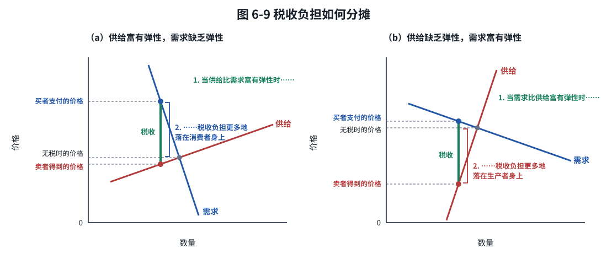

# 弹性与税收归宿：谁真正承担了大部分税负

| | |
|---|---|
| 表面 | Book |
| 用时 | 约 14 分钟 |
| 原书 | 曼昆《经济学原理》微观分册第 8 版 · 第 6 章 · 6.2.3（图 6-9） |
| 本章深度 | 会凭相对弹性判归宿、会析工薪税与奢侈品税 |
| 导航 | [学习台](../README.md) · [上一页](03_taxes_on_sellers_and_buyers.md) · [下一页](05_ch06_summary.md) |

## 学完你能做什么

- 对照曼昆图 6-9，根据供给与需求的相对弹性判断税收负担主要落在买者还是卖者身上。
- 从「不利条件下离开市场的意愿」讲清这一规律背后的经济学直觉。
- 运用这一原理说明工薪税的实际承担者，以及 1990 年美国游艇奢侈品税为何误伤中产阶级工人。

## 概念讲解

### 弹性如何决定税负分摊（6.2.3，图 6-9）

既然买者与卖者共同分摊税负，却只有在极巧合时才五五平分，究竟什么决定谁多担、谁少担？图 6-9 不再画移动后的新曲线（因为上一页已证明移哪条线与归宿无关），而是直接把同样大小的税收楔子放进两个**供求相对弹性相反**的市场：

1. **图 6-9（a）供给非常富有弹性，需求较为缺乏弹性**  
   卖者对价格变动非常敏感（供给曲线较为平坦），买者不敏感（需求曲线较为陡峭）。征税后，卖者得到的价格只下降了很小一点，而买者支付的价格大幅度上升——**买者（消费者）承担了大部分税收负担**。
2. **图 6-9（b）供给较为缺乏弹性，需求非常富有弹性**  
   卖者对价格变动不敏感（供给曲线较为陡峭），买者非常敏感（需求曲线较为平坦）。征税后，买者支付的价格只略微上升，而卖者得到的价格大幅度下降——**卖者（生产者）承担了大部分税收负担**。

*图：曼昆图 6-9。（a）供给比需求富有弹性时，买者支付价涨幅远大于卖者得到价跌幅，消费者承担大部分税负；（b）需求比供给富有弹性时，卖者得到价跌幅远大于买者支付价涨幅，生产者承担大部分税负。*

两幅图共同指向一条普遍规律：**税收负担更多地落在缺乏弹性的市场一方身上。**

为什么会这样？从本质上讲，**弹性衡量当市场条件变得不利时，买者或卖者离开市场的意愿与能力**：
- 需求弹性小，意味着买者对消费该物品缺少适当的替代品；
- 供给弹性小，意味着卖者对生产该物品缺少适当的替代出路。
当政府征税使交易条件恶化时，拥有丰富替代选择（富有弹性）的一方一见价格不利便抽身离场；缺少替代选择、难以离开市场（缺乏弹性）的一方无处可退，只能留下来吃下大部分税收负担。

---

### 现实检验一：工薪税究竟谁担大头？

把这条铁律代回上一页的 FICA 工薪税：大多数劳动经济学家发现，**劳动的供给远比劳动的需求缺乏弹性**（普通工人需要靠工作养家糊口，很难因税后工资降一点就彻底退出劳动市场；而企业相对更容易通过机器替代、调整用工或转移产能来应对用工成本上升）。因此，**是工人而不是企业承担了大部分工薪税的负担**——真实结果与立法者设想的「企业工人各担一半」相去甚远。

---

### 现实检验二：案例研究——谁支付了奢侈品税？

1990 年，美国国会针对游艇、私人飞机、皮衣、珠宝和豪华轿车开征了一项新的奢侈品税，本意是向买得起这类高档商品的富人征税，让最有能力承担的人多交税。

然而供求与弹性的力量迅速给出了完全相反的结果。以游艇市场为例：
- **需求端极其富有弹性**：百万富翁很容易不买游艇，改拿这笔钱去买更大的房子、去欧洲度假，或者留给继承人一笔更大的遗产；
- **供给端（尤其在短期）较为缺乏弹性**：专门建造游艇的船厂无法轻易改做其他用途，熟练的造船工人也很难因为市场景气变化立刻改行。

由于游艇需求富有弹性而供给缺乏弹性（正对应图 6-9b），游艇税后销量骤减、税前出厂价大跌，**税收负担主要落在了建造游艇的企业和工人身上**。造船工人并不是富人，这项旨在「劫富」的奢侈品税最终主要由中产阶级工人买单。错误的归宿假设很快暴露，奢侈品行业的国会议员纷纷反映困境，国会遂于 **1993 年废除了大部分奢侈品税**。

> [!NOTE]
> **标注 · 课本例子**  
> 工薪税：劳动供给远比劳动需求缺乏弹性 $\Rightarrow$ 工人承担大部分工薪税负担。  
> 1990 年奢侈品税（游艇、私人飞机、皮衣、珠宝、豪华轿车）：游艇需求极富有弹性、短期供给缺乏弹性 $\Rightarrow$ 造游艇的企业与中产工人承担大部分税负，1993 年废除大部分奢侈品税。

> [!WARNING]
> **注意**  
> 判断税负分摊看的是**供给弹性与需求弹性的相对大小**，既不看税种名字（叫「奢侈品税」不代表富人买单，叫「企业工薪税」不代表企业买单），也不只看某一方单独弹性的高低——必须把买方的退路和卖方的退路放在一起比谁更缺乏弹性！

> [!TIP]
> **关键术语**  
> **税收归宿的一般规律**：税收负担更多地落在缺乏弹性的市场一方身上，因为这一方在条件不利时缺少替代选择、更难离开市场。

> [!IMPORTANT]
> **深度解析**  
> 把图 6-9 推到极端情形更能一眼看透（如原书课后题中的波士顿红袜队主场 Fenway 公园）：球场只有固定的 $38\,000$ 个座位，门票供给曲线是一条垂直线（**供给完全无弹性，弹性 $= 0$**），而球迷看球的需求向右下方倾斜。哪怕市政府明文规定「向每位购票球迷征收 $\$5$ 门票税」，球迷能承受的含税总票价由 $38\,000$ 张座位对应的需求曲线高度锁死不变，球队只能把不含税票价整整下调 $\$5$ 才能坐满球场——最终**全部 $\$5$ 税负 $100\%$ 落在完全无弹性的球队所有者身上**！

## 小测验

### B04-1 · 选择

如果 ____，那么税收负担将主要落在消费者身上。

- A. 向消费者收税
- B. 向生产者收税
- C. 供给缺乏弹性，需求富有弹性
- D. 供给富有弹性，需求缺乏弹性

要点

D。税负分摊与向谁收税无关（排除 A、B）；税收负担更多落在缺乏弹性的一方身上，因此当需求比供给更缺乏弹性（供给富有弹性、需求缺乏弹性，图 6-9a）时，消费者承担大部分税负。

### B04-2 · 简答

如果政府对豪华轿车每辆征收 $\$500$ 的税，消费者支付的含税购车价格上涨幅度是大于 $\$500$、小于 $\$500$，还是正好等于 $\$500$？为什么？

要点

**小于 $\$500$**（在正常向下倾斜的需求曲线与向上倾斜的供给曲线下）。$\$500$ 税收楔子由消费者涨价部分和生产者降价部分共同拼成；更何况豪华轿车与游艇类似，富有消费者拥有许多替代消费选择（需求富有弹性），而短期车厂与工人供给相对缺乏弹性，不仅消费者涨幅小于 $\$500$，而且大部分税负还会落在生产者一侧。

### B04-3 · 简答

政府想通过每加仑汽油征 $\$0.50$ 税来减少汽油消费、减轻空气污染。如果汽油需求较富有弹性，这项税对减少汽油消费更为有效还是更为无效？结合长期与短期说明。

要点

**更为有效**。给定供给曲线，需求越富有弹性（曲线越平坦），打入同样 $\$0.50$ 税收楔子时均衡数量缩减得越多。由于汽油需求在长期比短期更富有弹性（人们可换购节油车或电动车、改乘公共交通），汽油税在长期减少油耗和污染的效果远比短期显著。

## 费曼输出（学完自己讲）

**一句：** 税收负担按供求相对弹性分配，谁缺乏弹性（替代选择少、更难离开市场），谁就承担大部分税负。  
**术语：** 缺乏弹性的一方承担更多税负。你补：背后的行为原因是弹性衡量 ______  
**例子：** 1990 年游艇奢侈品税。你补关键一步：为什么买游艇的百万富翁躲开了税负，造游艇的工人却替他们买了单？______  
**提醒：** 当某一方完全无弹性（垂直线）时，该方将独自承担 $100\%$ 的税收负担，哪怕法律把税单开给另一方。

## 本页带走

税收负担更多落在缺乏弹性的市场一方身上（图 6-9）：供给富有弹性而需求缺乏弹性时消费者多担，供给缺乏弹性而需求富有弹性时生产者多担。这一规律解释了为何工薪税主要由工人承担，以及为何 1990 年游艇奢侈品税意外伤及造船企业和中产工人并在 1993 年被废除。

下一页收拢第 6 章全部图形与政策框架：[全章收成：第 6 章政府政策分析总览](05_ch06_summary.md)。

掌握路径上，本页对应 [C6-R09](../PRACTICE.md#c6-r09)、[C6-R10](../PRACTICE.md#c6-r10)。
