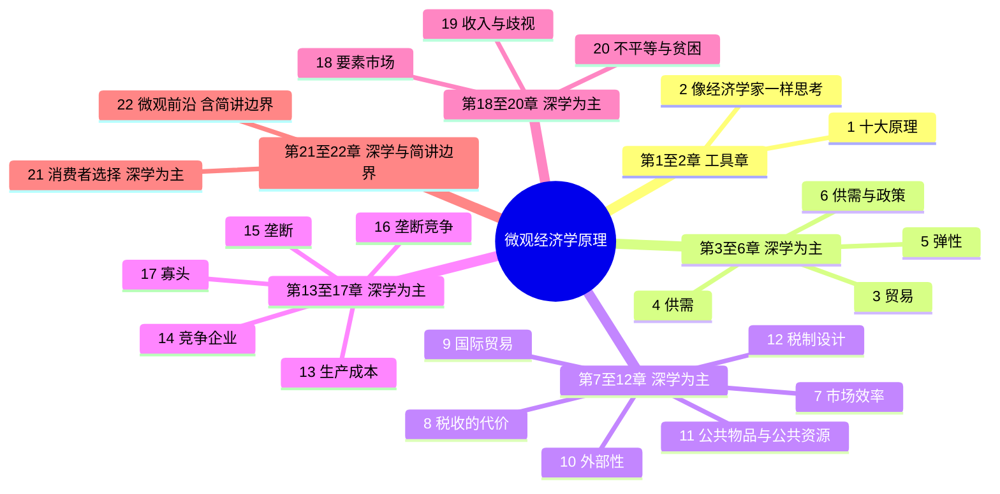
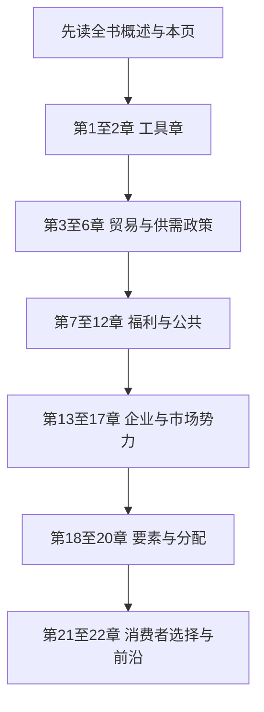

# 全书思维导图

配合 [全书概述](book_overview.md) 使用。概述是一篇大约 8–10 分钟的阅读，回答学这本书的目标、能获得什么、怎样使用。本页只保留结构图。读完概述再看图，然后进入 [第 1 章](chapters/ch01/README.md)。

## 六段结构

第 18–20 章以深学为主。其中歧视的识别、某一张税表是不是「该不该」的问题，证据和价值判断留在边界上，不在导图这一层展开。

## 书序主链

章号按书序往下走：1 → 2 → 3 → 4 → 5 → 6 → 7 → 8 → 9 → 10 → 11 → 12 → 13 → 14 → 15 → 16 → 17 → 18 → 19 → 20 → 21 → 22。

当前能打开的正文只有第 1 章。第 2 章起的文件夹随后按同一模板补：每章先有概述和思维导图，再有小课。
