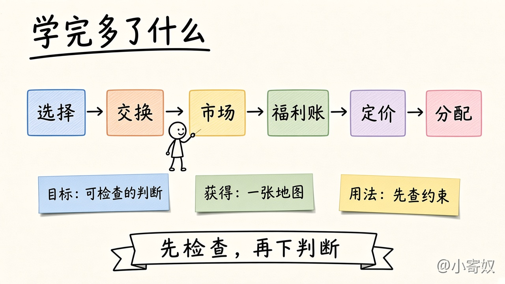

# 全书概述：微观经济学原理（书序）

这篇大约读 **12 分钟**。它回答三件事：这本书的学习目标是什么，读完能获得什么，以及这些知识在真实决定里怎样用。

对齐曼昆《经济学原理》第 8 版微观分册第 1–22 章。下面只用短标题对目录，不摘录原书段落。结构图在 [全书思维导图](book_mindmap.md)。读完本页，再打开 [第 1 章](chapters/ch01/README.md)。本路径从头学，别处做过的笔记不作为免修。

## 学完这本书，我到底多了什么能力？

一个国家的钢铁和劳动是有限的。多造枪炮，黄油就少。一个学生这一周的饭钱也是有限的。多买一盒冰淇淋，披萨就得少买一块。两边都可以举出理由，理由本身并不告诉你该停在哪里。

缺的是一条能把理由排开的检查顺序：哪一种资源真正不够，多做一件事具体少掉什么，再多做一点点值不值，规则和价格会把行为推向哪里，以及这件事是市场在传递稀缺，还是有人把成本漏到了交易外面。

这本书要留下的能力，就是把这种决定写成可检查的判断。判断可以错，但错在哪一步要能指出来。

## 这本书在解决什么问题

资源不够把想要的东西一起做完，这是自己的选择。选择还会碰到别人：你多做一点，好处或坏处不只落在你身上，也落在没和你一起做这个决定的人身上。课本里有三种最常见的情况，名字要和例子绑在一起看。

- **外部性。** 工厂多生产，烟囱的烟飘到隔壁。邻居的衣服脏了，人被呛到。工厂算自己的燃料费，不算邻居的这些损失。坏处落到了交易外面的人身上。
- **市场势力。** 镇上只有一家自来水公司，居民换不了第二家。这家公司可以把水价定得比「很多公司抢着供水」时更高。问题不是水本来就贵，而是买方走不开。
- **信息不对称。** 卖旧车的人知道这辆车是不是经常抛锚，买的人只看见标价。两边掌握的事实不一样，价格就汇总不到车的真实好坏。

价格有时做的是另一件事。夏天变热，想吃冰淇淋的人变多，价格上涨，店家多生产一些，有的人少买一点。价格把「别人现在更想要它」传了过来。这是市场在协调，不是上面的三扇门。

讨论里更容易用一句口号收场：都重要所以都做，贵就是坑，电影票已经买了就不能走。资源冲突、算错成本、用平均数代替下一单位、规则改写了行为、价格在协调、价格在失灵，改法并不相同。

这本书把这六件事分开，并给每一种配上后文会加厚的步骤。两条主线贯穿全书：市场在一定条件下能把互不相识的人协调到一起；市场也会失灵，规则有机会把结果改好。学生的时间本身就稀缺，所以先把地图画清，细节留到对应的章。这套切法的出处写在第 1 章目录里。

## 目标：把决定写成可检查的判断

学习目标可以收成一条链：

**稀缺下的选择 → 交换 → 市场在协调或在失灵 → 福利账 → 企业怎样定价 → 要素与分配。**

链上的每一环，都对应后面一组章，也对应课堂上会反复见到的一类问题。

选择这一环问：不够用的是哪一种资源，多要一边少掉哪一件，成本是不是只计了最佳替代，再多做一单位值不值，规则改了之后行为会滑到哪里。这是第 1–2 章的工具。第 2 章补上模型、假设和其他条件不变，让判断可以被别人复核。

交换这一环问：两人把时间花在自己更顺的环节上再互换，是不是比各自单干更有进展。第 1 章只建立方向，第 3 章才计算比较优势。

市场这一环问：冰淇淋涨价，是因为天热、想买的人多了，还是因为全城只有一家卖，价格里掺进了单方面的加价。第 4–6 章把供需、弹性和税收画成图。第 1 章只让你分清「稀缺在说话」和「要去认失灵的门」。

福利账这一环问：房租被规定不能高于某个数，或者对汽油征税之后，谁得到好处，谁承担代价，饼是变大了还是只是从一个人手里挪到另一个人手里。第 7–12 章用剩余、税收、贸易政策、外部性和税制把这本账做具体。第 1 章只点出「政府有时可以改善市场结果」，并留下上面那三扇门。

定价这一环问：自来水公司再多供一吨水，额外成本和额外收入各是多少；只有这一家卖家时，价格还是不是「别人取舍」的摘要。第 13–17 章从成本走到竞争、垄断和少数厂商的策略。

分配这一环问：劳动、资本和土地按什么被定价，收入差距里哪些能被证据分开，测量贫困和再分配时又要单独拿出价值判断。第 18–20 章做这件事。效率与公平在第 1 章只作为一对常见权衡被认出来，不在那里裁决哪一头应当赢。

第 21 章把预算和偏好补成正式步骤。第 22 章的信息、集体选择和有限理性放在地图边上，完整证明按边界处理。生产率、通胀、通胀与失业的短期关系只在第 1 章标出位置，这条路径不建宏观模型。

### 一条链，三次用法

六个格子是全书的检查顺序。下面三张便签分别对应目标、读完能带走的东西，以及下一次做决定时先做什么。

用枪炮与黄油把链再走一遍，只看每一环在问什么，不在这里下结论。约束是有限的钢铁。权衡是多一把枪就少一些黄油。机会成本是因此放弃的黄油，不是把没买的书、没看的电影全部加总。电影票已经买了、不能退，它不进入「现在还要不要进场」的比较。房租若被规定不能高于某个数，房东往往少提供出租屋。冰淇淋涨价，先看成更多人想买；若全城只有这一家冷饮店，再把它算作市场势力。工厂的烟是外部性，旧车是信息不对称。福利和定价的账留到后面的章。

## 你能获得什么

按章做过练习之后，可以带走四样东西。

第一是一张可复用的解题地图。遇到新问题时，从约束和权衡写起。弹性、剩余、成本曲线、少数卖家的收益矩阵，都是同一条链上后加的工具。

第二是能认出市场成功和市场失灵。冰淇淋涨价不一定是市场坏了，它可能正在把有限的奶油留给更想吃的人。工厂把烟的成本留给邻居、全城只有一家供水、卖车的人隐瞒抛锚，才是另三扇门。认错门，后面会拿错工具。

第三是福利账和定价的入口。这一页不算无谓损失或加价，但会先问：规则是把饼做大，还是把饼切开；企业多卖一单位时，边际收入是不是还等于标价。计算在第 7 章和第 13–15 章。

第四是边界感。宏观路径、某一种分法应当怎样、一篇新闻里的相关能不能当成因果，入门微观不把它们说成定论。知道「这次停在这里」，本身就是学完以后能用的判断。

### 学完应能做到，和容易误以为的

| | 学完应能做到 | 容易误以为学完就是 |
|---|---|---|
| 目标 | 把一个真实决定拆成可检查的步骤，并指出卡在哪一步 | 能背出十条原理或六个篇名 |
| 市场 | 分开「价格在传递稀缺」和「价格漏掉了成本、势力或信息」 | 把贵、排队、不顺心都叫成市场失灵 |
| 账 | 知道福利和定价要问谁得谁失、下一单位值不值，并知道到哪一章才算 | 看到税收或涨价就直接宣布有人受损 |
| 边界 | 宏观、公平裁决、复杂证据题能标成「这次不下定论」 | 用第 1 章的三句话预测通胀或裁定合同应当怎样写 |
| 时间 | 深学章把机制做成步骤；简讲章停在入口 | 22 章平均用力，或只读标题就跳过 |

## 应该怎样使用

### 读法

先读本页和 [思维导图](book_mindmap.md)，知道自己在 22 章的哪一段。进入某一章时，先读该章概述和导图，再做小课。小课回答一个问题；概述回答这一章为什么要有这些问题。

时间不按章均摊。标成深学的，把机制做成自己能复述的步骤，决策四条、供需、福利、成本和定价都在这里。标成中等的，建立直觉，计算和图形留到写明的章，第 1 章的贸易与市场就是这种。标成简讲或简讲知边界的，点名、看一个最小例子、写下后文在哪一章，然后停住。第 1 章大约 100 分钟，用来把地图画清，不把第 3 章以后的图提前做完。

每一课先看图，再用对照表核对口径，然后做短练习。目录级进度在 [按书序学](book_order_path.md)。当前正文是第 1 章，后面的章按同一模板补。

### 用法：先检查，再下判断

下一次看见枪炮与黄油、房租上限或旧车交易，按这个顺序问，不要先找一句口号贴上去。

1. **约束。** 哪一种资源不够：钱、时间、土地，还是钢铁。能同时多要两边的，先从冲突里拿掉。
2. **权衡。** 多得到 A 时，少掉的具体是 B 的哪一部分。效率与公平如果出现，只标成一对，不在这一步裁决。
3. **机会成本。** 只取最佳替代。显成本和隐成本都算，第三名及以后不相加。无论选哪边都付的账单，不构成差别。
4. **边际。** 再多一单位的额外收益和额外成本。平均数描述过去。已经退不回的花费留在比较外面。
5. **激励。** 这条价格或规则让哪个行为变贵，邻近的、没被点名的行为会不会变便宜。
6. **市场或政策。** 价格是在协调，还是要进失灵的某一扇门。若要改规则，先问饼变大还是只是切开，再决定这本账该拿到后面哪一章去算。

这个顺序在第 1 章就能用前四步，后两步先认方向。供需图、剩余和成本函数学完之后，同一步会写得更细，顺序不用推倒重来。

### 用得上的场合，以及不够用的场合

这条链用得上的，是资源冲突已经说得清的情形：枪炮还是黄油，这周的钱更多买披萨还是冰淇淋，房租上限或香烟税会把供给和需求推向哪里。看见工厂排污、独家供水、旧车市场，先问它动的是哪一环。

它不够用的，也要先说清。它不给出「公平应当偏哪一头」的准则，那需要单独的价值判断，第 20 章才有分配的语言，而且仍然不是一张标准答案。它不预测下一季的通胀路径，原理九只说明货币比货物增加得快很多时物价趋于上升。它不把「两个指标一起上升」读成因果，相关和因果是第 2 章的工具。冰淇淋很贵，但街上还有别的店，更像稀缺或口味差别，不要提前叫成垄断。估计很粗、区间重叠时，诚实的结论是先补信息，不是假装链已经算出了唯一方案。

先有一条清晰的检查顺序，后面的章才知道自己在加厚哪一环。增长模型、税制争议和机制设计不放进第一篇。

## 1 分钟费曼

合上本页，用自己的话讲三句：这本书要你获得的能力是什么；下一次看见「枪炮还是黄油」、房租上限或一辆旧车，你会按哪几步检查；哪一类问题你明确不在这 22 章的入门范围里下定论。讲完如果缺了「市场在协调」或「市场在失灵」里的任何一条，回到上面的链再看一眼。

## 下一站

先扫一遍 [全书思维导图](book_mindmap.md)，确认六段的顺序。然后打开 [第 1 章概述与导图](chapters/ch01/README.md)，从决策四条做起。第 1 章的 [勾选清单](chapters/ch01/CHECKLIST.md) 用来记进度，[术语表](chapters/ch01/GLOSSARY.md) 用来回看名词。

## 附录：六段、时间和深度

下面留作查阅，不是本篇要背的篇名。

| 段 | 章 | 这段在建立什么 | 粗标签 |
|---|---|---|---|
| 导言与工具 | 1–2 | 十条原理的地图；怎样把问题写成可检查的模型 | 工具章 |
| 市场如何运行 | 3–6 | 贸易为何互利；价格怎样协调；弹性；限价与税收 | 深学为主 |
| 福利与公共部门 | 7–12 | 剩余与效率；税收和贸易的福利账；外部性、公共物品、税制 | 深学为主 |
| 企业与市场结构 | 13–17 | 成本、竞争、垄断、差异化、少数厂商的策略 | 深学为主 |
| 要素与分配 | 18–20 | 劳动与资本的需求、收入差异、不平等与贫困的测量 | 深学为主，证据问题留边界 |
| 消费者选择与前沿 | 21–22 | 预算与偏好；信息不对称、集体选择、有限理性 | 第 21 章深学为主；第 22 章含简讲边界 |

全书预算大约 30 小时。第 1 章约 100 分钟。其余时间不按章均摊：深学章更厚，简讲边界知道位置就停。

三种深度：

- **深学**：把机制做成能拿来判断的步骤。
- **中等**：建立直觉和后文入口，计算留到指定章。
- **简讲 / 简讲知边界**：点名、一个最小例子、写明展开的章节。第 22 章里完整的机制设计、社会选择证明和前景理论估计，也按边界处理。
