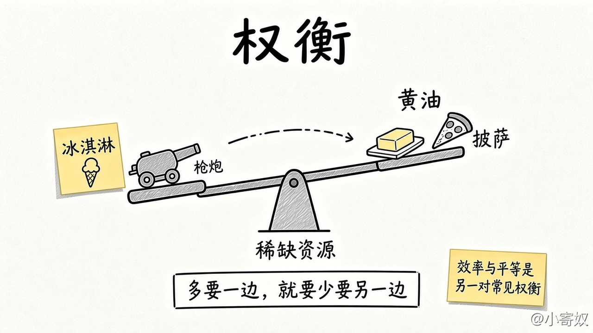

# 01 人们面临权衡

[本章目录](README.md)

**本课深度：深学。** 学完能点名不够用的资源，并写出多得到一边时少掉的是哪一边；效率与平等只作为常见的一对，不裁决该选哪边。福利怎样衡量留给第 7、20 章。

## 原书对应

第 8 版微观分册第 1 章：

- 1-1 人们如何做出决策（原理二至四在 02–04）
- 原理一：人们面临权衡取舍

效率与平等写在这一节里，目录上不另立标题。本章术语表里也写作效率与公平。

## 本课抓住什么

1. 做决定就是在目标之间取舍：多得到一边，通常少掉另一边。前提是资源**稀缺**。
2. 先点名不够用的资源，再写出少掉的那一件：一小时、一块钱，或一盒冰淇淋换走的那块披萨。
3. 社会是同一句话。「枪炮与黄油」：多用于国防，消费品就少；环境更干净，收入往往少一截。
4. **效率**是饼尽量大，**平等**是分得比较均匀。把饼切匀，饼本身常常小一圈。哪一边应当赢，本章不裁决。

## 原书这一节在讲什么

### 原理一：人们面临权衡取舍

要得到自己喜欢的东西，通常就得放弃另一件也喜欢的东西。做决定，就是在目标之间取舍。

#### 前提：稀缺

**稀缺**是前提：时间、收入或土地不够把想做的事一起做完。**权衡**发生在那种不够用的资源上。

#### 一个人：时间和收入

原书先写一个人的时间。学生把一小时用来读经济学，这一小时就不能用来读心理学，也不能用来睡觉、骑车、看电视或打工挣钱。再看家庭怎样花收入。多买食物、衣服或一次出游，留给退休或子女教育的钱就少一截；多花在其中一件上的那一块钱，就不能再花在别的用途上。饭桌上的同一句话是：多买一盒冰淇淋，披萨就少一块。

#### 社会：枪炮与黄油，环境与收入

人组成社会之后，取舍换成公共目标。经典的一对是「枪炮与黄油」：多把资源用于国防，用来提高国内生活水平的消费品就少。另一对是清洁的环境与较高的收入。法律要求企业少排污，生产成本上去，结果往往是利润变薄、工资变低、售价变高，或三者都有一点。环境更干净、健康更好，是得到的一边；企业主、工人和顾客的收入变少，是放弃的一边。

#### 效率与平等

同一节还有福利、失业保险，以及让高收入者多交的个人所得税。这些做法想把好处分得更匀，工作的回报却变小，人们可能少工作、少生产。原书把「饼尽量大」叫做**效率**，把「分得比较均匀」叫做**平等**（本章术语表也写作公平）。把饼切得更匀，饼本身常常会小一圈。

#### 认出权衡，还不选边

认出权衡，还不等于已经知道该选哪一边。学生不必为了多读经济学就放弃心理学；社会也不必因为环保会降低物质生活水平就不再保护环境。这一节先把「多得到一边，少掉的是哪一边」说清楚。哪一边应当赢，本章不裁决。

枪炮多一点，黄油就少一点；冰淇淋多一盒，披萨就少一块。支点是不够用的那种资源。效率与平等若出现，只是饼的大小和饼怎样分，贴上这对标签即可。

## 这一节要带走的

多得到一边，就要少掉另一边。先点名不够用的资源，再写出少掉的是哪一件，从一小时、一块钱到枪炮与黄油、环境与收入。效率是饼尽量大，平等是分得更匀；把饼切匀，饼常常变小。哪一边应当赢，本章不裁决。

## 1 分钟费曼

你面对的稀缺是哪一种资源？多要一边时，具体少掉的是哪一边？若一边是饼的大小、一边是分得匀不匀，怎样只用一句把这对权衡说完？

## 下一课

[02 成本是放弃之物](02_opportunity_cost.md)：把为了得到它而放弃的那一件，收成成本。
