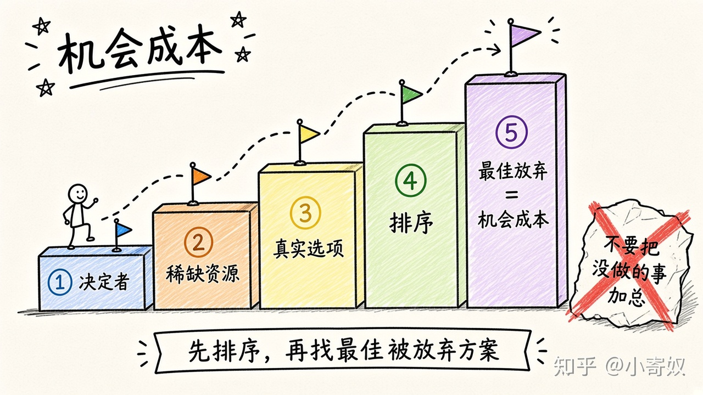

# 02 成本是放弃之物

[本章目录](README.md)

## 原书对应

第 8 版微观分册第 1 章：

- 原理二：某种东西的成本是为了得到它所放弃的东西

## 本课要解决的问题

选定一个方案之后，成本应当记成你因此放弃的最佳替代，而不是发票金额，也不是所有没做的事加在一起。

## 关键术语

- **机会成本**：为了得到某物而放弃的最佳替代的价值。
- **最佳替代**：在你真实会采纳的方案里，排在所选方案后面的那一个。
- **显成本**：为了这个选择才另外支付的金钱。
- **隐成本**：已经拥有的时间或资源，若改作最佳替代所能得到的价值。没有新账单，它仍然是成本。

### 只计最高的那一阶

课本例子是上大学：成本停在你真正会做的最佳替代上（常常是这段时间若工作能挣到的工资），不是把所有没做的事加总。沿着台阶往上排，机会成本停在最高那一阶。

## 机制（四步）

1. 只给真会采纳的方案排序。排第二的是最佳替代。
2. 机会成本等于这个最佳替代的价值。第三名及以后不加进总额。
3. 拆开看：为这个选择才新付的是显成本；自己的时间若去做最佳替代能得到的是隐成本。
4. 无论选哪边都要付的开销，不构成差别，不计入。

### 对照表

| | 进入机会成本 | 留在外面 |
|---|---|---|
| 排序第二的可行方案 | 这就是最佳替代 | |
| 第三名及更后面没做的事 | | 不相加 |
| 为了这个选择才新付的钱 | 显成本 | |
| 自己的时间改作最佳替代能得到的 | 隐成本 | |
| 无论选哪边都要付的账单 | | 不构成差别 |

## 最小例子（课本口径）

上大学的收益是学到的东西和日后的机会。成本不是把所有「没做的事」加总。学费和书本是为了上学才付的显成本。食宿里，不上学也要花的那一部分不算，只有因为上学才多出来的才算。最大的一块常常是隐成本：这段时间若去工作能挣到的工资。

若最佳替代根本不是工作，而是另一件你真会去做的事，工资就退出成本，换上那一件的价值。已经发生、两边都改变不了的开支，不进入「上还是不上」的差别。

## 练习

对一个你正在做的选择写四行：最佳替代（只能一个）；一项显成本；一项隐成本；一件你故意没加进去的放弃项，以及它为什么不是最佳替代。

## 1 分钟费曼

这个选择的机会成本是哪一个最佳替代？显成本和隐成本各占哪一部分？哪几件没做的事没有被加进去？

## 下一课

[03 理性人考虑边际量](03_marginal.md)：方案选定之后，再多做一点点是否值得。
