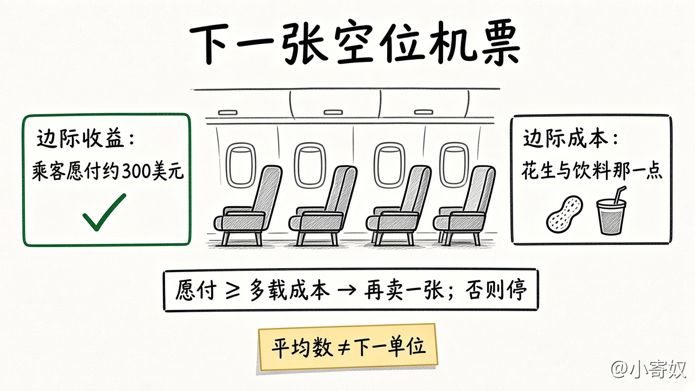

# 03 理性人考虑边际量

[本章目录](README.md)

## 原书对应

第 8 版微观分册第 1 章：

- 原理三：理性人考虑边际量

沉没成本不是这一节的目录标题。本课只把它移出边际比较，详细练习见第 13–14 章。

## 本课要解决的问题

已经做了一些之后，再多做一点点值不值。判断看的是下一单位的额外收益和额外成本，不是到目前为止的平均数。

## 关键术语

- **边际收益**：再增加一单位活动所多得到的收益。
- **边际成本**：再增加一单位所多付出的成本，按上一课的机会成本口径。
- **平均量**：到目前为止的总量，除以已经做过的单位数。它描述过去，不直接回答下一单位。
- **沉没成本**：已经发生、无法收回的成本。下一单位做或不做，它都不变。
- **理性人**：按自己的目标比较边际收益和边际成本的人。不是道德评语。

### 只比较下一单位

左右两边只比较下一单位。已经退不回的花费放在比较外面。平均数那一条也不能代替下一单位。

## 机制（四步）

1. 把决定改写成「要不要再增加一单位」，并写明这一单位是什么。
2. 估计这一单位新得到的收益，以及它新占用的最佳替代。
3. 边际收益高于边际成本，就再做一单位；低于就停。平均数只用来了解过去。平均看起来还好时，下一单位也可以已经不值得。
4. 沉没成本无论下一单位做或不做都收不回，不写入第 2 步的任何一边。

### 对照表

| | 用来决定下一单位 | 不要拿来决定下一单位 |
|---|---|---|
| 边际收益、边际成本 | 再做一单位新得到什么、挤掉什么 | |
| 平均数 | | 早期的结果还摊在里面 |
| 沉没成本 | | 停下来也退不回 |
| 停下来仍能退款或改作他用的花费 | 按机会成本重新算进边际成本 | |

## 最小例子（课本口径）

一趟航班的总成本很高，摊到每个座位上的平均数也不低。飞机即将起飞、还有空位时，多载一位乘客的边际成本只是很小的一份餐食和一点点服务。若候补乘客愿付的价格高于这个边际成本、低于平均成本，卖出这一张仍然可以符合边际比较。已经发生的航班成本退不回来，不决定这一张卖不卖。

同一条比较也用于水和钻石：水不可少，但到处都有时，多一杯的边际收益很低；钻石少，多一颗的边际收益高。价格跟着边际收益走，不跟着「总起来有多不可少」走。

## 练习

选一件「再做一点」的事。写三行：这一单位的边际收益；它的边际成本（指出挤掉的最佳替代）；一个不写入比较的沉没成本。再补一句：平均数为什么不能代替这三行。

## 1 分钟费曼

再多做一单位时，你比较哪两个量？已经花掉、收不回的花费为什么不在这个比较里？

## 下一课

[04 人们对激励作出反应](04_incentives.md)：价格和规则改变边际收益或边际成本之后，行为会怎样挪。
