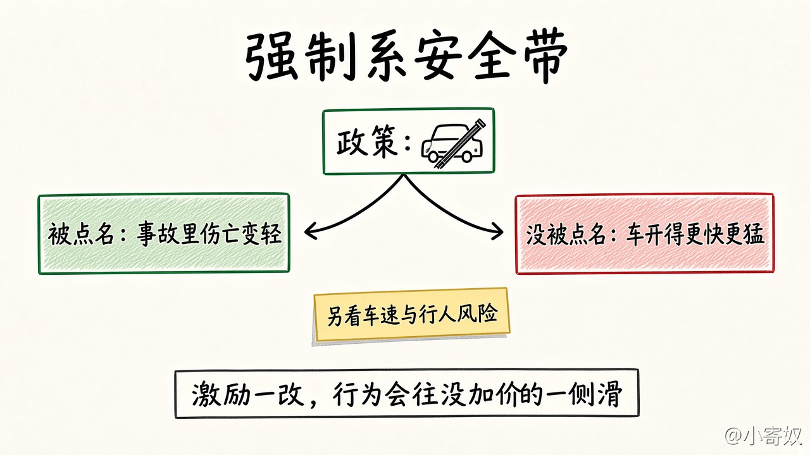

# 04 人们对激励作出反应

[本章目录](README.md)

## 原书对应

第 8 版微观分册第 1 章：

- 原理四：人们会对激励做出反应

## 本课要解决的问题

价格或规则一变，人会改行为；有时改到设计者没点名的那一侧。

## 关键术语

- **激励**：改变某一行为的边际收益或边际成本的因素（价格、罚款、考核等）。
- **非预期后果**：被点名的行为变贵（或变便宜）后，活动滑向邻近、没被同样加价的行为。

### 激励一改，行为会滑

课本例子是强制系安全带：碰撞里伤亡的预期损失下降，等于降低了「开得猛一点」的边际成本。被点名的一侧是伤亡指标；人还可能开得更快、更猛——车速与风险没被同样加价。伤亡数字变好，不等于整体风险下降。

## 机制（三步）

1. 写出规则直接改价的那个行为（安全带例子里：碰撞伤亡的预期损失）。
2. 预期：变贵的少做，变便宜的多做（开得猛一点相对变便宜 → 可能开得更快）。
3. 列出争夺同一风险预算的邻近行为；没被加价的一侧会吸走活动。被考核的数字变好，不等于你真正关心的结果变好。

### 对照表

| | 被规则点名 | 没被点名的邻近行为 |
|---|---|---|
| 安全带例子 | 碰撞伤亡的预期损失下降 | 车速、开得更猛 |
| 成本怎么变 | 点名侧按设计变化 | 相对变便宜 → 活动滑过来 |
| 报表能说明什么 | 点名的指标 | 不能单独代表真实结果 |

## 最小例子（课本口径）

同一机制也见于：汽油税提高 → 少开车、改坐公交。激励改写边际比较，人沿更划算的方向动。

## 练习

选一条你见过的规则（涨价、扣分、补贴）。写三行：哪个行为变贵了；哪个邻近行为变便宜了；你准备同时看哪个没被点名的指标。

## 1 分钟费曼

一条规则改了哪个行为的边际成本？人因此可能多做哪件规则没点名的事？用安全带例子各说一句。

## 下一课

[05 贸易互利与市场协调](05_trade_markets.md)：从一个人面对的激励，走到人和人之间的交换。
