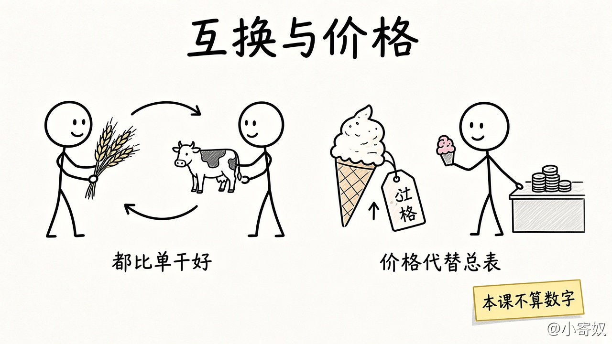

# 05 贸易互利与市场协调

[本章目录](README.md)

## 原书对应

第 8 版微观分册第 1 章：

- 1-2 人们如何相互影响（原理七在 06）
- 原理五：贸易可以使每个人的状况都变得更好
- 原理六：市场通常是组织经济活动的一种好方法

专栏「看不见的手」与同节案例不复述。比较优势的计算见第 3 章，供需图见第 4 章。

## 本课要解决的问题

为什么互换可以都比单干更好？没有总调度时，价格凭什么帮人对齐？

## 关键术语

- **贸易 / 专业化**：把时间更多放在自己机会成本较低的事上，其余靠交换获得。
- **市场**：许多交换汇在一起的安排。
- **价格**：别人愿意为多要一单位而放弃什么，被压成的一个数；用它代替写满所有人约束的总表。

### 互换与价格

左边：互换后双方都可比单干更好。右边：价格把别人的取舍传过来。本课不算数字、不画供需曲线。

## 机制（四步）

1. 各自做全套时，时间会耗在自己不顺手的环节。
2. 若两人在各环节上的机会成本不同，各自专做放弃较少的那一块再互换，两边可用成果都可以比单干时多。
3. **互利**相对各自单干，不是指分得一样多。
4. 市场里，价格上升 → 想要的人少要一点、能供的人多供一点（仍是激励）。通常不必开会清点每个人缺什么。

### 对照表

| | 各自做完整套 | 专业化再交换 | 看见一个新价格 |
|---|---|---|---|
| 时间花在哪 | 也花在自己慢的环节 | 更多花在机会成本较低的环节 | 少用变贵的那种投入 |
| 本课做不做 | 基准 | 不计算谁换谁划算 | 不画供需图 |

## 最小例子（课本口径）

一个更擅长种粮，一个更擅长养牛：各做各的全套，都要把时间耗在自己慢的一侧；专做再互换，双方都可以比单干过得更好。冰淇淋价格上涨时，想买的人少买一点，店家愿意多做一点——报价已经在传「别人现在更稀缺什么」，不必先开一张总调度表。谁相对成本更低、曲线怎么移，第 3、4 章再算。

## 练习

用身边两个角色写三句：各自最拖时间的环节；互换后可能多出什么；若某种投入涨价，你预期会少用什么。

## 1 分钟费曼

为什么两人互换可以都比单干更好？一个上涨的报价代替了哪一种总表？

## 下一课

[06 政府有时改善市场结果](06_government_preview.md)：这套协调什么时候会漏掉重要的成本或收益。
