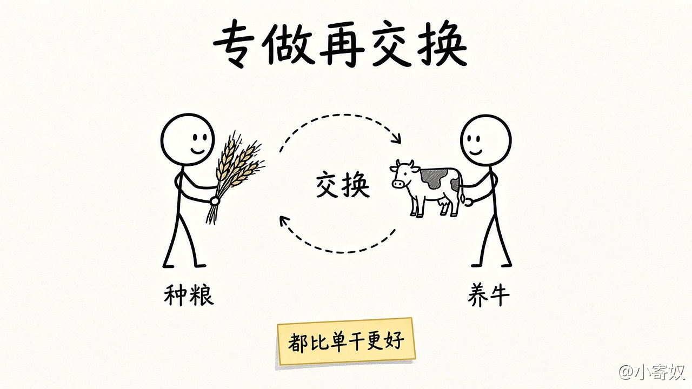
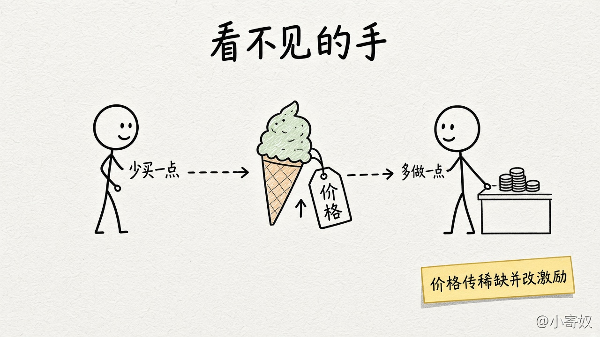

# 05 贸易互利与市场协调

[本章目录](README.md)

**本课深度：中等。** 学完能说出专做再交换为什么可以让双方都比单干更好，以及看不见的手怎样靠价格协调；不算比较优势，不画供需图。计算见第 3 章，图形见第 4 章。

## 原书对应

第 8 版微观分册第 1 章：

- 1-2 人们如何相互影响（原理七在下一课）
- 原理五：贸易可以使每个人的状况都变得更好
- 原理六：市场通常是组织经济活动的一种好方法

比较优势的完整计算见第 3 章；供给与需求曲线见第 4 章。本课只概括第 1 章对这两条原理的表述。专栏里的「看不见的手」，按第 1 章的意思写在原理六下面。

## 本课抓住什么

1. 贸易不是零和。交换让人专做更拿手的事，再换到更多样、成本更低的东西；国家之间是同一句话。
2. 种粮的与养牛的各专一侧再交换，双方都可以比各自单干更好。「更适合」看**机会成本**；即使一方两件事都更快，放弃的比例不同仍可能互利。完整计算见第 3 章。
3. 互利是相对单干而言，不保证分得一样多，也不保证每个短期都不受冲击。
4. **看不见的手**靠**价格**协调：价格反映社会价值，也反映生产成本。冰淇淋涨价，买方少买、店家多做。供需图见第 4 章。
5. 税收或房租管制若不准价格调整，手就难起作用。一家能左右价格，或影响到没参加交易的人，是原理七。

## 原书这一节在讲什么

### 原理五：贸易可以使每个人的状况都变得更好

#### 不是零和

贸易不是零和游戏，也不是一场必须分出胜负的比赛。两国厂商会争夺同一批顾客，家庭在找工作和购物时也彼此竞争。竞争之下，一方多得，另一方并不必然少得。

原书的直觉从家庭写起。一个家庭若和所有别人隔绝，就得自己种粮食、自己做衣服、自己盖房子。和别人交换，每个人可以专门做自己更拿手的事，再换到更多样、成本更低的东西。国家之间是同一句话：贸易让各国专做自己相对更适合的生产。

#### 种粮与养牛

把这个直觉收成一对具体的人。若每个人都又种粮又养牛，时间和技能会被摊薄。一个人相对更适合种粮，另一个相对更适合养牛，各自多做擅长的一侧，再互相交换，双方能得到的组合都可以比各自单干时更好。

「更适合」看的是机会成本：专做某一侧时，放弃的另一侧是多少。即使有一方两件事都更快，只要两人放弃的比例不同，分工再贸易仍可能对双方有利。完整计算见第 3 章。互利是相对各自单干而言，不保证分得一样多，也不保证每个短期都不受冲击。

种粮的与养牛的各专一侧，再把成果换给对方。比较的对象是各自单干。

### 原理六：市场通常是组织经济活动的一种好方法

#### 没有一个总调度

许多人之间的贸易要有安排来协调。中央计划者可以规定生产什么、生产多少、谁生产和谁消费。原书指出，计划者缺少消费者口味和生产者成本的信息，而这些信息在市场经济里反映在价格上。市场经济把决定交给大量企业和家庭：企业决定雇谁、生产什么，家庭决定为谁工作、用收入买什么。他们在市场上相互交易，没有一个总调度去规定每家每户的生产与消费。

#### 看不见的手靠价格

每个人主要关心自己，并没有人专门为「社会整体」值班，结果却常常促进整体的经济福利。亚当·斯密把这只引导称作「看不见的手」。第 1 章里，这只手靠的就是**价格**：买方看着价格决定买多少，卖方看着价格决定供多少。价格既反映一件东西对社会的价值，也反映生产它所费的成本，并由此把分散的决定引向在许多情况下对社会更好的结果。

冰淇淋价格上涨时，想买的人会少买一点，店家更愿意多做一点。双方不必开会清点全城还缺多少盒，报价已经在传递稀缺，并改写节约与增产的激励。供给曲线、需求曲线和均衡，第 4 章再学。

冰淇淋涨价时，买方少买、店家多做。价格既传稀缺，也改激励。

#### 价格若不许调整

政府若不准价格随买和卖调整，手就难起作用。税收扭曲价格，房租管制这一类直接管住价格也一样；图形留到后面。一家企业能左右价格，或一项活动影响到没参加交易的人，市场结果就未必把社会福利做到最大。这两种情况是原理七。

## 这一节要带走的

贸易可以让双方都比各自单干更好：种粮的与养牛的各专一侧再交换，「更适合」看机会成本，完整计算留给第 3 章。互利不保证分得一样多。看不见的手靠价格协调分散的决定；冰淇淋涨价，买方少买、店家多做，供需图留给第 4 章。价格若不许调整，或另有失灵，再看原理七。

## 1 分钟费曼

用自己的话各说一句：原理五里，种粮的和养牛的为什么可以都比单干更好？原理六里，「看不见的手」靠什么在起作用？

## 下一课

[06 政府有时改善市场结果](06_government_preview.md)：市场结果什么时候可能不够好。
