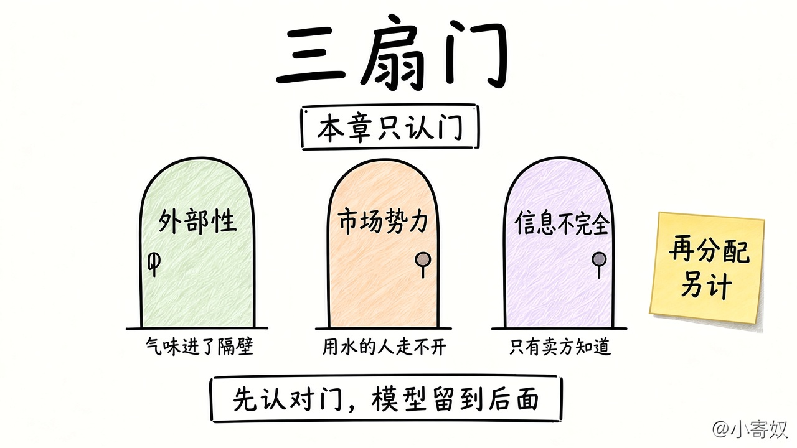

# 06 政府有时改善市场结果

[本章目录](README.md)

## 原书对应

第 8 版微观分册第 1 章：

- 原理七：政府有时可以改善市场结果

信息不完全本章只认门。展开见第 7、10、15–17、22 章；再分配见第 20 章。

## 本课要解决的问题

价格常常能传递参加者的取舍。什么时候这个传递会漏，因而规则有机会把结果改好。

## 关键术语

- **外部性**：行为给没参加交易的人带来成本或收益，决定者的边际比较里没有这一项。
- **市场势力**：一方能单独把价格定在还有许多竞争者时的水平之外。
- **信息不完全**：一方掌握另一方没有的关键事实，价格汇总不到质量或风险。
- **再分配**：改变谁分到多少。不是上面三扇门里的一扇。

### 三扇门，本章只认门

三扇门是价格里漏掉的三类东西。再分配不进门。本章只认门，不做模型。

## 机制（三步）

先有产权：别人不能随意拿走你生产的东西。价格汇总的是参加者自己的边际。下面会漏：

1. **外部性**：局外人的成本或收益不在决定者的比较里。把漏掉的一项加回去，行为会改。
2. **市场势力**：另一侧走不开，定价者停在更小的数量上，一些值得做成的交易不会发生。
3. **信息不完全**：一边只看见价格。按平均情况出价时，好的一方退出。

认对门，不等于任何干预都会更好。

再分配另说：税收和转移改变分法，也会改写工作的激励，于是又碰到效率与公平。本课不选分法。

### 对照表

| | 外部性 | 市场势力 | 信息不完全 | 再分配 |
|---|---|---|---|---|
| 看哪一句 | 受影响的人在不在交易里 | 能不能另找对象 | 关键事实是不是只有一边知道 | 分法要不要改 |
| 课本例子 | 污染 | 镇上唯一的供水 | 卖方知道旧车是否出过事故 | 税收与转移 |
| 后面 | 第 10 章 | 第 15–17 章 | 第 22 章 | 第 20 章 |

报价只是在传递稀缺时，回到第 05 课，不要叫成市场失灵。

## 最小例子（课本口径）

工厂的烟让附近的人承担成本，这笔钱不进再多生产一点的账单。镇上只有一家供水，居民走不开，一些本来值得用的水会用不上。旧车卖方知道事故，买方只看见价格；按平均质量出价，好车退出。

## 练习

各用一句判断：受影响的人在不在交易里；对方能不能换；有没有关键事实只有一边知道。三条都不像，就写「更可能只是稀缺在通过价格说话」。

## 1 分钟费曼

市场会漏掉什么？点出三扇门，各给一个短例子。

## 下一课

[07 宏观边界与第 1 章总复盘](07_macro_boundary_review.md)：把原理八至十标到边上，再把十条收成一张表。
