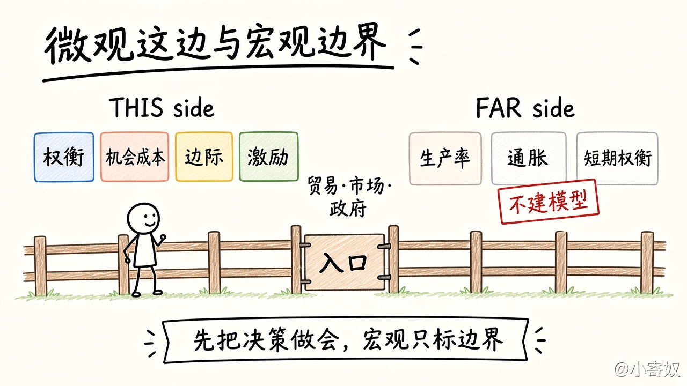

# 07 宏观边界与第 1 章总复盘

[本章目录](README.md)

## 原书对应

第 8 版微观分册第 1 章：

- 1-3 整体经济如何运行
- 原理八：一国的生活水平取决于它生产物品与劳务的能力
- 原理九：当政府发行了过多货币时，物价上升
- 原理十：社会面临通货膨胀与失业之间的短期权衡取舍

本章只标边界。章末名词用总表和 [术语表](GLOSSARY.md) 核对。

## 本课要解决的问题

原理八至十标到哪里为止，十条怎样收成一张能复述的表。

## 关键术语

- **生产率**：一小时劳动能够生产的物品与劳务。
- **通胀**：物价总体水平持续上升。个别物品涨价不一定是通胀。
- **短期权衡**：本课专指压低通胀时，失业可能先上升。不画曲线。

### 栅栏右边只标边界

左边四条要做会，门口是贸易、市场和政府。右边三条只标边界。

## 机制（三条都停住）

1. 一小时劳动的产出更高，物质生活水平才有基础。长期差距主要跟着这种生产能力走。不讲增长核算。
2. 物品与劳务大体不动、货币增加得很快时，同样的东西会标出更高的价格。不写货币公式。
3. 价格和工资往往不能马上全部改完。急着压低通胀，短期里可能先换来更高的失业。不画曲线。

个别物品涨价是相对价格，回到第 05 课，不是物价总体上升。

### 第 1 章总表

| 原理 | 短标题 | 深度 | 课 | 后面再加厚 |
|---:|---|---|---|---|
| 1 | 人们面临权衡 | 深学 | 01 | 第 7、20 章 |
| 2 | 成本是放弃之物 | 深学 | 02 | 第 13 章 |
| 3 | 理性人考虑边际量 | 深学 | 03 | 第 13–14 章 |
| 4 | 人们对激励作出反应 | 深学 | 04 | 第 6、17 章 |
| 5 | 贸易能使人们互利 | 中等 | 05 | 第 3 章 |
| 6 | 市场通常是好的协调方式 | 中等 | 05 | 第 4 章 |
| 7 | 政府有时改善市场结果 | 简讲 | 06 | 第 7、10、15–17、22 章 |
| 8 | 生活水平取决于生产率 | 简讲 | 07 | 不建增长模型 |
| 9 | 货币过多则物价上升 | 简讲 | 07 | 不写货币公式 |
| 10 | 通胀与失业的短期权衡 | 简讲 | 07 | 不画曲线 |

原理六是市场成功的入口，原理七是市场失灵的入口。

## 练习

每问一两句：

1. 多造枪炮时少掉什么？
2. 飞机还有空位。卖不卖下一张票，比的是哪两个量？已经发生的航班成本进不进这个比较？
3. 工厂的烟、镇上唯一的供水、卖方知道出过事故的旧车，各是哪一扇门？
4. 原理八、九、十各用半句说出本章停住的那一句。

## 1 分钟费曼

合上总表讲：哪四条能用来做一个决定；贸易和价格在做什么；三扇门叫什么；哪三条这次不建模型。

## 下一课

第 1 章到这里结束。下一章是第 2 章「像经济学家一样思考」。正文还没写。

回到 [全书概述](../../book_overview.md) 看这章在 22 章里的位置，或打开 [按书序学](../../book_order_path.md) 看第 2 章的目录级预告。
