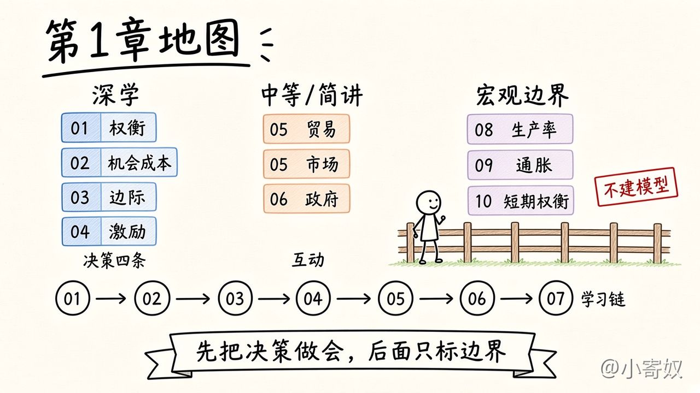
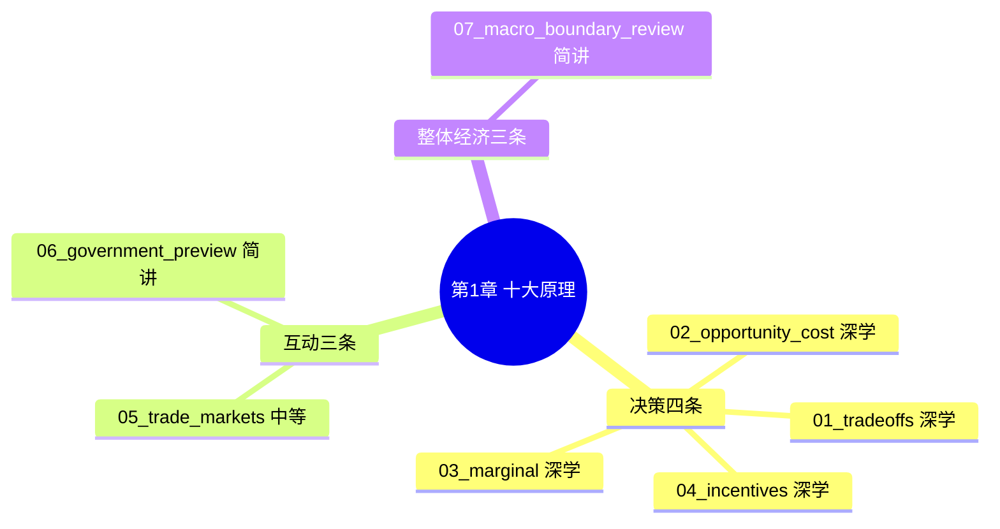

# 第 1 章 经济学十大原理

**第 1 章文档齐备**（概述 · 导图 · 七课 · 配图 · 对照表 · [勾选清单](CHECKLIST.md) · [术语表](GLOSSARY.md) · [原书目录覆盖表](#原书目录覆盖表)）。

对齐曼昆《经济学原理》第 8 版微观分册第 1 章。下面是自编讲解，只用短标题对着目录，不摘录原书段落。

本章大约 **100 分钟**：先读本页概述和两张导图约 6 分钟，再做七课合计约 94 分钟。

## 概述

第 1 章要交一张能带着走的地图：资源不够把想做的事一起做完时，人怎样做选择；这些选择怎样碰到别人；整张地图上哪些区域这次只标边界。十条原理都出现，但只有决策那四条在本章练到能用来判断。

原书把十条分成三大块。第一块是人怎样做决定：权衡、机会成本、边际、激励。第二块是人怎样相互影响：贸易、市场、政府。第三块是经济整体：生产率与生活水平、货币与通胀、通胀和失业的短期权衡。

第一块四课是深学。入门课后面反复用到的，就是这套决定步骤。Frank 一脉的教材也把稀缺下的权衡、按边际比较收益和成本、以及分清哪些成本进入决定，放在最前面反复练。这里把时间花够，供需和企业定价才有可复用的问法。

第二块拆成两课。贸易和市场用中等篇幅：分工可以互利，价格可以在没有总调度的时候传递取舍。政府一课只做简讲，把市场失灵的门打开。市场成功和市场失灵是整门课的两条主线，图形、福利账和三类失灵的机制分别放到第 3–4 章和第 7 章以后。

第三块合成一课，简讲知边界。这条路径先学微观。生产率、通胀、通胀与失业的短期关系，在第 1 章只说明它们在地图的哪一侧，不教增长模型、货币模型或菲利普斯曲线。

七课连成一条链。先承认必须放弃（01），再把放弃折成最佳替代（02），再问再多做一点点值不值（03），再看价格和规则怎样改这个比较（04）。然后把视野从一个人放到交换：贸易为什么能让双方都比各自单干更好，价格在协调什么（05）。交换常常有效，所以接着问它什么时候不够，政府一类规则从哪几扇门进去（06）。最后把宏观三条标成边界，并用一张总表把十条收回来（07）。

第 1 章学完，是指你能用前四条做一个自己的决定；能用几句话说清贸易和市场在做什么，也能说出政府那一课的三扇门通向后面哪几章；能把原理 8–10 放在「这次不展开」的位置上，并凭记忆列出十条短标题。做到这些再打开第 2 章。第 2 章讲怎样把问题写成模型。本章不提前讲模型、实证和规范。

## 思维导图

### 十条原理一张图

左边四课深学，中间是贸易、市场和政府的入口，右边三条只标边界。下面一排是学习顺序 01 到 07。

学习顺序：

## 怎样学

先读完上面的概述、两张导图和章首总图，大约 5–8 分钟，再打开小课。不要从 01 直接开始。进度记在 [勾选清单](CHECKLIST.md)，名词回看用 [术语表](GLOSSARY.md)。

每课 10–15 分钟，一次一课。先看「本课要解决的问题」，再看机制，然后用例子自己走一遍。这和读一篇短论文的四步一样：

1. **问题**：这一课要判断什么。
2. **解法**：机制按哪几步走。
3. **适用边界**：什么情况下这几步不够用。
4. **为何如此**：为什么本章停在这个深度，nuance 留到哪一章。

做文中的练习（大约 2–3 分钟），先写自己的答案，再打开参考要点。最后用 1 分钟，用自己的话复述这一课的问题答案。

每课都有一张手绘白板图和一张对照表，放在术语后面、机制旁边。先看图上的步骤，再用表核对容易写混的那一对，然后回到正文。概述和上面的思维导图仍然先读。

本路径从头学。以前在别处做过的笔记不作为本章免修。

## 章目标

学完本章，你应该能够：

- 把一个真实的时间或产品决定写成权衡，并只把机会成本计在最佳替代上。
- 对「再多做一点」比较边际收益和边际成本，并把已经收不回的花费留在比较之外。
- 看到一条价格或规则时，预期行为会沿哪一侧调整，包括设计者没写进条文的那一侧。
- 用日常语言说明贸易互利和市场协调，不靠计算、不画供需图。
- 点出外部性、市场势力、信息不完全这三扇门，以及原理 8–10 属于宏观边界。

## 深度与时间

| 课 | 文件 | 原理 | 深度 | 分钟 |
|---|---|---|---|---:|
| 章首 | 本页概述与导图 | 全章地图 | — | 6 |
| 01 | [01_tradeoffs.md](01_tradeoffs.md) | 1 人们面临权衡 | 深学 | 15 |
| 02 | [02_opportunity_cost.md](02_opportunity_cost.md) | 2 成本是放弃之物 | 深学 | 15 |
| 03 | [03_marginal.md](03_marginal.md) | 3 理性人考虑边际量 | 深学 | 15 |
| 04 | [04_incentives.md](04_incentives.md) | 4 人们对激励作出反应 | 深学 | 15 |
| 05 | [05_trade_markets.md](05_trade_markets.md) | 5 贸易互利；6 市场协调 | 中等 | 12 |
| 06 | [06_government_preview.md](06_government_preview.md) | 7 政府有时改善市场结果 | 简讲 | 10 |
| 07 | [07_macro_boundary_review.md](07_macro_boundary_review.md) | 8–10 宏观边界，加总复盘 | 简讲 | 12 |
| 合计 | | | | **100** |

七课合计 94 分钟。加上章首，整章约 100 分钟。后面全课程大约 30 小时，本章是稍厚的地基，不是提前把第 3 章以后的内容讲完。全书位置见 [全书概述](../../book_overview.md)。

## 与原书三大块对应

| 原书的块 | 原理 | 本章怎么处理 |
|---|---|---|
| 人们如何做决策 | 1–4 | 四课深学。效率与公平只作为一对常见权衡点到为止。沉没成本只在边际那课里挪出比较，详细练习留到第 13–14 章。 |
| 人们如何相互影响 | 5–7 | 05 中等，建立贸易与市场的直觉。06 简讲，只开市场失灵的门。比较优势的计算在第 3 章，供需图在第 4 章，福利与失灵的深学在第 7 章以后。 |
| 整体经济如何运行 | 8–10 | 07 简讲知边界。微观优先的路径不在第 1 章教宏观模型。 |

## 原书目录覆盖表

下表对着第 8 版微观分册第 1 章目录。短标题只用于对目录，不摘正文。每一行都有着落：深学、中等、简讲，或标明正文展开的后章。勾选见 [CHECKLIST.md](CHECKLIST.md)。

| 原书目录 | 课 | 深度 | 状态 |
|---|---|---|---|
| 1-1 人们如何做出决策 | [01](01_tradeoffs.md)–[04](04_incentives.md) | 深学 | 四课合起来覆盖这一块 |
| 原理一 人们面临权衡取舍 | [01](01_tradeoffs.md) | 深学 | 本章覆盖。效率与公平只作其中一对，不另开目录 |
| 原理二 某种东西的成本是为了得到它所放弃的东西 | [02](02_opportunity_cost.md) | 深学 | 本章覆盖 |
| 原理三 理性人考虑边际量 | [03](03_marginal.md) | 深学 | 本章覆盖。沉没成本不是独立小节，详细练习见第 13–14 章 |
| 原理四 人们会对激励做出反应 | [04](04_incentives.md) | 深学 | 本章覆盖 |
| 1-2 人们如何相互影响 | [05](05_trade_markets.md)、[06](06_government_preview.md) | 中等 / 简讲 | 建立入口，不把后章提前讲完 |
| 原理五 贸易可以使每个人的状况都变得更好 | [05](05_trade_markets.md) | 中等 | 本章只建立直觉；正文展开见第 3 章 |
| 原理六 市场通常是组织经济活动的一种好方法 | [05](05_trade_markets.md) | 中等 | 本章只建立直觉；正文展开见第 4 章 |
| 原理六下的专栏：看不见的手；以及同节案例 | [05](05_trade_markets.md) | 简讲 | 不复述专栏和案例。协调的直觉在 05 |
| 原理七 政府有时可以改善市场结果 | [06](06_government_preview.md) | 简讲 | 本章只标边界；正文展开见第 7、10、15–17、22 章。再分配见第 20 章 |
| 1-3 整体经济如何运行 | [07](07_macro_boundary_review.md) | 简讲 | 本章只标边界 |
| 原理八 一国的生活水平取决于它生产物品与劳务的能力 | [07](07_macro_boundary_review.md) | 简讲 | 本章只标边界；不建增长模型 |
| 原理九 当政府发行了过多货币时，物价上升 | [07](07_macro_boundary_review.md) | 简讲 | 本章只标边界；不写货币模型 |
| 原理十 社会面临通货膨胀与失业之间的短期权衡取舍 | [07](07_macro_boundary_review.md) | 简讲 | 本章只标边界；不画曲线 |
| 章末：内容提要、关键概念、复习与习题 | [07](07_macro_boundary_review.md)、[术语表](GLOSSARY.md)、[勾选清单](CHECKLIST.md) | 简讲 | 用总表和术语核对名词。不做原书习题原文 |

## 专家依据

本章的切法来自这些公开讨论，这里只取教学含义，不摘长段原文。

- Mankiw, N. Gregory. 2020. “Reflections of a Textbook Author.” *Journal of Economic Literature* 58 (1): 215–228. [https://www.aeaweb.org/articles?id=10.1257/jel.20191589](https://www.aeaweb.org/articles?id=10.1257/jel.20191589)  
  学生的时间是稀缺的。入门课先强调大想法，再随着理解加深。第 1 章是地图。

- Mankiw, N. Gregory. 2016. “The Tradeoff between Nuance and Clarity.” *Eastern Economic Journal* 42: 169–170. [https://doi.org/10.1057/eej.2015.58](https://doi.org/10.1057/eej.2015.58)  
  先有清晰，再加 nuance。十条原理给第一次学经济学的人一张简图；第 2 章起才一层层加厚。本章若把贸易计算、供需图和宏观模型一起塞进来，清晰会先丢。

- Federal Reserve Bank of St. Louis. 2024. *Teach Economics* podcast, “Greg Mankiw: When Introducing Economics to Students, It Helps to Keep Things Simple” (October 18). [https://www.stlouisfed.org/education/teach-economics-podcast-series/introducing-economics-to-students-keep-things-simple-greg-mankiw](https://www.stlouisfed.org/education/teach-economics-podcast-series/introducing-economics-to-students-keep-things-simple-greg-mankiw)  
  入门课希望留下两条主线：在一定条件下市场做得好，以及市场也会失灵。第 1 章先把两扇门都指出来，深的内容留给后面。

- Frank, Robert H. 2006. “The Economic Naturalist Writing Assignment.” *Journal of Economic Education* 37 (1): 58–67. [https://doi.org/10.3200/JECE.37.1.58-67](https://doi.org/10.3200/JECE.37.1.58-67)  
  入门决策要反复练一个短清单：稀缺下的权衡、按额外的收益和成本做决定、分清机会成本和边际成本进入比较，沉没成本和平均数常常把比较带偏。所以原理 1–4 深学。

- 兰小欢. 2023. 「关于经济学原理教学的几点思考」. 复旦大学中国社会主义市场经济研究中心. [https://cces.fudan.edu.cn/info/1022/4232.htm](https://cces.fudan.edu.cn/info/1022/4232.htm)  
  概念沿用主流框架，例子用听课的人碰得到的具体情境。本章用研发排期、测试轮次和产品规则举例，不把原理写成时评。

## 过关标准

下面六条都能做到，本章就可以收束：

1. 写出一个你自己的两难，说清稀缺的是哪种资源。效率与公平如果出现，只作为其中一对权衡，不展开成价值争论。
2. 对这个两难指出最佳替代，分开显成本和隐成本，并且没有把所有没做的事加总。
3. 对「再多一单位」写出边际收益和边际成本。已经付掉、收不回的花费不进入这个比较。
4. 改一条价格或考核规则，说出行为会滑向哪里，包括规则没有点名的那一种行为。
5. 不计算、不画图，用自己的话说明：为什么互换任务可以让两边都比各自单干更有进展，价格在代替什么信息。
6. 背出十条短标题，并标上深学、中等或简讲。原理 7 能说出三扇门的名字和后文章号。原理 8–10 能说出「本次不建模型」。

第 07 课的综合练习是一次总检查。做完再决定要不要重读某一课。

## 下一章预告

第 2 章是「像经济学家一样思考」：模型靠哪些假设、其他条件不变是什么意思、相关和因果怎样分开、实证表述和规范表述各做什么。那些是工具，本章的地图还没用到它们。

第 2 章正文尚未写入 `chapters/`。写的时候会先有概述和思维导图，再有小课。目录级预告见 [按书序学](../../book_order_path.md)。
