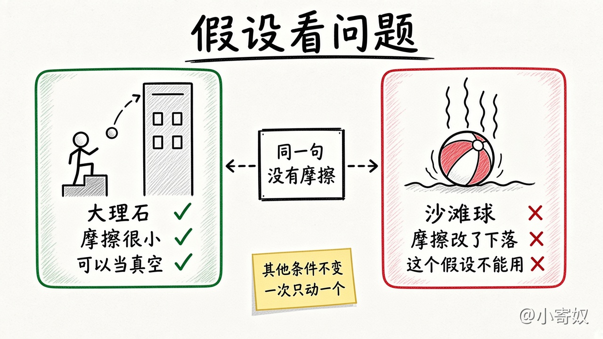

# 01 作为科学家：假设与模型

[本章目录](README.md)

## 原书对应

第 8 版微观分册第 2 章：

- 2-1 作为科学家的经济学家（循环流量图、生产可能性边界、微观与宏观在后面三课）
- 科学方法：观察、理论和进一步观察
- 假设的作用
- 经济模型

附录把「其他条件不变」用来单独看一个因素。小说价格怎样影响购买量、收入先固定，那张需求曲线留到第 4 章。两件事一起变化还不等于谁导致谁，见第 06 课（附录「原因和结果」）。

## 原书这一节在讲什么

### 科学方法：观察、理论和进一步观察

经济学家想以科学家的客观性来看经济：提出理论，收集数据，再分析数据，看理论站不站得住。科学的核心是这套方法，不是试管或望远镜。

原书用物价飞涨走一遍。生活在物价迅速上升的地方，可能提出一种通胀理论：政府发行了过多货币，高通胀就出现。检验是收集许多国家的物价和货币量。对不上，理论就可疑；各国数据里两者紧密相伴，理论就更可信。第 1 章原理九只把这句标在边界上。这里只把它当作观察、理论和再观察，仍不写货币模型。

难处是：往往不能为了数据去操纵一国的政策。研究重力可以把物体扔下楼；研究通胀不能为了实验去改货币。经济学家更像天文学家，用世界已经给出的数据。历史里的自然实验是替代。中东战争打断原油运输，世界油价飞涨。对经济学家，这是观察一种重要资源怎样影响世界经济的机会。

### 假设的作用

问一块大理石从十层楼落下要多久，物理学家可能假设它在真空里下落。楼外有空气，摩擦会让它稍慢，但这点摩擦小到可以忽略。假设不真实，答案几乎不受影响。

换成沙滩球，同一句「没有摩擦」就不合适：空气对沙滩球的作用大得多。假设要跟着问题走。

做假设，是为了把世界简化到能解释。研究国际贸易，可以假设只有两个国家，每个国家只生产两种产品。现实里国家很多、产品成千上万。先在假想世界里把贸易想清楚，计算见第 3 章。

假设也随问题而变。研究货币量变动，要看价格怎样反应。报摊上的杂志价格可以好几年不动。看短期，可以假设价格变动不大，甚至完全固定；看长期，可以假设价格都能调整。和大理石、沙滩球是同一件事。

附录把一种常用的简化叫做其他条件不变：要看一个因素，先把其余相关因素当成不动。看小说价格怎样影响买多少，先把收入固定。收入若同时变了，买多少就混进了别的原因。

被放下的那一项若会改这一问的答案，假设就不适用。沙滩球的摩擦、短期里不能当成完全可变的价格，都属于这一类。简单本身不是错；简单若拿掉了关键原因，就要换假设，或把模型加厚。

大理石落下，空气摩擦小，当成真空几乎不改答案。沙滩球用同一假设，会把下落说错。

### 经济模型

高中生物用塑料人体讲解剖：心脏、肝脏、肾脏都在，许多肌肉和毛细血管不在。没有人把它当成真人。正因为略去细节，器官怎样连在一起才看得清。

经济模型通常是图形和方程。它同样故意不画经济的每一个特征，把与这个问题无关的细节先放下。后面各章的模型都站在这样的假设上。

留下这一问要看的连接，拿掉用不上的细节。把它当成完整现实，就用错了。

## 这一节要带走的

理论来自观察，再用数据或历史里的自然实验去对。假设和模型都可以不真实。要问的是：放下的那一项，会不会把这一问的答案带偏。

## 1 分钟费曼

大理石和沙滩球，「没有摩擦」各能不能用？中东战争打断原油运输，为什么对经济学家是一次观察，而不是实验室里扔下的石头？其他条件不变，是在固定什么？

## 下一课

[02 循环流量图](02_circular_flow.md)：第一个模型，家庭和企业怎样通过两个市场对着走。
