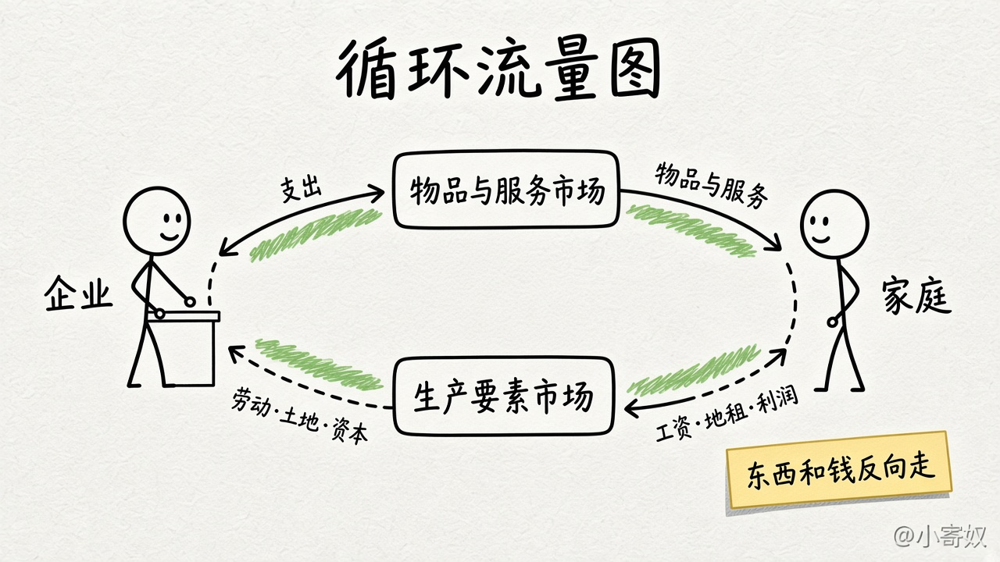

# 02 循环流量图

[本章目录](README.md)

## 原书对应

第 8 版微观分册第 2 章：

- 我们的第一个模型：循环流量图

下图对应原书的循环流量图（图 2-1）。原书用「循环流量图」这个名字；导航里有时写作循环流向图，是同一张图。政府和国际贸易不在图里。

## 原书这一节在讲什么

经济里有千百万人在买、卖、工作和雇用。要看出它怎样组织起来，需要一个模型，把所有这些活动收成一张简图。

循环流量图把决策者收成两类：家庭和企业。企业用劳动、土地和资本（建筑物和机器等）生产物品与服务。这些投入叫做生产要素。家庭拥有生产要素，并消费企业生产的物品与服务。

两类人在两个市场上交易。在物品与服务市场上，家庭是买者，企业是卖者：家庭购买企业生产的物品与服务。在生产要素市场上，家庭是卖者，企业是买者：家庭提供劳动、土地和资本。

图上有两圈，方向相反。里面一圈是投入与产出。家庭在生产要素市场上把劳动、土地和资本卖给企业；企业用这些要素生产物品与服务，再在物品与服务市场上卖给家庭。外面一圈是货币。家庭花钱购买物品与服务；企业用一部分销售收入支付要素的报酬，例如工资，剩下的是利润。企业所有者也是家庭的成员，利润回到家庭。东西往这边走，钱往对面走。

原书拿一张钞票走一圈。它先在某个家庭的钱包里。拿去物品与服务市场买一杯咖啡，它进了店里的收银机，成为企业的收益。它停不久：企业要在生产要素市场上付房租或工资。这张钞票又成为某个家庭的收入，回到一只钱包，循环再开始。

这是简化。更完整的图会放进政府和国际贸易。付出去的那一杯，可能有一部分变成税，咖啡豆也可能来自国外的农户。这些细节对「经济大体怎样接在一起」不是必须的。记这张图，是为了想各部分如何拼起来时有一个底图。

上边是物品与服务市场，下边是生产要素市场。内圈是货物和要素，外圈是支出和收入，方向相反。

## 这一节要带走的

两类决策者，两个市场。实物和货币是同一笔交易的两面。政府与国外贸易是这张图故意没画的。

## 1 分钟费曼

在生产要素市场上，谁是买者，谁是卖者？一杯咖啡的钱怎样回到一只钱包？这张图放下了哪两件现实里有的事？

## 下一课

[03 生产可能性边界](03_production_possibilities.md)：第二个模型，资源既定时两种产品最多能到哪。
