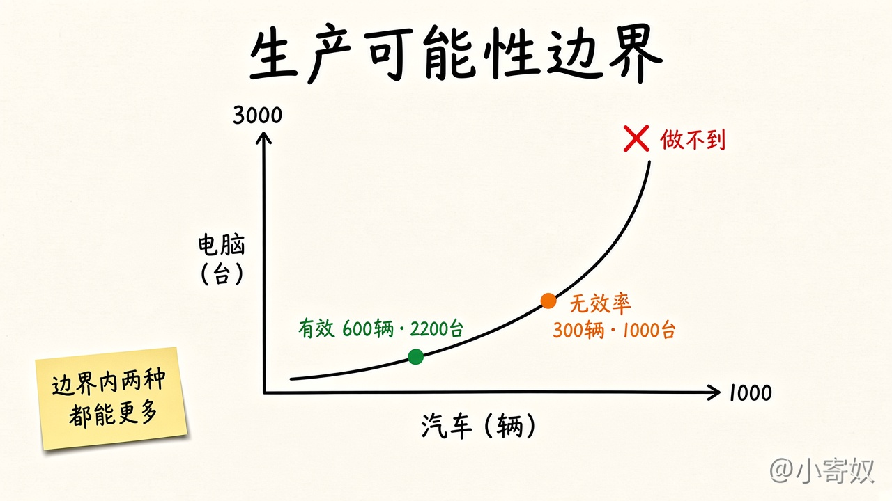
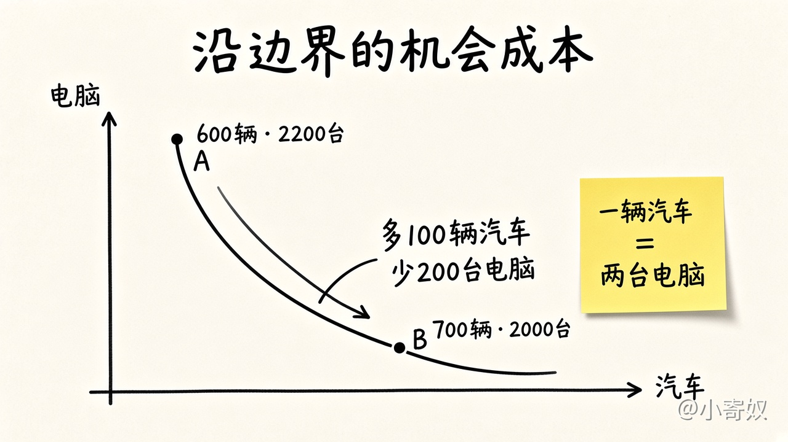
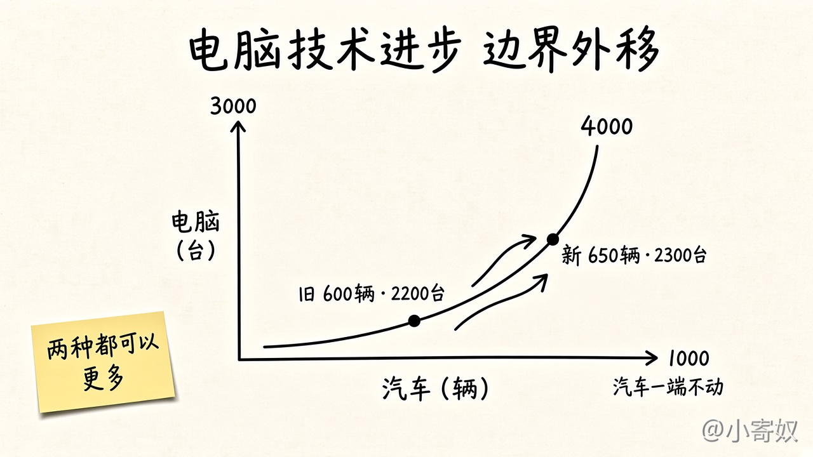

# 03 生产可能性边界

[本章目录](README.md)

## 原书对应

第 8 版微观分册第 2 章：

- 我们的第二个模型：生产可能性边界

第一张图对应原书图 2-2：边界上、边界以内、边界以外，以及沿边界移动时的机会成本。第二张图对应沿边界的那一步斜率。第三张图对应原书图 2-3：电脑行业技术进步使边界向外移动。附录用斜率复习作图；这里只把它用在汽车和电脑上。

## 原书这一节在讲什么

生产可能性边界是一个简单的经济模型，用来把几条基本想法画在一起。现实里有成千上万种物品。这里设想一个只生产汽车和电脑的经济，两个行业共用全部生产要素。边界表示：生产要素和生产技术既定时，这两种产品能够达到的各种数量组合。

全部资源用于汽车，得到 1000 辆汽车、0 台电脑。全部用于电脑，得到 3000 台电脑、0 辆汽车。两端是两种极端。更常见的是两边都生产。边界上可以是 600 辆汽车和 2200 台电脑；把一部分要素从电脑转到汽车，可以变成 700 辆汽车和 2000 台电脑。

资源稀缺，不是每种想象都做得到。边界以外的组合，在现有技术和要素下做不到。边界上和边界以内做得到。

有效率，是指从稀缺资源里得到了所能得到的。边界上的点是有效率的：不减少一种产品，就无法增加另一种。边界以内是无效率。原书用普遍失业作原因：经济只生产了 300 辆汽车和 1000 台电脑，少于资源允许的产量。从这一点挪到边界上的 600 辆和 2200 台，两种都可以更多。

边界以内还能同时多得到汽车和电脑。到了边界上，多要一种就必须少另一种。

第 1 章的权衡，在这里是社会的权衡。一旦停在边界上有效率的一点，多得到一种物品的办法，就是少生产另一种。从 600 辆、2200 台移到 700 辆、2000 台，多了 100 辆汽车，少了 200 台电脑。这 100 辆汽车的机会成本是 200 台电脑，也就是每辆汽车两台电脑。这个代价等于边界在该处的斜率：纵轴上电脑的变动，除以横轴上汽车的变动。

用电脑衡量的汽车机会成本不是常数，要看已经在生产多少。边界凹向原点。大部分资源用于电脑、只生产少量汽车时，边界较平，汽车的机会成本较低：最适合造汽车的资源，例如熟练的汽车工人，还在电脑行业里。他们并不擅长造电脑，多造一辆汽车只挤掉很少电脑。大部分资源已经在造汽车时，边界变陡：再多一辆，就要把最好的电脑技工调去做汽车，电脑会少掉不少。

斜率是机会成本。边界凹向原点，是因为资源不是同样适合两种生产。

边界画的是某一时点的权衡，随时间可以变。假设电脑行业技术进步，每个工人每周能造出更多电脑。任何既定的汽车产量下，电脑都可以比以前多。若完全不生产电脑，汽车仍是 1000 辆，这一端不动。只要有资源用在电脑上，电脑就更多，边界向外移动。社会可以从旧边界上的一点走到新边界上的一点，两种都增加：例如从 600 辆汽车、2200 台电脑，到 650 辆汽车、2300 台电脑。新边界上选哪一点，看社会对两种物品的偏好。

沿边界移动，是在既有资源和技术下重新配置。整条边界外移，才是技术或资源变了。

## 这一节要带走的

边界上有效，以内无效率，以外做不到。沿边界的斜率是机会成本，并且通常随产量组合而变。外移和沿着走不是同一件事。

## 1 分钟费曼

300 辆汽车和 1000 台电脑是哪一种点，为什么两种都能增加？从 600 辆、2200 台走到 700 辆、2000 台，一辆汽车的机会成本是多少台电脑？电脑技术变好时，为什么汽车那一端可以不动，两种产量却可以同时提高？

## 下一课

[04 微观与宏观](04_micro_macro.md)：两个领域各问什么，又怎样连在一起。
