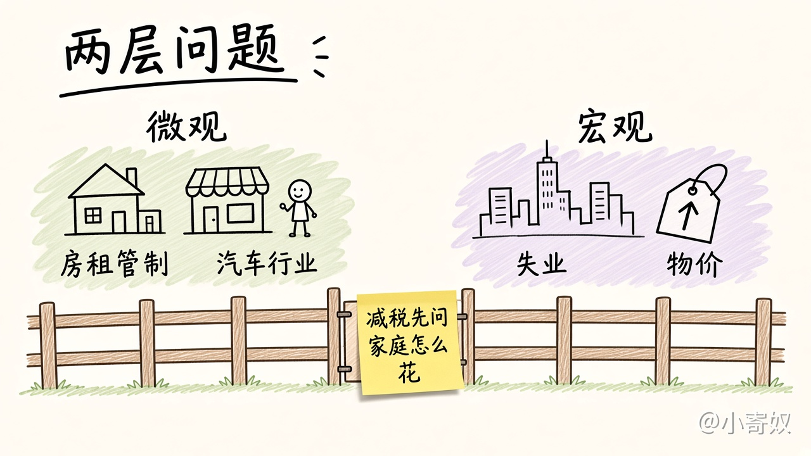

# 04 微观经济学与宏观经济学

[本章目录](README.md)

## 原书对应

第 8 版微观分册第 2 章：

- 微观经济学与宏观经济学

本章只把两个领域分开，并记住它们连在一起。通货膨胀、失业和增长的模型仍不在这里建，与第 1 章原理八至十的边界相同。

## 原书这一节在讲什么

许多学科分层次。生物学里，有人看构成生命的化学分子，有人看细胞，有人看物种怎样进化。经济学也分层次。可以研究单个家庭与企业的决定，可以研究某一种物品与服务市场上他们怎样交易，也可以研究这些市场上全部决定加总之后的整体经济。

传统上分成两个领域。微观经济学研究家庭和企业如何做决定，以及他们如何在特定市场上相互交易。宏观经济学研究整体经济现象，包括通货膨胀、失业和经济增长。

原书举的微观问题是：租金控制怎样影响纽约市的住房，外国竞争怎样影响美国汽车行业，义务教育怎样影响工人的收入。宏观问题是：联邦政府借债有什么影响，失业率怎样随时间变动，哪些政策能提高一国的生活水平。

两者是连着的。整体经济的变动来自千百万个人的决定，抛开相关的微观决定，就看不懂宏观。宏观经济学家若问联邦个人所得税减少会怎样影响物品与服务的总生产，就得考虑家庭会把多少钱改用于购买。第 1 章已经把生产率、过多的货币、短期里通胀与失业的权衡标在边界上。这一节补上两个领域的名字，以及一句：宏观问题要落到家庭和企业的决定上。

两个领域强调的问题不同，各有一套模型，通常分在不同的课程里讲。这条路径先走微观。

左边是租金控制、汽车行业这一类市场问题。右边是整个经济的失业和物价。减税若要影响总生产，仍要先问家庭怎样花钱。

## 这一节要带走的

微观是家庭、企业和某一个市场。宏观是通胀、失业和增长这一类整体现象。整体仍然由一个个决定加总而来。

## 1 分钟费曼

房租管制和失业率，哪一个是微观问题，哪一个是宏观问题？减税若要影响物品与服务的总生产，中间必须经过谁的决定？

## 下一课

[05 实证与规范](05_positive_normative.md)：解释世界，和主张世界应该怎样，不是同一种话。
