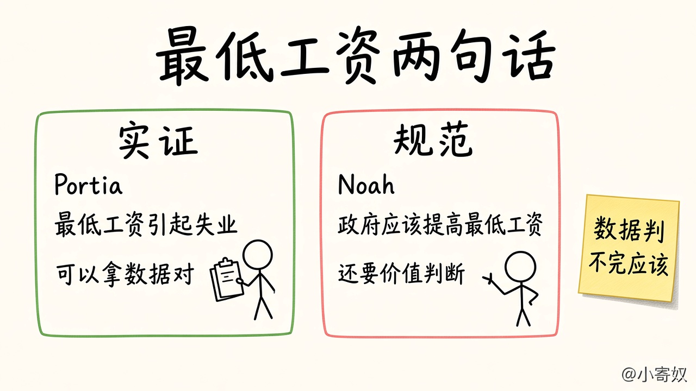

# 05 作为政策顾问：实证与规范

[本章目录](README.md)

## 原书对应

第 8 版微观分册第 2 章：

- 2-2 作为政策顾问的经济学家
- 实证分析与规范分析
- 华盛顿的经济学家们
- 为什么经济学家的建议并不总是被采纳

最低工资会不会、以及在多大程度上引起失业，图形留到第 6 章。本课用书里的两句话把两类表述分开。

## 原书这一节在讲什么

人们有时要经济学家解释世界，例如为什么青少年失业率更高；有时要他们提出改善的办法。前一种角色是科学家，后一种是政策顾问。

### 实证分析与规范分析

两种角色说话不同。原书让两个人讨论最低工资法。

Portia：最低工资法引起了失业。

Noah：政府应该提高最低工资。

先不管同意不同意。Portia 在说世界怎样运转，像科学家。Noah 在说他想怎样改变世界，像政策顾问。

关于世界的表述分两类。实证表述是描述性的，试图说明世界是什么样。规范表述是规定性的，试图说明世界应该是什么样。Portia 那句是实证的，Noah 那句是规范的。

差别在于怎样判断对错。实证表述原则上可以用证据确认或否定：看一段时期里最低工资和失业怎样变动，来评价 Portia。规范表述既要事实，也要价值观。数据单独判不了 Noah。什么是好政策，还涉及伦理、宗教和政治哲学。

两类话常常连在同一个人身上。若 Portia 是对的，她可能就不再同意应该提高最低工资。规范结论仍然不能只从实证推出来。本书许多内容只解释世界如何运行；用它来问如何改善经济时，人已经站到政策顾问一边。有的判断不写出「应该」，仍要看它是不是在给目标排序。

左边原则上可以用数据去对。右边还要问，在失业与收入的取舍里什么更值得。

### 华盛顿的经济学家们

杜鲁门想找一位「独臂」的经济学家。他请人提建议，听到的总是「一方面……另一方面……」。这来自第 1 章那条权衡：一项提高效率的政策可能损害平等，一项有利子孙后代的政策可能损害这一代。把每项政策都说成轻而易举、利弊分明的经济学家，不值得信任。

自 1946 年以来，总统得到经济顾问委员会的指导。委员会的职责是提建议，并撰写每年的《总统经济报告》。管理与预算办公室、财政部、劳工部和司法部里也有经济学家，分别碰到支出与监管、税收、劳动市场和反垄断。国会预算办公室向国会提供独立评价。美联储雇用经济学家分析经济状况。

影响还不限于顾问职务。凯恩斯认为，经济学家的思想比实干家自以为的更有力量。原书说，这句写于 1935 年的意思今天仍在，而现在影响政策的往往包括凯恩斯本人的想法。

### 为什么建议并不总是被采纳

向总统或其他民选领导人提建议的经济学家知道，建议并不总被看重。课本讨论政策时，常常集中在一个问题：什么是最好的政策？这样写，像是假定政策由一位仁慈的国王决定，选对了就能施行。

在现实里，选定政策只是工作的一部分。总统听完哪一项最好，还要听公关顾问怎样向公众解释，新闻顾问媒体会怎样报道，法律顾问议会会怎样修改、通过的可能性有多大，政治顾问哪些集团会支持或反对、选举里的形象会怎样变。权衡之后他才决定下一步。在代议制民主里，总统常常有理由不采用经济学家的方案。建议只是这个过程里的一种要素。

## 这一节要带走的

「世界是什么样」原则上能用证据去对。「世界应该怎样」还要价值排序。顾问说「一方面，另一方面」，是因为政策多半是权衡。指出一项最好的政策，还不等于它会被选中。

## 1 分钟费曼

Portia 和 Noah 的两句，哪句是实证，哪句是规范？为什么数据判不完「应该提高最低工资」？杜鲁门为什么讨厌「另一方面」？总统不采纳一条经济建议，书里还写了哪些原因？

## 下一课

[06 分歧、因果与章复盘](06_disagreement_review.md)：意见为什么会分，以及图形里的一起变动为什么还不等于因果。
