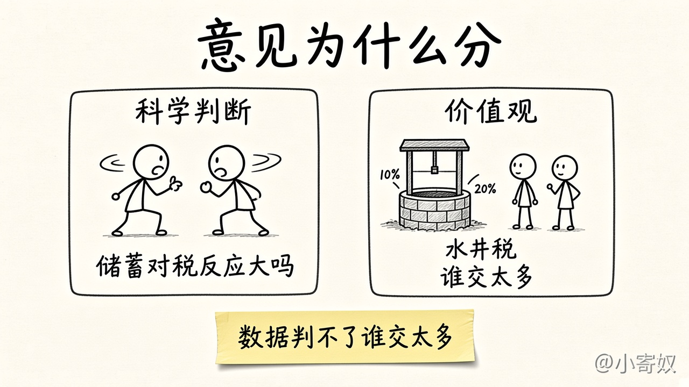
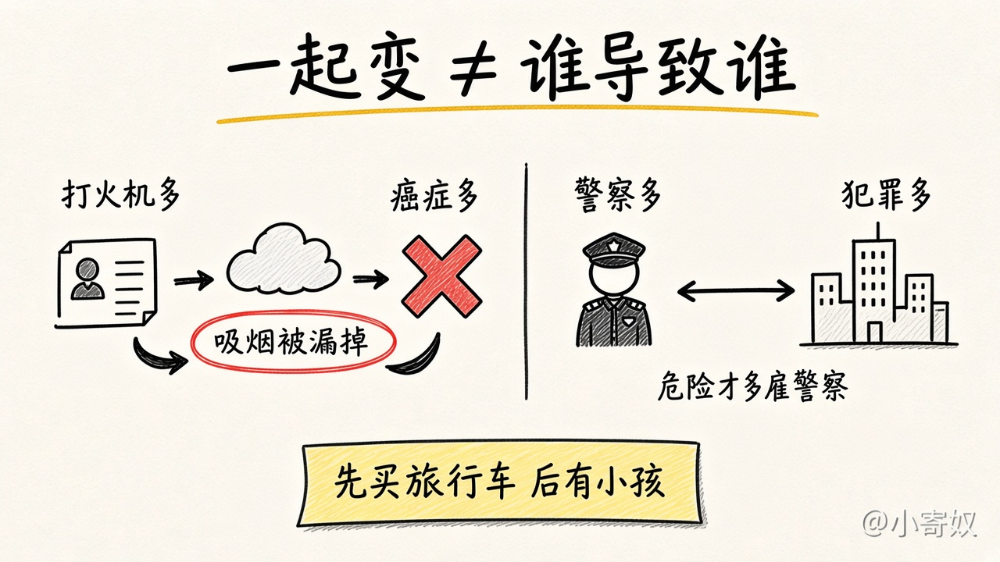

# 06 意见分歧、相关与因果，以及章复盘

[本章目录](README.md)

## 原书对应

第 8 版微观分册第 2 章：

- 2-3 经济学家意见分歧的原因
- 科学判断的不同
- 价值观的不同
- 感觉与现实（原书表 2-1；「专家看法」小栏在此说明）
- 2-4 出发吧
- 附录「绘图：简单的复习」中的「原因和结果」：忽略的变量，反向因果关系

附录的其余部分不单开课。单变量图、坐标系和曲线的形状，已在循环流量图和生产可能性边界里用过。斜率在第 03 课用汽车和电脑算过一次。Emma 的小说需求曲线，以及沿曲线的变动与曲线的移动，留到第 4 章。章末名词用下面的一览和 [术语表](GLOSSARY.md) 核对。这里不做原书习题的原文。

## 原书这一节在讲什么

### 意见为什么会分

经济学家常因建议互相矛盾而受到批评。原书用玩笑记下这种印象：围坐在一起也达不成共识；一百道题好像会有三千个答案。

分歧有两个基本原因。一是对哪一种实证理论正确、或某个参数有多大，看法不同。二是价值观不同，于是对政策应该追求什么有不同的规范观点。科学仍在认识之中，中间有分歧并不奇怪。

原书的例子是：政府应按家庭收入征税，还是按消费征税。主张改为消费税的人认为，不对储蓄起来的那部分收入征税，家庭会多储蓄；储蓄高，就有更多资源用于资本积累，生产率和生活水平提高得更快。主张维持所得税的人认为，家庭储蓄对税法的这种改变反应不大。两派的规范主张不同，是因为他们对「储蓄对税收激励的反应有多大」这一实证问题看法不同。

价值观上的不同，用一口井就能看出来。Peter 和 Paula 从镇上的水井中取同样多的水。为了支付修井费用，镇里向居民征税。Peter 的收入为 15 万美元，纳税 1.5 万美元，是收入的 10%。Paula 的收入为 3 万美元，纳税 6000 美元，是收入的 20%。这样公平吗？谁交得太多？Paula 收入低，是因为她残疾，还是因为她决定从事演艺？Peter 收入高，是因为继承了遗产，还是因为他愿意长时间做枯燥的工作？这些都会改变人们怎么看。镇里请两位专家研究这笔税，得到不一致的建议，并不奇怪。经济科学再完善，也回答不了两人里谁的税交得太多。这接上第 05 课：规范结论不能只从科学里长出来。

左边是一个实证上的大小还没有定论。右边是数字已经摆出来，仍要问怎样才算公平。

### 感觉与现实

分歧不可避免，但不宜夸大。共识比人们有时以为的更多。原书表 2-1 有约二十条政策主张，专业经济学家里绝大多数赞同，公众里往往没有同样的认同。正文接着讲两条：租金上限降低了住房的数量和质量；关税和进口配额通常降低总体经济福利。赞同的比例都大约九成。表里还有一条：最低工资增加年轻人和不熟练工人的失业。尽管如此，房租上限和进口限制仍然常见。原因可能在政治过程，也可能是公众还没有被说服。

书中还有「专家看法」小栏，记录一批经济学家是同意、不同意，还是不确定。这里举的例子是限制转售演出和比赛门票：许多经济学家认为，这使潜在观众平均而言变差。本课不展开倒票。

### 附录：原因和结果

图形常被用来说明一件事怎样引起另一件事。需求曲线这类图把其他因素固定住再让价格动，原因是画图的人放进去的。用现实数据作图，就不那么稳。

第一类问题是忽略的变量。做不到其他条件不变时，可能把图里一个变量看成另一个变量变动的原因，其实变动来自图上没画的第三个变量。原书设想一项研究在房间里的东西和癌症之间找关系，发现家里的打火机越多，家庭成员得癌症的可能越大，于是建议对打火机征税，并印上有害健康的警示。这张图没有把吸烟数量固定住。打火机多的人往往烟也多，引发癌症的是吸烟，不是打火机。看到一幅图被用来支持因果，要问有没有一个没画出来的变量，能够解释你看到的一起变动。

第二类问题是反向因果关系：以为是甲引起乙，事实上是乙引起甲。原书设想一幅图，大城市里每千人的警察越多，每千人的暴力犯罪越多，于是有人认为警察带来了犯罪，应当取消执法。图本身分不清方向。更说得通的一种读法是：越危险的城市，雇用的警察越多。看哪一个先变动，也不够保险。人常常按对未来的预期行动。预期犯罪将高涨的城市，现在就会多雇警察。家用旅行车把这一点说得更直白：夫妇往往在预期孩子出生时先买车。买车在前，不能得出旅行车的销售引起了人口增长。

还没有一套完整的规则，保证从图形里读出因果是妥当的。记住两句，就可以避开许多站不住的推论：打火机没有引起癌症，家用旅行车没有带来小孩。

一起变动只说明相关。因果还要再问：是不是漏了一个变量，或者把方向弄反了。

### 本章一览

| 容易混的一对 | 怎样分开 | 落在 |
|---|---|---|
| 能用的假设，和该换的假设 | 大理石：摩擦小，真空几乎不改答案。沙滩球：摩擦改了下落 | 01 |
| 模型，和完整现实 | 塑料人体留下心、肝、肾，不画每一条毛细血管 | 01 |
| 边界上、以内、以外 | 上：有效，不减少一种就不能增加另一种。内：例如失业，两种都可以更多。外：现有资源和技术做不到 | 03 |
| 沿边界走，和边界外移 | 走：从 600 辆、2200 台到 700 辆、2000 台，每辆汽车两台电脑。外移：电脑技术变好，可以走到 650 辆和 2300 台 | 03 |
| 微观，和宏观 | 房租、汽车业是微观。失业和增长是宏观。减税仍要问家庭的购买 | 04 |
| 实证，和规范 | Portia：最低工资引起失业。Noah：政府应该提高最低工资 | 05 |
| 科学判断，和价值观 | 储蓄对消费税的反应大不大。Peter 的 10% 和 Paula 的 20%，谁交得太多 | 06 |
| 相关，和因果 | 打火机与癌症漏了吸烟。旅行车在婴儿之前，不是车带来了人 | 附录，本课 |

### 出发吧

前两章介绍了经济学的思想和做法。下一章开始更具体地看经济行为，首先是相互依存和贸易。凯恩斯的忠告可以收成一句：这门学科看起来门槛不高，难处在于同一个人要能在具体事实和抽象模型之间来回走。靠的是练习。

## 1 分钟费曼

合上表说四句。储蓄和消费税的分歧，卡在哪一个实证的量上？水井税的分歧，为什么有了 10% 和 20% 仍然判不完？打火机和旅行车，各是哪一种因果错误？沿边界走和边界外移，各用汽车、电脑说一个数字。

## 下一课

第 2 章到这里结束。下一章是第 3 章「相互依存性与贸易的好处」：生产可能性怎样变成专业化，再变成贸易。正文还没写。

回到 [全书概述](../../book_overview.md) 看这一章在 22 章里的位置，或打开 [按书序学](../../book_order_path.md) 看第 3 章的目录级预告。
