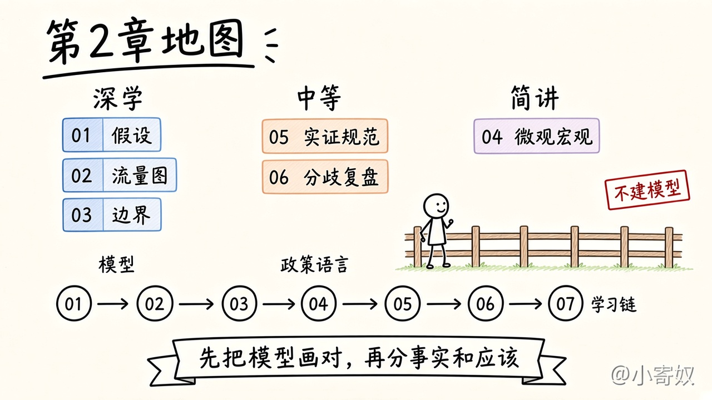
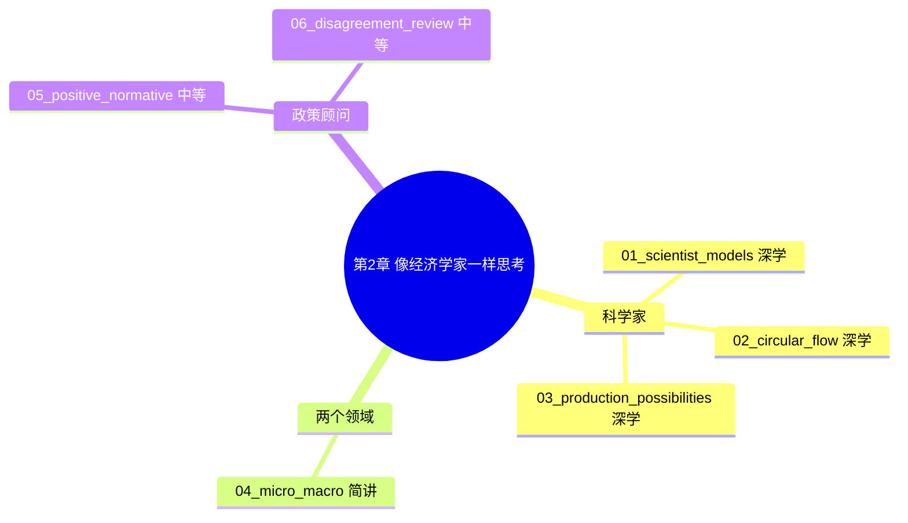

# 第 2 章 像经济学家一样思考

**第 2 章文档齐备**（概述 · 导图 · 六课 · 配图 · 章末一览 · [勾选清单](CHECKLIST.md) · [术语表](GLOSSARY.md) · [原书目录覆盖表](#原书目录覆盖表)）。

对齐曼昆《经济学原理》第 8 版微观分册第 2 章。下面是自编讲解，只用短标题对着目录，不摘录原书段落。

先读本页概述和导图，再一次一课。六课按第 2 章课本的篇幅写成短文，不按分钟数凑字。

## 概述

第 1 章留下一张地图：人怎样在稀缺下做决定，交换怎样碰到别人，宏观三条这次只标边界。第 2 章补的是思考的做法。经济学家有两种角色。解释世界如何运行时，他是科学家。主张怎样改善结果时，他是政策顾问。

作为科学家，他提出理论，再用数据或历史里已经发生的事件去对。假设和模型都可以不真实。大理石下落可以忽略空气；沙滩球不行。塑料人体不画毛细血管，器官怎样连在一起才看得清。要问的是：放下的那一项，会不会把这一问的答案带偏。附录把「先让别的因素不动」叫做其他条件不变。

本章给出两个模型，都要会读。循环流量图把经济收成家庭与企业、物品与服务市场与生产要素市场。里面一圈是投入和产出，外面一圈是货币，方向相反。生产可能性边界用汽车和电脑画出：边界上有效，边界内无效率，边界外做不到；沿边界移动的斜率是机会成本；电脑行业的技术进步使边界向外移动。

微观与宏观只标两个领域的名字。微观看家庭、企业和某一个市场，例如租金控制下的住房。宏观看通胀、失业和增长。整体仍由一个个决定加总而来。宏观模型继续不在这里建。

作为政策顾问，先分清两类话。实证表述描述世界是什么样，原则上可以用证据去对。规范表述规定世界应该什么样，还要价值判断。书里的一对是：最低工资引起失业，以及政府应该提高最低工资。建议进了华盛顿，也不等于会被采纳。政策多半是权衡，决定还要经过公关、新闻、法律和政治。

意见分歧有两个来源：对实证理论或参数大小看法不同，例如储蓄对税收激励的反应；价值观不同，例如同一口井的税，10% 和 20% 谁交得太多。共识其实比玩笑里说的更多，租金控制和关税是原书表里接着讲的两条。附录的「原因和结果」并进最后一课：打火机与癌症漏掉了吸烟，家用旅行车买在孩子出生之前，并不是车带来了人。

六课连成一条链。先承认经济学用科学的方法，并看假设何时可用（01）。再读第一张图，家庭和企业怎样对着走（02）。再读第二张图，资源既定时的权衡、无效率和增长（03）。然后只把微观和宏观两个名字放好（04）。接着分开实证与规范，并看建议为什么常常停在采纳之前（05）。最后把分歧的两类原因、图形里的因果陷阱和全章易混的几对收在一起（06）。

第 2 章学完，是指你能判断一个假设会不会改答案；能讲清循环流量图的两圈；能在汽车和电脑的边界上指出有效、无效率和不可达，并区分沿边界走与边界外移；能把一句政策话分成实证或规范；能用书里的例子说出意见分歧的两类原因，以及相关还不等于因果。做到这些再打开第 3 章。第 3 章才把生产可能性写成专业化与贸易的计算。

作图附录附在这一章后面。本路径不单开一课把坐标、散点图和需求曲线再讲一遍。读图就在循环流量图和生产可能性边界里练。斜率只用汽车和电脑算一次。Emma 买小说的需求曲线，以及沿曲线变动和曲线移动，留到第 4 章。附录里单独成节的「原因和结果」，写在第 06 课，并在下面的覆盖表里单列。

## 思维导图

### 两个角色一张图

左边三课把科学家用的假设和两张图走通。中间是政策语言和分歧。右边只把微观和宏观分成两个领域。下面一排是学习顺序 01 到 06。

学习顺序：

## 怎样学

先读完上面的概述、两张导图和章首总图，再打开小课。不要从 01 直接开始。进度记在 [勾选清单](CHECKLIST.md)，名词回看用 [术语表](GLOSSARY.md)。

一次一课。每课是这一节的课本摘要：按原书顺序读「原书这一节在讲什么」，例子用书里的案例。配图在讲到该书例子时出现。对照表不在每课都做；容易写混的几对，放在第 06 课的一览里。读完用「1 分钟费曼」，用自己的话复述这一节的核心。

本路径从头学。以前在别处做过的模型笔记、循环流量图或生产可能性边界，不作为本章免修。

## 章目标

学完本章，你应该能够：

- 说明理论怎样从观察来，又怎样用数据或自然实验去对；并判断一个不真实的假设会不会改这一问的答案。
- 讲清循环流量图里谁在哪个市场买卖，实物与货币为什么方向相反，以及图中故意没有政府和国际贸易。
- 在汽车和电脑的例子上区分边界上、边界内和边界外；用沿边界的移动算出机会成本；说明技术进步怎样使边界外移。
- 用书中的例子各举一个微观问题和一个宏观问题，并说出宏观变动要落到家庭和企业的决定上。
- 把一句政策表述分成实证或规范，并说明数据为什么不能单独判决「应该」。
- 分开科学判断上的分歧和价值观上的分歧；在一幅一起变动的图旁，问出忽略的变量或反向因果。

## 深度

课文按第 2 章的课本内容写成短文。深学把模型读到能用来判断。中等停在书中的例子和分类。简讲只把领域的名字放好。不按分钟数凑字。

| 课 | 文件 | 原书的块 | 深度 |
|---|---|---|---|
| 章首 | 本页概述与导图 | 全章地图 | — |
| 01 | [01_scientist_models.md](01_scientist_models.md) | 科学方法、假设、经济模型 | 深学 |
| 02 | [02_circular_flow.md](02_circular_flow.md) | 循环流量图 | 深学 |
| 03 | [03_production_possibilities.md](03_production_possibilities.md) | 生产可能性边界 | 深学 |
| 04 | [04_micro_macro.md](04_micro_macro.md) | 微观经济学与宏观经济学 | 简讲 |
| 05 | [05_positive_normative.md](05_positive_normative.md) | 政策顾问：实证与规范 | 中等 |
| 06 | [06_disagreement_review.md](06_disagreement_review.md) | 意见分歧、原因和结果、章复盘 | 中等 |

比较优势的计算不在本章。供需图不在本章。宏观模型不在本章。全书位置见 [全书概述](../../book_overview.md)。

## 与原书两个角色对应

| 原书的块 | 小节 | 本章怎么处理 |
|---|---|---|
| 作为科学家的经济学家 | 科学方法、假设、模型、两张图、微观与宏观 | 01–03 深学。04 简讲，只分领域，不建宏观模型。 |
| 作为政策顾问的经济学家 | 实证与规范、华盛顿、建议为何不被采纳 | 05 中等。最低工资的失业图形见第 6 章。 |
| 意见分歧与出发 | 科学判断、价值观、感觉与现实、出发吧 | 06 中等，并收本章一览。 |
| 附录 | 绘图的复习；原因和结果 | 作图不单开课。原因和结果写入 06。 |

## 原书目录覆盖表

下表对着第 8 版微观分册第 2 章目录，含章末的作图附录。短标题只用于对目录，不摘正文。每一行都有着落：深学、中等、简讲，或标明正文展开的后章。勾选见 [CHECKLIST.md](CHECKLIST.md)。

| 原书目录 | 课 | 深度 | 状态 |
|---|---|---|---|
| 2-1 作为科学家的经济学家 | [01](01_scientist_models.md)–[04](04_micro_macro.md) | 深学 / 简讲 | 四课合起来覆盖这一块 |
| 科学方法：观察、理论和进一步观察 | [01](01_scientist_models.md) | 深学 | 本章覆盖。货币与物价的例子不写成货币模型 |
| 假设的作用 | [01](01_scientist_models.md) | 深学 | 本章覆盖。两国两种产品的贸易计算见第 3 章 |
| 经济模型 | [01](01_scientist_models.md) | 深学 | 本章覆盖 |
| 我们的第一个模型：循环流量图 | [02](02_circular_flow.md) | 深学 | 本章覆盖。对应原书图 2-1。政府与国际贸易是图中故意省略的 |
| 我们的第二个模型：生产可能性边界 | [03](03_production_possibilities.md) | 深学 | 本章覆盖。对应原书图 2-2、图 2-3。汽车与电脑 |
| 微观经济学与宏观经济学 | [04](04_micro_macro.md) | 简讲 | 本章只分领域。宏观模型不建 |
| 2-2 作为政策顾问的经济学家 | [05](05_positive_normative.md) | 中等 | 分类和制度位置在本章；失业的图形不在本章 |
| 实证分析与规范分析 | [05](05_positive_normative.md) | 中等 | 本章覆盖。Portia 与 Noah 的最低工资两句 |
| 华盛顿的经济学家们 | [05](05_positive_normative.md) | 中等 | 本章覆盖。知道建议从哪些机构来，不记机构名单 |
| 为什么经济学家的建议并不总是被采纳 | [05](05_positive_normative.md) | 中等 | 本章覆盖 |
| 2-3 经济学家意见分歧的原因 | [06](06_disagreement_review.md) | 中等 | 两类原因加共识的感觉 |
| 科学判断的不同 | [06](06_disagreement_review.md) | 中等 | 本章覆盖。收入税与消费税，储蓄反应的大小 |
| 价值观的不同 | [06](06_disagreement_review.md) | 中等 | 本章覆盖。Peter 与 Paula 的水井税 |
| 感觉与现实 | [06](06_disagreement_review.md) | 中等 | 对应原书表 2-1。正文点名租金控制、关税与进口配额。不抄全表 |
| 表 2-1 旁的「专家看法」：门票转售 | [06](06_disagreement_review.md) | 简讲 | 只说明小栏在说共识或分歧。倒票不展开 |
| 2-4 出发吧 | [06](06_disagreement_review.md) | 简讲 | 指向第 3 章。不摘凯恩斯的长段 |
| 章末：内容提要、关键概念、复习题、问题与应用 | [06](06_disagreement_review.md)、[术语表](GLOSSARY.md)、[勾选清单](CHECKLIST.md) | 简讲 | 用一览和术语核对名词。不做原书习题原文 |
| 附录 绘图：简单的复习 | 见下列各行 | 简讲 | 不单开长课。读图在 02、03 的图里练 |
| 附录：单变量的图形 | [02](02_circular_flow.md)、[03](03_production_possibilities.md) | 简讲 | 本章的图是二维的。不另讲柱状图 |
| 附录：两个变量的图形：坐标系 | [03](03_production_possibilities.md) | 简讲 | 横轴汽车，纵轴电脑 |
| 附录：坐标系中的曲线 | [03](03_production_possibilities.md) | 简讲 | 边界凹向原点。Emma 的需求曲线及移动，见第 4 章 |
| 附录：斜率 | [03](03_production_possibilities.md) | 深学 | 100 辆汽车对 200 台电脑，斜率即该处机会成本 |
| 附录：原因和结果 | [06](06_disagreement_review.md) | 中等 | 忽略的变量：打火机与癌症。反向因果：警察与犯罪，家用旅行车与婴儿 |

## 专家依据

这一章的切法只取教学含义，不摘长段原文。

- Mankiw, N. Gregory. 2020. “Reflections of a Textbook Author.” *Journal of Economic Literature* 58 (1): 215–228. [https://www.aeaweb.org/articles?id=10.1257/jel.20191589](https://www.aeaweb.org/articles?id=10.1257/jel.20191589)  
  入门课先把大的想法说清楚。第 2 章的大想法是：模型可以简化，简化要接受检验；实证和规范不是同一种句子。两张图深学，机构名单不深学。

- Mankiw, N. Gregory. 2016. “The Tradeoff between Nuance and Clarity.” *Eastern Economic Journal* 42: 169–170. [https://doi.org/10.1057/eej.2015.58](https://doi.org/10.1057/eej.2015.58)  
  先有清晰，再加细节。作图附录若铺成另一门课，汽车和电脑这张边界会先被淹没。斜率只在边界上算一次。需求曲线留到第 4 章再加厚。

## 过关标准

下面六条都能做到，本章就可以收束：

1. 用大理石和沙滩球说清：不真实的假设何时仍可用，何时会把答案带偏。
2. 讲清循环流量图里两个市场谁买谁卖，两圈为什么方向相反，以及图中没有政府和国际贸易。
3. 指出汽车与电脑的一个有效点、一个无效率点和边界外为什么做不到。从 600 辆、2200 台走到 700 辆、2000 台，说出一辆汽车的机会成本。再说出电脑技术进步时边界怎样动。
4. 用租金控制和失业率各标微观或宏观。减税对总生产的影响，要落到家庭的哪一个决定上。
5. 把 Portia 和 Noah 关于最低工资的两句分成实证和规范，并说明数据为什么判不完后一句。
6. 用储蓄对税收的反应、水井税的 10% 与 20%，分开两类分歧。用打火机和家用旅行车各说出一种因果错误。

第 06 课的一览和费曼是一次总检查。做完再决定要不要重读某一课。

## 下一章预告

第 3 章是「相互依存性与贸易的好处」。生产可能性在那里写成两个人或两国的专业化，再问交换能不能使双方都比单干更好。机会成本的比较从本章的斜率，进到比较优势的计算。

第 3 章正文尚未写入 `chapters/`。写的时候会先有概述和思维导图，再有小课。目录级预告见 [按书序学](../../book_order_path.md)。
